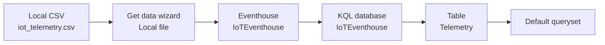
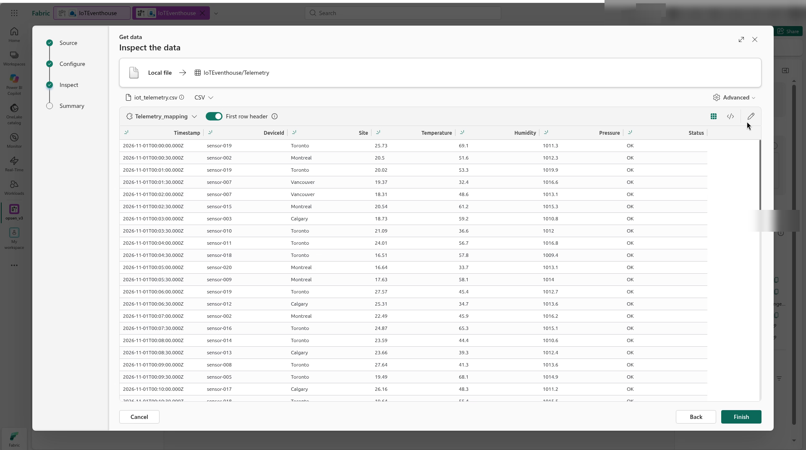
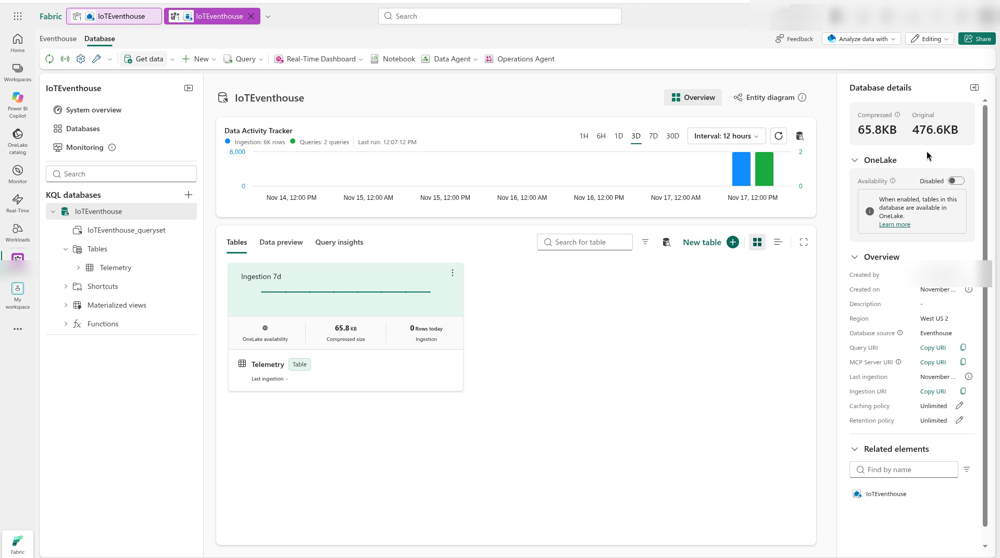
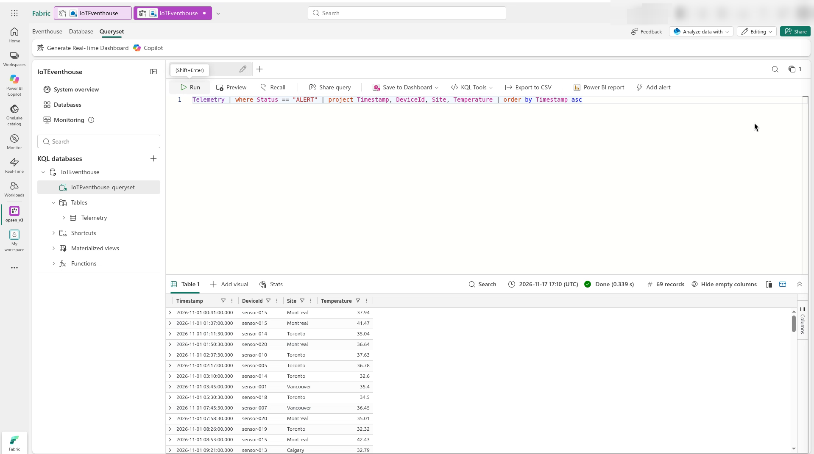

# Video 1 — Create an Eventhouse and ingest data

In a Microsoft Fabric workspace that runs on a Fabric capacity, create an Eventhouse, load a local IoT telemetry file into a `Telemetry` table, and run a few KQL queries to prove the data landed.

This folder is the hands-on companion to video 1 in the Data for AI series.

## What you will build



A PNG of the same diagram is in [diagrams/architecture.png](diagrams/architecture.png).

## Concepts in plain words

- An **Eventhouse** is a container for event-like, time-based data. Inside it you keep one or more **KQL databases**, and each database holds tables.
- When you create an Eventhouse, Fabric also creates a **default KQL database with the same name**, plus a **default queryset** so you can start querying immediately.
- Compute autoscale, and the Eventhouse can pause when it is idle. Storage is separate: a fast cache tier and a standard retention tier. Details are in [docs/concepts.md](docs/concepts.md).
- **OneLake availability** can later expose the same table in Delta Lake format to other Fabric engines. We do not turn it on in this lesson.
- For a first load, the **Get data** wizard with a **local file** is the simplest path. Streaming options such as Eventstream and Event Hubs are covered in the concepts doc and later videos.

## Prerequisites

- A Microsoft Fabric workspace on a Fabric-enabled capacity, and permission to create items in it
- The sample file [data/iot_telemetry.csv](data/iot_telemetry.csv), or a fresh copy from [data/generate_telemetry.py](data/generate_telemetry.py)

## Sample data

The CSV has **6,000 rows** of synthetic sensor readings:

| Column | Meaning |
| --- | --- |
| Timestamp | UTC time, every 30 seconds from `2026-11-01T00:00:00Z` through `2026-11-03T01:59:30Z` |
| DeviceId | One of 20 devices, `sensor-001` through `sensor-020` |
| Site | Toronto, Montreal, Vancouver, or Calgary. Each device is assigned one site. |
| Temperature | Degrees Celsius |
| Humidity | Relative humidity, about 30 to 70 |
| Pressure | Pressure around 1013 |
| Status | `ALERT` when Temperature is above 32, otherwise `OK` |

About one percent of rows get a +15 °C spike so you have a small set of alerts to query. The generator uses seed `7` and recreates this file exactly:

```bash
python data/generate_telemetry.py
```

## Step-by-step

The item names below match the video. You can use the same names, or substitute your own.

### 1. Open a workspace with Fabric capacity

1. In the Fabric portal, open an existing workspace that runs on a Fabric capacity. The video uses an existing workspace; you do not need a new one.
2. An Eventhouse needs a workspace with a Microsoft Fabric-enabled capacity ([prerequisites](https://learn.microsoft.com/en-us/fabric/real-time-intelligence/create-eventhouse)).

### 2. Create the Eventhouse

1. Select **New item**.
2. In the **Track data** section, select **Eventhouse**.
3. Name it `IoTEventhouse` and select **Create**. Provisioning takes a few seconds.
4. Dismiss the **Welcome to Eventhouse** dialog.

### 3. Look at what Fabric created for you

When provisioning finishes, the Eventhouse **system overview** opens.

- A **KQL database** named `IoTEventhouse` is already there. This is the default child database, created with the same name as the Eventhouse.
- A **default queryset** is attached to that database. That is where you will run the queries in step 6.

The Eventhouse is the container. The KQL database is where tables live. The queryset is the workbench.

### 4. Ingest the local CSV

1. Select the `IoTEventhouse` KQL database. It is empty at first.
2. Select **Get data**, then **Local file**.
3. Select **+ New table** and name the table `Telemetry`.
4. Upload [data/iot_telemetry.csv](data/iot_telemetry.csv) and select **Next**. The wizard accepts up to 1,000 files, each up to 1 GB uncompressed.
5. On the **Inspect** step:
   - The format is **CSV**.
   - Turn on **First row header**, so the first line becomes the column names: `Timestamp`, `DeviceId`, `Site`, `Temperature`, `Humidity`, `Pressure`, `Status`.
   - The mapping drop-down shows **`Telemetry_mapping`**. Fabric creates this ingestion mapping automatically to map the CSV columns onto the table columns. You do not need to create it yourself.
6. Glance at the preview, then select **Finish**.



### 5. Check the ingestion summary

The summary page lists three preparation steps:

- **Create table** (`Telemetry`)
- **Create mapping** (`Telemetry_mapping`)
- **Data queuing**

When the load finishes, all three show a green check, the file shows **Successfully ingested**, and the header reads **1 blobs: 1 succeeded, 0 failed**. Select **Close**.

Back on the database overview, the **Data Activity Tracker** shows the ingestion (**6K rows**), and `Telemetry` appears under **Tables**. In the recording the database showed about 65.8 KB compressed and 476.6 KB original size.



### 6. Run the exploration queries

Open the default queryset, `IoTEventhouse_queryset`, from the database tree. It starts with sample queries that use a `YOUR_TABLE_HERE` placeholder. Replace them with the queries in [kql/01_explore.kql](kql/01_explore.kql) and run each one on its own.

| Query | Result in the video |
| --- | --- |
| `Telemetry \| count` | `6,000` |
| `Telemetry \| take 10` | 10 records with all seven columns |
| `Telemetry \| summarize AvgTemp = avg(Temperature), Readings = count() by Site \| order by AvgTemp desc` | 4 records, one per city. Calgary 22.36 (1,232 readings), Toronto 22.20 (2,969), Vancouver 22.14 (608), Montreal 22.10 (1,191) |
| `Telemetry \| where Status == "ALERT" \| project Timestamp, DeviceId, Site, Temperature \| order by Timestamp asc` | **69 records**, all with Temperature above 32 |
| `.show table Telemetry schema as json` | 1 record with the stored schema (`Timestamp` is `datetime`, `DeviceId` is `string`, and so on) |

Tip: if you type a query on the same line as a comment or leave placeholder text in the editor, KQL returns `Syntax error: Query operator expected.` Clear the sample text first, or highlight just the query you want to run.



Screenshots are from the recording, with account details, other people's names, and resource identifiers blurred.

## What is next

**Next: [Video 2 — Tables and materialized views](../02-tables-and-materialized-views/README.md).** You stay in this Eventhouse, create a `SensorReadings` table with `.create table`, load it from `Telemetry` with `.set-or-append`, and build three materialized views on top of it with backfill: a dedup view with `take_any`, the latest reading per device with `arg_max`, and hourly averages by site.

## Official docs

- [Eventhouse overview](https://learn.microsoft.com/en-us/fabric/real-time-intelligence/eventhouse)
- [Create an eventhouse](https://learn.microsoft.com/en-us/fabric/real-time-intelligence/create-eventhouse)
- [Get data from file](https://learn.microsoft.com/en-us/fabric/real-time-intelligence/get-data-local-file)
- [Get data overview](https://learn.microsoft.com/en-us/fabric/real-time-intelligence/get-data-overview)
