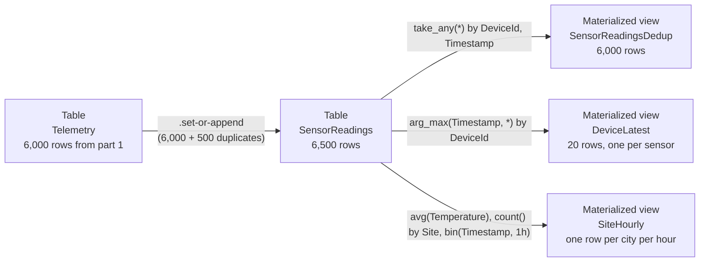
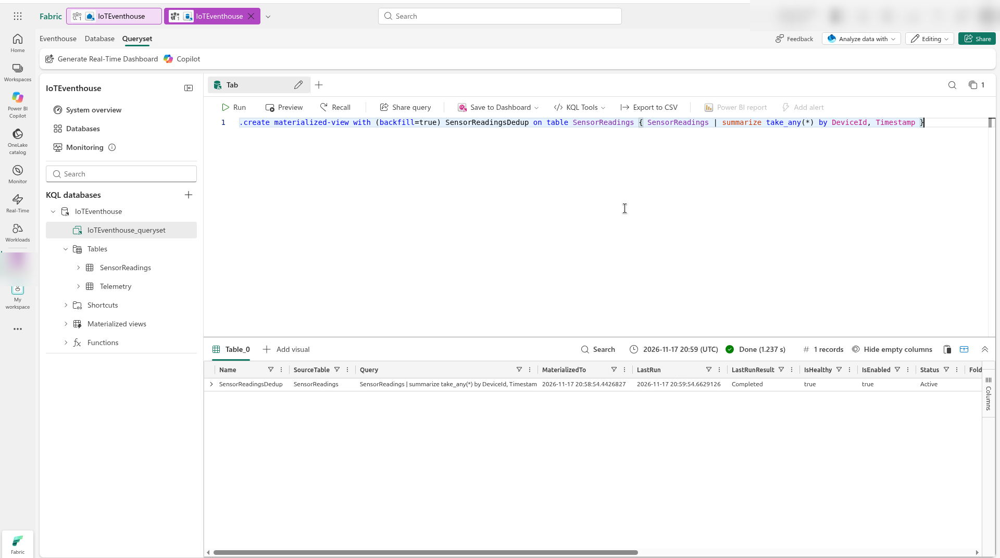
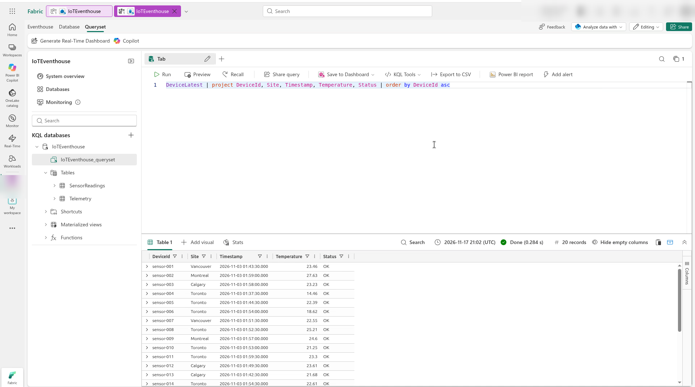
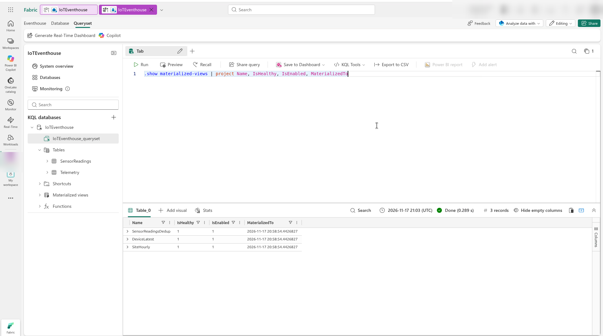

# Video 2 — Tables and materialized views

Stay in the `IoTEventhouse` Eventhouse from [video 1](../01-eventhouse-create-and-ingest/). Create a `SensorReadings` table with a KQL command, load it from `Telemetry`, add 500 duplicate rows on purpose, and then build three materialized views on top of it: one that removes the duplicates, one with the latest reading per sensor, and one with hourly averages per city.

This folder is the hands-on companion to video 2 in the Data for AI series.

## What you will build



A PNG of the same diagram is in [diagrams/architecture.png](diagrams/architecture.png).

## Concepts in plain words

- **Two ways to create a table.** The **Get data** wizard (video 1) infers the schema from your data and creates the table and its ingestion mapping. The **`.create table`** command creates an empty table with exactly the columns and types you write, which makes it easy to script and keep in Git.
- **`.set-or-append`** ingests the result of a query into a table, and creates the table if it does not exist. Columns are matched by type and position, not by name.
- **Duplicates happen** when devices resend cached readings or a pipeline is retried. They make counts and averages wrong.
- A **materialized view** is one `summarize` query over a source table that Fabric keeps up to date in the background. Querying it combines the already-processed **materialized part** with the newest rows (the **delta**), so results are always fresh.
- **`backfill=true`** makes a new view also process the rows that are already in the table. Without it, the view only covers rows ingested from now on.
- Use a **materialized view** for aggregations (dedup, latest per key, rollups). Use an **update policy** to transform or enrich rows as they are ingested.

More detail, with links to Microsoft Learn, is in [docs/concepts.md](docs/concepts.md).

## Prerequisites

- Everything from [video 1](../01-eventhouse-create-and-ingest/): the `IoTEventhouse` Eventhouse and KQL database, and the `Telemetry` table with 6,000 rows
- Database Admin permission on the KQL database (needed to create materialized views). If you created the Eventhouse yourself, you have it.

## Step by step

All statements are in [kql/02_tables_and_materialized_views.kql](kql/02_tables_and_materialized_views.kql), in the same order as the video.

### 1. Open the queryset

Open the `IoTEventhouse` KQL database, then open its default queryset, `IoTEventhouse_queryset` (or use **Query > KQL Queryset**). Clear any old text from the editor. Run **one statement at a time**: put the cursor on it, or highlight it, and select **Run**.

### 2. Create the table

```kusto
.create table SensorReadings (Timestamp: datetime, DeviceId: string, Site: string, Temperature: real, Humidity: real, Pressure: real, Status: string)
```

The result is one row with the new table's schema, and `SensorReadings` appears under **Tables**. If a table with that name already exists, the command succeeds without changing it.

### 3. Load it from Telemetry

```kusto
.set-or-append SensorReadings <| Telemetry
```

The result describes the new extent (data shard) that was written, with **RowCount 6,000**.

### 4. Add 500 duplicates on purpose

```kusto
.set-or-append SensorReadings <| Telemetry | take 500
SensorReadings | count
```

The count is **6,500**: the 6,000 original rows plus 500 duplicates, like a device resending data it already sent.

### 5. Create three materialized views

Run each command separately. Each returns one row with the view definition, **LastRunResult = Completed**, **IsHealthy = true**, and **IsEnabled = true**.

```kusto
// Dedup: keep one row per device and timestamp
.create materialized-view with (backfill=true) SensorReadingsDedup on table SensorReadings { SensorReadings | summarize take_any(*) by DeviceId, Timestamp }

// Latest reading per device
.create materialized-view with (backfill=true) DeviceLatest on table SensorReadings { SensorReadings | summarize arg_max(Timestamp, *) by DeviceId }

// Hourly average temperature and reading count per city
.create materialized-view with (backfill=true) SiteHourly on table SensorReadings { SensorReadings | summarize AvgTemperature = avg(Temperature), Readings = count() by Site, bin(Timestamp, 1h) }
```

With only 6,500 rows, each backfill finished in about a second. On a large table, Microsoft Learn says to use `.create async materialized-view ...` and track progress with `.show operations`. The view can't be queried until its backfill finishes.



### 6. Query the views

Query a view by name, just like a table.

| Query | Result in the video |
| --- | --- |
| `SensorReadingsDedup \| count` | **6,000**. The 500 duplicates are gone. |
| `DeviceLatest \| project DeviceId, Site, Timestamp, Temperature, Status \| order by DeviceId asc` | **20 rows**, one per sensor (`sensor-001` to `sensor-020`), each with its newest reading, all from early on 2026-11-03 (UTC) |
| `SiteHourly \| where Site == "Toronto" \| order by Timestamp desc \| take 10` | **10 rows** of Toronto hourly averages. The newest is 2026-11-03 01:00 (UTC): AvgTemperature about 21.73, 65 readings. |



### 7. Check view health

```kusto
.show materialized-views | project Name, IsHealthy, IsEnabled, MaterializedTo
```

Three rows (`SensorReadingsDedup`, `DeviceLatest`, `SiteHourly`), all healthy and enabled (the queryset shows `IsHealthy` and `IsEnabled` as `1`, which means true). `MaterializedTo` is the newest source ingestion time already processed into each view. In the database tree you now see two tables (`SensorReadings`, `Telemetry`) and **Materialized views (3)**.



Screenshots are from the recording, with account details, the workspace name, and resource identifiers blurred.

### Optional: query only the materialized part

```kusto
materialized_view("SiteHourly") | where Site == "Toronto"
materialized_view("SiteHourly", 10m) | where Site == "Toronto"
```

`materialized_view()` reads only the already-processed part of the view. It can lag slightly behind, but it's faster, which suits dashboards. With a max age such as `10m`, you get the materialized part if it was refreshed within that window, and the full view otherwise.

### Clean up (optional)

The KQL file ends with commented `.drop` commands that remove the three views and `SensorReadings`. `Telemetry` is left alone. Drop the views before the table.

## Results at a glance

| Step | Expected |
| --- | --- |
| `.set-or-append SensorReadings <\| Telemetry` | 6,000 rows ingested |
| `... \| take 500` | 500 more rows |
| `SensorReadings \| count` | 6,500 |
| 3 x `.create materialized-view ... backfill=true` | Completed, healthy, enabled |
| `SensorReadingsDedup \| count` | 6,000 |
| `DeviceLatest` | 20 rows |
| `SiteHourly`, Toronto, take 10 | 10 rows, newest 2026-11-03 01:00 UTC, about 21.73, 65 readings |
| `.show materialized-views` | 3 healthy, enabled views |

## What is next

Video 3 covers update policies and stored functions: transforming and enriching data as it lands, and when to pick an update policy over a materialized view.

## Official docs

- [Create an empty table (Fabric)](https://learn.microsoft.com/en-us/fabric/real-time-intelligence/create-empty-table)
- [.create table command](https://learn.microsoft.com/en-us/kusto/management/create-table-command?view=microsoft-fabric)
- [Ingest from query (.set, .append, .set-or-append, .set-or-replace)](https://learn.microsoft.com/en-us/kusto/management/data-ingestion/ingest-from-query?view=microsoft-fabric)
- [Materialized views overview](https://learn.microsoft.com/en-us/kusto/management/materialized-views/materialized-view-overview?view=microsoft-fabric)
- [.create materialized-view](https://learn.microsoft.com/en-us/kusto/management/materialized-views/materialized-view-create?view=microsoft-fabric)
- [Materialized views use cases, and materialized views vs update policies](https://learn.microsoft.com/en-us/kusto/management/materialized-views/materialized-view-use-cases?view=microsoft-fabric)
- [materialized_view() function](https://learn.microsoft.com/en-us/kusto/query/materialized-view-function?view=microsoft-fabric)
- [.show materialized-views](https://learn.microsoft.com/en-us/kusto/management/materialized-views/materialized-view-show-command?view=microsoft-fabric)
