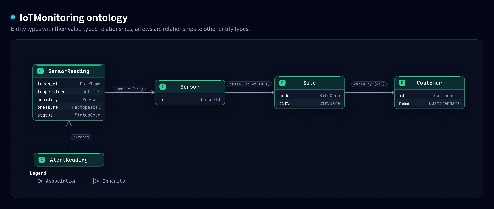
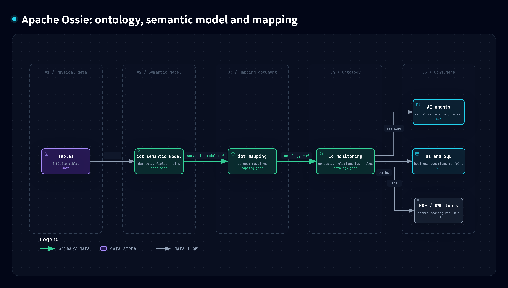
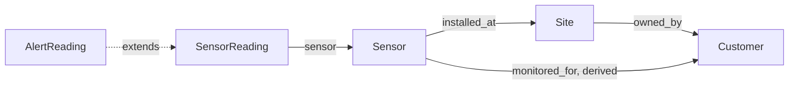

# 03 — Ontology with Apache Ossie (incubating)

An earlier Data for AI video looked at ontology inside Microsoft Fabric IQ. This time we build one the open, vendor-neutral way, with **Apache Ossie (incubating)**, formerly Open Semantic Interchange (OSI). You will write a small IoT ontology, a semantic model for four tables, and a standalone mapping document that connects the two. Then you validate all three with the official Ossie schemas and validator, and use them to generate and run SQL.

The data is the same 6,000 rows of IoT telemetry used in [video 1](../01-eventhouse-create-and-ingest/) and [video 2](../02-tables-and-materialized-views/), loaded into a local SQLite file, so no cloud account is needed.

> The Ossie ontology specification used here is version `0.3.0.dev0`, which is **unreleased and still changing**. The files were validated against apache/ossie commit `74a26be` (18 Nov 2026). If a newer commit rejects them, check [docs/spec_changes.md](https://github.com/apache/ossie/blob/main/docs/spec_changes.md) in the Ossie repo.

## What you will build





| File | Ossie document | Validated by |
|---|---|---|
| [models/iot.ontology.yaml](models/iot.ontology.yaml) | Ontology: concepts, relationships, rules | `ontology/ontology.json` |
| [models/iot.semantic_model.yaml](models/iot.semantic_model.yaml) | Core semantic model: datasets, fields, joins | `core-spec/ossie-schema.json` |
| [models/iot.mapping.yaml](models/iot.mapping.yaml) | Standalone mapping document | `ontology/mapping.json` |
| [ossie_demo.py](ossie_demo.py) | Validates, explains and queries the three files | |
| [build_db.py](build_db.py) | Builds `data/iot.db` (SQLite) from the CSV | |

The diagrams were made with [archify](https://github.com/tt-a1i/archify) and come as PNG, SVG, interactive HTML and the archify JSON. [diagrams/iot-ontology.mmd](diagrams/iot-ontology.mmd) is a Mermaid version written by the demo script. The slides from the video are in [docs/slides.pdf](docs/slides.pdf).



## Concepts in plain words

- A **semantic model** describes the tables you have. An **ontology** describes the business: the things that exist, how they relate, and the rules that always hold. A **mapping document** connects the two.
- **Entity types** are real-world things you reference through other information (a `Sensor`, by its id). **Value types** are data types with business meaning (`Celsius` is a `Decimal` between -60 and 80). Built-ins such as `String`, `Decimal` and `DateTime` can be used without declaring them.
- **Relationships** are declared under the concept that plays their first role (`Sensor.installed_at`). `roles` adds the other players; when the same concept plays two roles, the extra one gets a `name` (`Sensor:primary`). Every relationship needs **`verbalizes`**, sentence patterns such as `{Sensor} is installed at {Site}`.
- **`multiplicity`**: `ManyToOne` means the last role is determined by the others; `OneToOne` is many-to-one in both directions (binary relationships only).
- **`identify_by`** lists the relationships that reference a concept. `SensorReading` has a compound identifier: `sensor` + `taken_at`.
- **Business rules** are expressions. `requires` must always hold; `derived_by` computes a concept or relationship instead of storing it (`AlertReading`, `Sensor.monitored_for`).
- **`iri`** links a concept or relationship to a public vocabulary, using `prefixes` such as `sosa:` for the W3C SOSA sensor ontology. **`ai_context`** gives AI tools instructions, synonyms and example questions.
- A **mapping document** has `ontology_ref`, `semantic_model_ref` and `concept_mappings` with object, link and referent mappings. The older embedded `ontology_mappings` list is deprecated.

More detail, with links to the specification, is in [docs/concepts.md](docs/concepts.md).

## Prerequisites

- Python 3.11 or later and Git
- About 50 MB of disk space for the Ossie clone and the Python packages

## Step by step

### 1. Get the code and the Ossie repository

```bash
git clone https://github.com/aniket-work/fabrics-learning-v1
cd fabrics-learning-v1/03-ontology-with-apache-ossie
git clone --depth 1 https://github.com/apache/ossie     # schemas, validator, Python SDK
python -m venv .venv && source .venv/bin/activate        # Windows: .venv\Scripts\activate
pip install -r requirements.txt ./ossie/python
```

The demo looks for the Ossie clone in `./ossie`. To use a clone somewhere else, set `OSSIE_REPO` to its path.

### 2. Build the sample database

```bash
python build_db.py
```

Expected output: `customers 2`, `sites 4`, `devices 20`, `readings 6000` rows.

### 3. Validate the three documents

```bash
python ossie_demo.py validate
```

This runs three checks and should end with **All checks passed**:

1. Each file against its official JSON Schema (`jsonschema`, Draft 2020-12). The schemas' `raw.githubusercontent.com` references are served from your local clone.
2. The official validator, `ossie/validation/validate.py`. For the mapping it also checks that every concept, relationship and `dataset.field` it names exists in the ontology and the semantic model.
3. Loading the semantic model with the official Python SDK (`ossie.OssieDocument`).

You can run the official validator yourself:

```bash
python ossie/validation/validate.py models/iot.ontology.yaml --schema ossie/ontology/ontology.json
python ossie/validation/validate.py models/iot.semantic_model.yaml
python ossie/validation/validate.py models/iot.mapping.yaml --schema ossie/ontology/mapping.json
```

### 4. Break it on purpose

```bash
sed 's/readings\.ts$/readings.tz/' models/iot.mapping.yaml > models/typo.mapping.yaml
python ossie/validation/validate.py models/typo.mapping.yaml --schema ossie/ontology/mapping.json
rm models/typo.mapping.yaml
```

The JSON Schema accepts the typo, but the validator reports `dataset 'readings' declares no field 'tz'` three times.

### 5. Read the ontology back

```bash
python ossie_demo.py concepts    # entity types, identifiers, expanded IRIs, value types
python ossie_demo.py verbalize   # every relationship as a sentence, multiplicities read out loud
python ossie_demo.py rules       # requires and derived_by expressions, ai_context
```

### 6. Ask a business question

```bash
python ossie_demo.py sql
```

The script finds a path from `SensorReading` to `Customer` in the ontology. The shortest one uses the derived `Sensor.monitored_for`, and its `derived_by` rule expands it to `sensor -> installed_at -> owned_by`. The mapping gives the field for each hop, the semantic model's relationships confirm each join, and the `AlertReading` rule becomes a `CASE` expression. Expected result:

| customer | avg_celsius | alert_readings | readings |
|---|---:|---:|---:|
| Prairie Grid Labs | 22.29 | 19 | 1840 |
| Aurora Cold Chain | 22.17 | 50 | 4160 |

### 7. Rules as data-quality checks

```bash
python ossie_demo.py checks
```

The `requires` rules of `Celsius`, `Percent` and `StatusCode` are run against the mapped columns (0 violations), and `out/iot_ontology.mmd` is written.

`python ossie_demo.py all` runs every step. The SQL generation is a small teaching example written for this lesson. It is not an Ossie feature, and it only handles binary relationships between entity types with simple identifiers.

## Try next

- Add a `Technician` entity type who services sensors, with a verbalization and a mapping, and validate again.
- Give `Site` an `iri` from another vocabulary and check how `concepts` expands it.
- Write a `requires` rule that the data breaks, and watch `checks` count the violations.

## Official sources

- [Apache Ossie repository](https://github.com/apache/ossie) and [website](https://ossie.apache.org/)
- [Ontology specification](https://github.com/apache/ossie/blob/main/ontology/ontology.md), [ontology.json](https://github.com/apache/ossie/blob/main/ontology/ontology.json), [mapping.json](https://github.com/apache/ossie/blob/main/ontology/mapping.json)
- [Core specification](https://github.com/apache/ossie/blob/main/core-spec/spec.md) and [expression language](https://github.com/apache/ossie/blob/main/core-spec/expression_language.md)
- [Significant specification changes](https://github.com/apache/ossie/blob/main/docs/spec_changes.md)
- [Flights example: ontology, semantic model and mapping](https://github.com/apache/ossie/tree/main/examples)
- [W3C SOSA ontology](https://www.w3.org/TR/vocab-ssn/)

Apache Ossie (incubating) is an effort undergoing incubation at The Apache Software Foundation (ASF). Apache Ossie, Ossie, Apache, the Apache feather logo and the Apache Ossie project logo are trademarks of The Apache Software Foundation. This tutorial is not affiliated with or endorsed by the ASF.
