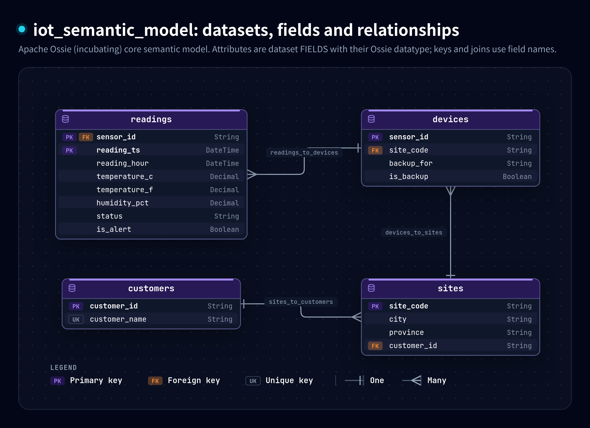
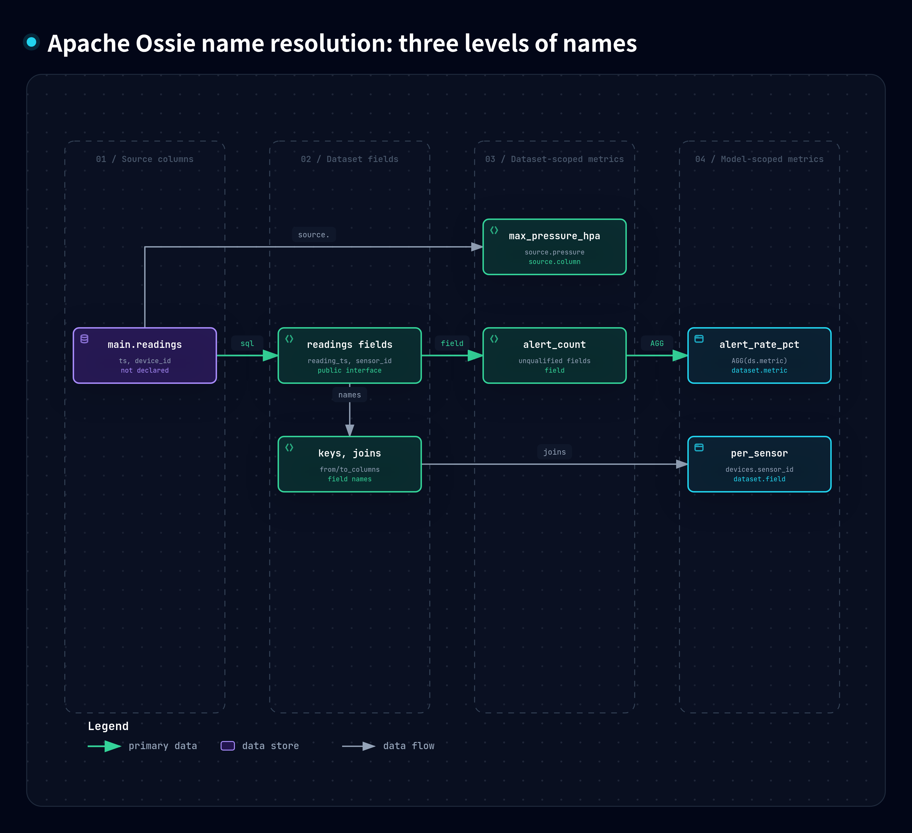

# 04 — Semantic Model in Apache Ossie (incubating)

Part 2 of the Apache Ossie series. In [part 1](../03-ontology-with-apache-ossie/) we wrote an ontology, a small semantic model and a mapping document. This lesson goes deep on the **core semantic model**, the Ossie document that describes the data you have: datasets, fields, keys, relationships, dataset-scoped and model-scoped metrics, `ai_context`, and the name-resolution rules that tie them together. You validate a richer IoT model with the official Ossie tools, catch name-resolution mistakes, and compile its metrics into SQL that runs on DuckDB.

The data is the same 6,000 rows of IoT telemetry used in videos 1 to 3, loaded into a local DuckDB file, so no cloud account is needed.

> The Ossie core specification used here is version `0.3.0.dev0`, which is **unreleased and still changing**. The files were validated against apache/ossie commit `74a26be` (18 Nov 2026). If a newer commit rejects them, check [docs/spec_changes.md](https://github.com/apache/ossie/blob/main/docs/spec_changes.md) in the Ossie repo.

## What you will build





| File | What it is |
|---|---|
| [models/iot.semantic_model.yaml](models/iot.semantic_model.yaml) | The Ossie core semantic model: 4 datasets, 3 relationships, 6 dataset-scoped and 3 model-scoped metrics |
| [models/iot.ontology.yaml](models/iot.ontology.yaml) | The ontology from part 1, unchanged |
| [models/iot.mapping.yaml](models/iot.mapping.yaml) | The part 1 mapping, updated to this model's field names (`readings.reading_ts`, `devices.sensor_id`, ...) |
| [semantic_demo.py](semantic_demo.py) | Validates, explores and queries the model |
| [build_db.py](build_db.py) | Builds `data/iot.duckdb` from the CSV |

The diagrams were made with [archify](https://github.com/tt-a1i/archify) and come as PNG, SVG, interactive HTML and the archify JSON. The slides from the video are in [docs/slides.pdf](docs/slides.pdf), and [docs/semantic-model.md](docs/semantic-model.md) summarizes the specification.

## Concepts in plain words

- One **document** is one model. `version`, `name` and a non-empty `datasets` list are required; `description`, `ai_context`, `relationships`, `metrics` and `nonportable_extensions` are optional.
- A **dataset** is a logical table: a `name`, a `source` (table, view or query), an optional `primary_key` and `unique_keys` (a list of lists), its `fields` and its own `metrics`.
- A **field** has an `expression` (a scalar SQL expression over the source's columns, never an aggregate), an optional `datatype` (`String`, `Integer`, `Decimal`, `Float`, `Boolean`, `Date`, `Time`, `DateTime`, `DateTimeTz`, `Opaque`) and an optional `dimension.is_time`, which defaults to true for temporal datatypes.
- **`expression.sql`** is the portable form, written in `OSSIE_SQL_2026`. **`expression.dialects`** adds vendor versions such as `BIGQUERY`. When both are present, the top-level `sql` is authoritative.
- **Name resolution**: field expressions read source columns. Keys and relationship `from_columns`/`to_columns` name **fields**, not source columns. A field cannot reference another field.
- A **relationship** joins the `from` dataset (many side) to the `to` dataset (one side) on matching field lists.
- A **dataset-scoped metric** uses its dataset's fields by plain name and source columns as `source.column`, and is referenced as `dataset.metric`. A **model-scoped metric** uses `dataset.field`, may span datasets, and can reuse a dataset-scoped metric only through `AGG(dataset.metric)`.
- **`ai_context`** is a string or an object with `instructions`, `synonyms` and `examples`, on the model, datasets, fields, relationships and metrics.

## Prerequisites

- Python 3.11 or later and Git
- About 80 MB of disk space for the Ossie clone and the Python packages

## Step by step

### 1. Get the code and the Ossie repository

```bash
git clone https://github.com/aniket-work/data-for-ai
cd data-for-ai/04-semantic-model-with-apache-ossie
git clone --depth 1 https://github.com/apache/ossie     # schemas, validator, Python SDK
python -m venv .venv && source .venv/bin/activate        # Windows: .venv\Scripts\activate
pip install -r requirements.txt ./ossie/python
```

The demo looks for the Ossie clone in `./ossie`. To use a clone somewhere else, set `OSSIE_REPO` to its path.

### 2. Build the sample database

```bash
python build_db.py
```

Expected output: `customers 2`, `sites 4`, `devices 20`, `readings 6000` rows.

### 3. Validate with the official tools

```bash
python semantic_demo.py validate
```

It runs three checks and ends with **All checks passed**:

1. Each file against its official JSON Schema (`core-spec/ossie-schema.json`, `ontology/ontology.json`, `ontology/mapping.json`).
2. The official validator, `ossie/validation/validate.py`: unique names, references, metric scoping, `AGG` placement and SQL parsing; for the mapping, every `dataset.field` it names.
3. Loading the model with the official Python SDK (`ossie.OssieDocument.from_ossie_yaml`): 4 datasets, 3 relationships, 6 dataset-scoped and 3 model-scoped metrics.

### 4. Catch name-resolution mistakes

```bash
sed -e 's/MAX(source.pressure)/MAX(pressure)/' -e 's/key: \[sensor_id\] /key: [device_id] /' models/iot.semantic_model.yaml > models/broken.yaml
python ossie/validation/validate.py models/broken.yaml
rm models/broken.yaml
```

The JSON Schema accepts both mistakes. The official validator reports two errors: `primary_key references undeclared field 'device_id'` (a source column, not a field) and `Dataset-scoped metric 'readings.max_pressure_hpa' ... references undeclared field(s) 'pressure'` (a source column must be written `source.pressure`).

### 5. Explore the model

```bash
python semantic_demo.py datasets   # every field and the source expression it resolves to
python semantic_demo.py metrics    # relationships and both kinds of metrics
```

### 6. Run metrics as SQL

```bash
python semantic_demo.py query readings.avg_temperature_c readings.alert_count readings.max_pressure_hpa --by sites.province
python semantic_demo.py query alert_rate_pct readings_per_sensor alerts_per_site --by customers.customer_name
```

Expected results:

| province | avg_temperature_c | alert_count | max_pressure_hpa |
|---|---:|---:|---:|
| AB | 22.36 | 12 | 1,025.40 |
| BC | 22.14 | 7 | 1,027.00 |
| ON | 22.20 | 36 | 1,028.10 |
| QC | 22.10 | 14 | 1,024.60 |

| customer_name | alert_rate_pct | readings_per_sensor | alerts_per_site |
|---|---:|---:|---:|
| Aurora Cold Chain | 1.20 | 297.14 | 25.00 |
| Prairie Grid Labs | 1.03 | 306.67 | 9.50 |

> **Teaching helper, not an Ossie feature.** Ossie defines the model and how its names resolve; it does not ship a query engine. The `query` command's small compiler was written for this lesson. It follows the spec's [Name Resolution](https://github.com/apache/ossie/blob/main/core-spec/spec.md#name-resolution) rules: each field reference becomes the field's expression, `source.column` becomes the column, `AGG(dataset.metric)` becomes that metric's expression, and joins follow the relationships from the many side to the one side. It uses the top-level `sql` of each expression and only handles models whose joins form a many-to-one tree, like this one.

## Try next

- Add a dataset-scoped metric `avg_humidity_pct` on `readings`, then a model-scoped `alerts_per_customer`, and validate again.
- Give `sites` a `unique_keys` entry and see the validator reject a source column there.
- Add a `SNOWFLAKE` dialect to `reading_hour` and check that `datasets` lists it.

## Official sources

- [Apache Ossie repository](https://github.com/apache/ossie) and [website](https://ossie.apache.org/)
- [Core specification](https://github.com/apache/ossie/blob/main/core-spec/spec.md), [ossie-schema.json](https://github.com/apache/ossie/blob/main/core-spec/ossie-schema.json) and [expression language](https://github.com/apache/ossie/blob/main/core-spec/expression_language.md)
- [Dialect catalog](https://github.com/apache/ossie/blob/main/extensions/dialects.md)
- [Official validator](https://github.com/apache/ossie/tree/main/validation) and [Python SDK](https://github.com/apache/ossie/tree/main/python)
- [Significant specification changes](https://github.com/apache/ossie/blob/main/docs/spec_changes.md)
- [Ontology specification](https://github.com/apache/ossie/blob/main/ontology/ontology.md) (part 1)

Apache Ossie (incubating) is an effort undergoing incubation at The Apache Software Foundation (ASF). Apache Ossie, Ossie, Apache, the Apache feather logo and the Apache Ossie project logo are trademarks of The Apache Software Foundation. This tutorial is not affiliated with or endorsed by the ASF.
