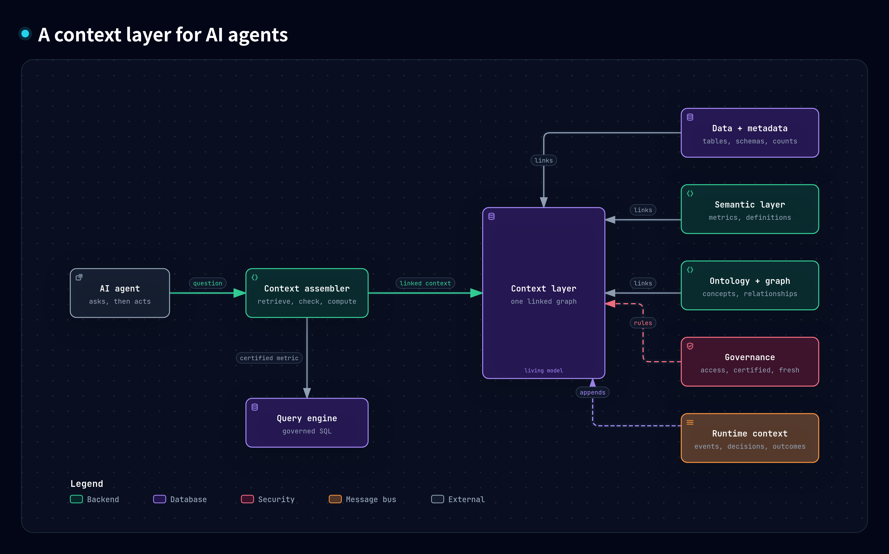
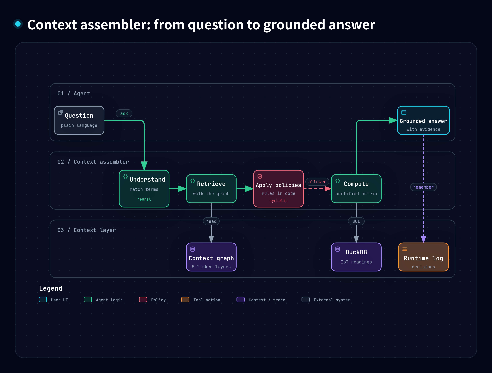

# 05 — Context Layers for AI Agents

Semantics, ontology, semantic layer, knowledge graph, context layer: these terms get used as if they meant the same thing. This lesson separates them, explains why AI agents need a **context layer**, and builds a small one in Python.

The context layer here links five layers into one graph:

| Layer | File | Where it comes from |
|---|---|---|
| Data and metadata | `data/iot.duckdb` | The same 6,000 IoT readings used in videos 1 to 4 |
| Semantics | [models/iot.semantic_model.yaml](models/iot.semantic_model.yaml) | The Apache Ossie (incubating) semantic model from [folder 04](../04-semantic-model-with-apache-ossie/), plus two `sites` fields |
| Ontology | [models/iot.ontology.yaml](models/iot.ontology.yaml) and [models/iot.mapping.yaml](models/iot.mapping.yaml) | The Ossie ontology and mapping from [folder 03](../03-ontology-with-apache-ossie/) |
| Governance | [context/policies.yaml](context/policies.yaml) | New: access, certification and freshness rules |
| Runtime | [context/runtime_seed.jsonl](context/runtime_seed.jsonl) | New: events, decisions, actions and outcomes |

An agent question then goes through a **context assembler**: understand, retrieve, apply policies, compute, answer, and remember. Everything runs locally. No LLM is called and no API key is needed.

> **Teaching code, not a product or standard feature.** The graph builder, the context assembler, the policy checks, the answer composer and the SQL compiler (from folder 04) were written for this lesson. The formats of `policies.yaml` and `runtime_seed.jsonl` are our own, not a standard. The "understand" step uses a simple fuzzy matcher as a stand-in for the neural part (a language model in a real system). The full context packet is saved to `out/context_packet.json`, so you can hand it to any LLM you like.

## What you will build





The diagrams come as PNG, SVG, interactive HTML and JSON source. The slides from the video are in [docs/slides.pdf](docs/slides.pdf), and [docs/context-layers.md](docs/context-layers.md) explains the concepts.

## Concepts in plain words

- **Semantics**: the meaning of a term, number or column.
- **Ontology**: a formal model of a domain's concepts, relationships and rules (customer, site, sensor, reading; an alert reading is a reading with status `ALERT`).
- **Semantic layer**: a governed business view over data: datasets, fields, metrics defined once (`alert_rate_pct`), and rules about access, certification and freshness.
- **Knowledge graph**: real things and their links (sensor-002 is installed at MTL-01, which Aurora Cold Chain owns), usually shaped by an ontology.
- **Context layer**: business semantics and governance from the semantic layer, plus the ontology-shaped graph, linked in one model and kept current with **runtime context**: events, decisions, actions and outcomes, including the agent's own answers.
- **Neural plus symbolic**: the neural side (a language model) reads the question and writes the reply; the symbolic side (ontology rules, policies, certified metrics) is checked in code and decides what is allowed and true.

## Prerequisites

- Python 3.11 or later and Git

## Step by step

### 1. Get the code

```bash
git clone https://github.com/aniket-work/data-for-ai
cd data-for-ai/05-context-layers-for-ai
python -m venv .venv && source .venv/bin/activate        # Windows: .venv\Scripts\activate
pip install -r requirements.txt
```

### 2. Build the sample database

```bash
python build_db.py
```

Expected output: `customers 2`, `sites 4`, `devices 20`, `readings 6000` rows. The `sites` table now also has `site_manager` (a fictional person's name, treated as personal data) and `on_call_channel` (the approved way to escalate).

### 3. Look at the two new layers

- [context/policies.yaml](context/policies.yaml): `POL-PII-01` denies `sites.site_manager` to the `ops_agent` role and points to `sites.on_call_channel` instead; `POL-MET-02` lists the certified metrics; `POL-FRESH-03` requires readings to be at most 15 minutes old.
- [context/runtime_seed.jsonl](context/runtime_seed.jsonl): an HVAC stress test at TOR-01 (`EVT-101`), the decision to exclude its readings from alert metrics (`DEC-102`), alerts on sensor-002 at MTL-01 (`EVT-103`), a technician dispatch (`ACT-104`) and a replaced cooler fan (`OUT-105`). All times are UTC.

### 4. Link the layers into one graph

```bash
python context_layer.py build --reset
```

It prints the node count per layer (30 data, 33 semantics, 5 ontology, 3 governance, 5 runtime), 76 nodes and 135 edges, of which 61 cross layers, and saves the graph to `out/context_graph.json`. `--reset` copies the runtime seed to `out/runtime_log.jsonl`.

```bash
python context_layer.py log 5                  # the runtime context
python context_layer.py explore site:MTL-01    # walk four hops from a node, grouped by layer
```

### 5. Ask without context (baseline)

```bash
python context_layer.py ask "Which site has the worst alert rate right now, and who should I call?" --no-context
```

This is a **scripted** baseline: the kind of SQL an agent writes from table names alone. It answers `TOR-01 is the worst site, with 36 alerts. Call Lea Tremblay.` That uses a raw count instead of a rate, includes the excluded test traffic, exposes a person's name, and gives no evidence.

### 6. Ask with the context layer

```bash
python context_layer.py ask "Which site has the worst alert rate right now, and who should I call?"
```

| Step | What happens |
|---|---|
| 1. Understand | Fuzzy-matches words to names and `ai_context` synonyms: "site" to the `Site` concept, "call" to `sites.site_manager`, "alert rate" to `alert_rate_pct` |
| 2. Retrieve | Walks the graph: the metric's dependencies, the `AlertReading` rule, the policies that govern what was touched, runtime records about sites, and the join path from the relationships |
| 3. Apply policies | `POL-FRESH-03` PASS, `POL-MET-02` PASS, `POL-PII-01` BLOCK (site manager swapped for the on-call channel), `DEC-102` APPLY (exclude TOR-01's test window) |
| 4. Compute | Compiles `alert_rate_pct` per site with that filter and runs it on DuckDB |
| 5. Answer | Composes a grounded answer with its evidence |
| 6. Remember | Appends the answer to `out/runtime_log.jsonl` as `ANS-106` |

Expected result of step 4:

| site | alert_rate_pct | alerts | readings |
|---|---:|---:|---:|
| MTL-01 | 1.18 | 14 | 1191 |
| VAN-01 | 1.15 | 7 | 608 |
| TOR-01 | 0.98 | 24 | 2443 |
| CAL-01 | 0.97 | 12 | 1232 |

And the answer: `MTL-01 (Montreal, Aurora Cold Chain) has the worst certified alert rate: 1.18%. TOR-01 is 0.98% once its HVAC test window is excluded (DEC-102). Recent context: cooler fan replaced next to sensor-002 (OUT-105); 1 alert at MTL-01 since then. Escalate via #oncall-mtl. The site manager's name is withheld (POL-PII-01).`

### 7. See the context keep learning

```bash
python context_layer.py log 2
```

The newest record is the agent's answer, `ANS-106`, with its evidence. Run `ask` again and the next answer gets the next ID. Use `build --reset` to start over.

### Optional: validate the Ossie files

The semantic model gained two fields (`site_manager`, `on_call_channel`) compared with folder 04. To check the files with the official Ossie validator, clone [apache/ossie](https://github.com/apache/ossie) (spec `0.3.0.dev0`, unreleased; checked at commit `74a26be`) and run:

```bash
python ossie/validation/validate.py models/iot.semantic_model.yaml
python ossie/validation/validate.py models/iot.mapping.yaml --schema ossie/ontology/mapping.json
```

## Try next

- Add a policy that blocks `readings.temperature_f` for a `guest_agent` role, then ask with `--role guest_agent`.
- Append a runtime event and decision that exclude a window at MTL-01, run `build`, and watch the ranking change.
- Send `out/context_packet.json` to a language model of your choice and compare its answer with the template answer.

## Related videos

- Ontology with Apache Ossie (incubating): https://youtu.be/TV70PHBNNPk ([folder 03](../03-ontology-with-apache-ossie/))
- Semantic model in Apache Ossie (incubating): https://youtu.be/6fAn39bPZb0 ([folder 04](../04-semantic-model-with-apache-ossie/))

## Sources

- [Apache Ossie repository](https://github.com/apache/ossie), [core specification](https://github.com/apache/ossie/blob/main/core-spec/spec.md) and [ontology specification](https://github.com/apache/ossie/blob/main/ontology/ontology.md)
- [NetworkX](https://networkx.org/documentation/stable/), [DuckDB](https://duckdb.org/docs/), [SQLGlot](https://sqlglot.com/)

All people, companies and channels in the sample data are fictional.

Apache Ossie (incubating) is an effort undergoing incubation at The Apache Software Foundation (ASF). Apache Ossie, Ossie, Apache, the Apache feather logo and the Apache Ossie project logo are trademarks of The Apache Software Foundation. This tutorial is not affiliated with or endorsed by the ASF.
