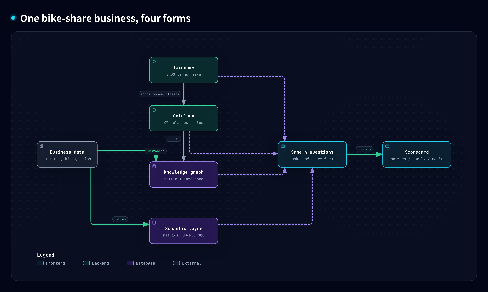
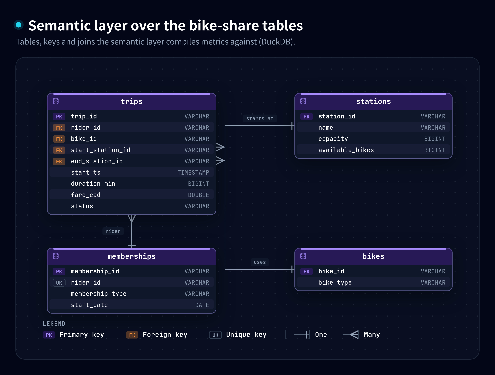

# 06 — One Business, Four Models: Taxonomy, Ontology, Knowledge Graph and Semantic Layer

Taxonomy, ontology, knowledge graph and semantic layer are often mentioned together. This lesson shows what **one business** looks like in each of the four forms, asks every form **the same four questions**, and scores what each one can and can't answer.

The business is **Harbourline Bikes**, a fictional bike-share service in a made-up city: riders, memberships (Casual or Annual), bikes (Classic or E-bike), dock stations and trips. Every station, bike, rider and trip is invented. Riders are IDs only, with no names or other personal data.

| Form | File | What it holds |
|---|---|---|
| 1. Taxonomy (SKOS) | [taxonomy/bikeshare_taxonomy.ttl](taxonomy/bikeshare_taxonomy.ttl) | Agreed terms, synonyms (`altLabel`) and a broader / narrower tree |
| 2. Ontology (OWL) | [ontology/bikeshare_ontology.ttl](ontology/bikeshare_ontology.ttl) | Classes, subclasses, disjointness, relationships, cardinality and two rule-defined classes |
| 3. Knowledge graph (RDF) | built by `four_forms.py kg` from the ontology + [data/](data/), with [kg/rules/](kg/rules/) and [kg/queries/](kg/queries/) | Instances, RDFS inference, rules, a data check and multi-hop SPARQL |
| 4. Semantic layer | [semantic_layer/bikeshare_semantic.yaml](semantic_layer/bikeshare_semantic.yaml) on DuckDB | Tables, joins, dimensions and governed metrics compiled to SQL |

Everything runs locally with Python, [rdflib](https://rdflib.readthedocs.io/), [owlrl](https://owl-rl.readthedocs.io/) and [DuckDB](https://duckdb.org/). No LLM is called and no API key is needed.

> **Teaching code, not a product or standard feature.** `four_forms.py` (the command-line tool, the answers and the scorecard), `semantic_compiler.py`, `show.py` and the closed-world "one bike per trip" check were written for this lesson. The YAML format of the semantic layer is our own teaching format. For a real open specification, see our Apache Ossie (incubating) semantic model lesson in [folder 04](../04-semantic-model-with-apache-ossie/). SKOS, OWL, RDF, SPARQL and RDFS inference are W3C standards, used through rdflib and owlrl.

## What you will build





The diagrams were made with [archify](https://github.com/tt-a1i/archify) and come as PNG, SVG, interactive HTML and the archify JSON. The slides from the video are in [docs/slides.pdf](docs/slides.pdf).

## The business rules and the four questions

Rules:

- A trip uses **exactly one** bike (and is taken by exactly one rider).
- An **active rider** has at least one completed trip in the last 30 days.
- A station is **empty-risk** when it has fewer than 3 bikes available.

"Now" is fixed at **2026-06-30 18:00** so every run gives the same answers.

Questions asked of every form:

1. Is an e-bike a kind of bike?
2. Can one trip use two bikes?
3. Which annual members ended an e-bike trip this week at a station that is now empty-risk?
4. What is the average trip revenue per station, and is it the same number everywhere?

## Prerequisites

- Python 3.11 or later and Git

## Step by step

### 1. Get the code

```bash
git clone https://github.com/aniket-work/data-for-ai
cd data-for-ai/06-one-business-four-models
python -m venv .venv && source .venv/bin/activate        # Windows: .venv\Scripts\activate
pip install -r requirements.txt
```

### 2. Build the sample data

```bash
python build_data.py
```

This writes `data/*.csv` (the CSVs are also committed) and loads them into `bikeshare.duckdb`: 8 stations, 42 bikes (14 e-bikes), 60 riders, 60 memberships and 1,200 trips. The data is generated from a fixed seed, so you get the same numbers as the video.

### 3. Form 1: the taxonomy

```bash
python show.py taxonomy/bikeshare_taxonomy.ttl 10 15
python four_forms.py taxonomy
```

You see the SKOS tree with synonyms. A lookup of `"electric bike"` resolves to **E-bike → Bike → Vehicle**. A taxonomy knows names, synonyms and is-a, but no relationships, rules or data.

### 4. Form 2: the ontology

```bash
python show.py ontology/bikeshare_ontology.ttl 15 23
python four_forms.py ontology
```

You see the classes (`EBike` is a subclass of `Bike` and disjoint with `ClassicBike`), the relationships with their domain and range, the cardinality rules (`every Trip usesBike exactly 1 Bike`) and the two rule-defined classes, `ActiveRider` and `EmptyRiskStation`. The ontology holds **0** riders, bikes or trips.

> OWL is open world. A reasoner that sees one trip with two bikes would conclude that the two bikes must be the same bike, not report an error. To flag bad data you need a closed-world check. This lesson uses a SPARQL query ([kg/queries/one_bike_per_trip.rq](kg/queries/one_bike_per_trip.rq)); [SHACL](https://www.w3.org/TR/shacl/) is the standard tool for this kind of validation.

### 5. Form 3: build the knowledge graph

```bash
python four_forms.py kg
python four_forms.py kg --inject-bad-trip | tail -2
```

Expected output:

- ontology 73 triples + instance data 9,854 triples
- RDFS inference with owlrl: 9,927 → 13,866 triples (every `EBike` is now also a `Bike`)
- rule `active_rider` +44 facts, rule `empty_risk_station` +3 facts (Market Square, Old Mill, North Ferry)
- `✔ check every trip uses exactly one bike`, and with `--inject-bad-trip`: `✘ violation TR-0042 uses 2 bikes`

The graph is saved to `out/knowledge_graph.ttl`. The two rules are SPARQL `CONSTRUCT` queries in [kg/rules/](kg/rules/); they read the window (30 days) and the threshold (3) from the ontology.

### 6. Multi-hop SPARQL

```bash
python four_forms.py query
```

The query in [kg/queries/q3_annual_ebike_empty_risk.rq](kg/queries/q3_annual_ebike_empty_risk.rq) follows four hops (Rider → Membership, Trip → Rider, Trip → Bike, Trip → Station). Expected: **6 riders** (R-001, R-010, R-026, R-034, R-038, R-045) across Market Square, North Ferry and Old Mill.

### 7. Form 4: the semantic layer

```bash
python show.py semantic_layer/bikeshare_semantic.yaml 9 32
python four_forms.py semantic
```

The metric `avg_trip_revenue = trip_revenue / trip_count` is defined once; both base metrics only count completed trips. The compiler turns it into SQL with `FILTER (WHERE ...)` clauses and DuckDB runs it per station. Market Square: **$2.35** from the dashboard, the notebook and the agent alike. A hand-written `AVG(fare_cad)` gives **$2.27**, because it also counts cancelled trips.

### 8. Same concept, four homes

```bash
python four_forms.py homes ebike active-rider empty-risk
```

| Concept | Taxonomy | Ontology | Knowledge graph | Semantic layer |
|---|---|---|---|---|
| E-bike | `skos:Concept` with altLabels | `owl:Class`, subclass of Bike | 14 bikes typed `EBike` (and `Bike`) | a value: `bike_type = 'ebike'` |
| Active rider | a term with a text definition | a class + its 30-day rule | 44 riders inferred by a rule | the governed metric `active_riders` (44) |
| Empty-risk station | a narrower term | a class + threshold 3 | 3 stations inferred by a rule | not modeled (only `available_bikes`) |

### 9. Ask every form the same questions, then score them

```bash
python four_forms.py ask
python four_forms.py scorecard
```

| Form | Q1 | Q2 | Q3 | Q4 | Best at |
|---|:-:|:-:|:-:|:-:|---|
| Taxonomy | ✔ | ✘ | ✘ | ✘ | shared words, synonyms, is-a |
| Ontology | ✔ | ✔ | ✘ | ✘ | structure, constraints, rules |
| Knowledge graph | ✔ | ✔ | ✔ | ~ | connected facts, inference, multi-hop |
| Semantic layer | ✘ | ✘ | ~ | ✔ | governed numbers, consistent everywhere |

✔ answers, ~ partly, ✘ can't. Q3 in the semantic layer is "partly" because the same 6 riders come out only with hand-written joins and hard-coded rules. Q4 in the graph is "partly" because a SPARQL `AVG` works, but each query carries its own definition (here it gives $2.27, not the certified $2.35).

No single form answers everything. Real systems combine them: words → model → graph → governed metrics.

## Try it yourself

- Add a synonym (for example `"cargo bike"` under a new concept) to the taxonomy and look it up.
- Change the empty-risk threshold in the ontology from 3 to 5 and rerun `python four_forms.py query`.
- Add a metric to the semantic layer, such as revenue per e-bike trip, and compile it with `semantic_compiler.compile_query`.

## Files

```
06-one-business-four-models/
├── build_data.py              # fictional data -> data/*.csv + bikeshare.duckdb
├── four_forms.py              # the CLI: taxonomy | ontology | kg | query | semantic | homes | ask | scorecard
├── semantic_compiler.py       # tiny metric -> SQL compiler (our own teaching helper)
├── show.py                    # prints a file with syntax colors
├── taxonomy/bikeshare_taxonomy.ttl
├── ontology/bikeshare_ontology.ttl
├── kg/rules/*.rq              # SPARQL CONSTRUCT rules
├── kg/queries/*.rq            # data check and multi-hop query
├── semantic_layer/bikeshare_semantic.yaml
├── data/*.csv
├── diagrams/                  # archify PNG, SVG, HTML and JSON
└── docs/slides.pdf
```

## Earlier videos in this series

- Ontology with Apache Ossie (incubating): [folder 03](../03-ontology-with-apache-ossie/), https://youtu.be/TV70PHBNNPk
- Semantic model in Apache Ossie (incubating): [folder 04](../04-semantic-model-with-apache-ossie/), https://youtu.be/6fAn39bPZb0
- Context layers for AI agents: [folder 05](../05-context-layers-for-ai/), https://youtu.be/DSXlY7Gruhg

Apache Ossie (incubating) is an effort undergoing incubation at The Apache Software Foundation (ASF). Apache Ossie, Ossie, Apache and the Apache Ossie project logo are trademarks of the ASF. This lesson is not affiliated with or endorsed by the ASF.
