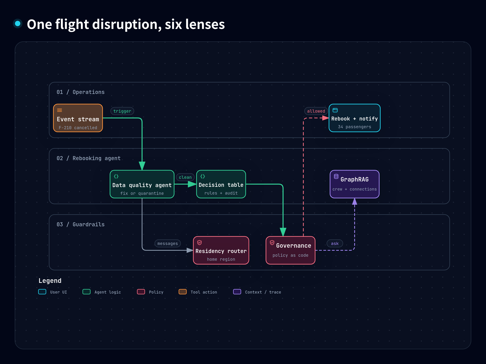
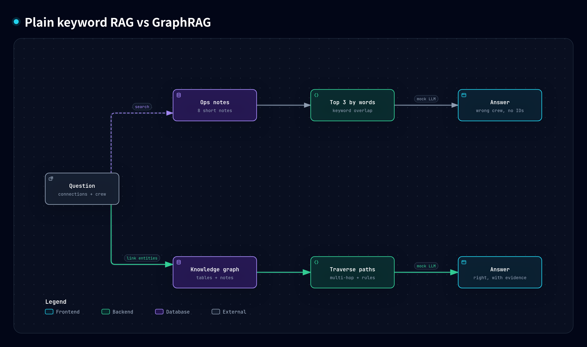

# 07 — One Flight Disruption, Six Data and AI Trends

Six ideas come up again and again in data and AI right now: **sovereign AI and data residency**, **decision governance**, **AI governance platforms**, **agentic data streaming**, **agentic data management** and **GraphRAG**. Instead of six separate explainers, this lesson runs **one event** through all six, asks every lens **the same six questions**, and ends with a scorecard of what each one adds.

The event: **Larkspur Air**, a fictional regional airline, cancels flight **F-210** from Norport at 06:40 because of freezing rain. Larkspur flies between two made-up jurisdictions, **Norland** and **Solmara**, each with its own data laws. Every airport, flight, crew and passenger is invented. Passengers are IDs only (P-001 … P-036), with no names, contact details or other personal data.

| Lens | Command | File(s) | What it shows |
|---|---|---|---|
| 1. Agentic data streaming | `stream` | [data/events.jsonl](data/events.jsonl) | Events replayed in order; state across events; the cancellation triggers the agent at once |
| 2. Agentic data management | `quality` | [data/bookings.csv](data/bookings.csv) | An agent that detects data-quality patterns, auto-fixes safe ones, quarantines risky ones and reports a score |
| 3. Sovereign AI and data residency | `residency` | [config/residency.yaml](config/residency.yaml) | A residency-tagged data map; personal data may only go to a model endpoint in its home jurisdiction |
| 4. Decision governance | `decide [--explain P-007]` | [decisions/rebooking.dmn.yaml](decisions/rebooking.dmn.yaml) | A DMN-style decision table (hit policy FIRST), explanations and an audit log |
| 5. AI governance platform | `govern` | [governance/policies.yaml](governance/policies.yaml) | A model registry and policies as code: allow, needs approval or deny, plus coverage checks |
| 6. GraphRAG vs plain RAG | `graphrag` | [knowledge/ops_notes/](knowledge/ops_notes/) + the CSVs | Plain keyword RAG vs a knowledge graph built from tables and notes, on one multi-hop question |

Everything runs locally with Python, [PyYAML](https://pyyaml.org/), [networkx](https://networkx.org/) and [rich](https://github.com/Textualize/rich). No LLM is called and no API key is needed.

> **Teaching code, not a product or standard.** `six_lenses.py`, `show.py` and every YAML format here (residency map, decision table, policies) were written for this lesson. The decision table is *DMN-style*: it borrows the idea of decision tables and hit policies from the DMN standard, but it is plain YAML, not DMN XML. The policies are in the spirit of policy-as-code tools, not any product's syntax. Wherever a real system would call a language model (writing the answer, extracting entities from text), `mock_llm()` fills a fixed template and the entity extraction uses regular expressions. Both are labelled in the output. The streaming clock is simulated; the processing time is measured.

## What you will build





The diagrams were made with [archify](https://github.com/tt-a1i/archify) and come as PNG, SVG, interactive HTML and the archify JSON. The slides from the video are in [docs/slides.pdf](docs/slides.pdf).

## The scenario and the six questions

Facts the agent must respect:

- Personal data is processed only in its home jurisdiction (Norland or Solmara).
- Crew duty limit: **13 hours** a day; each flight adds its block time plus 1 hour of briefing.
- Minimum connection time at SOL-1 Solmara City: **60 minutes**.
- F-214 (14:00 today) has **6** free seats; F-218 leaves tomorrow at 07:00.

Questions asked of every lens:

1. May passenger data go to the offshore model?
2. Why is P-007 on tomorrow's flight?
3. May the agent issue a 450 CAD voucher on its own?
4. How fast did we react to the cancellation?
5. Which records were unsafe to act on?
6. Which passengers still make their onward connection on F-214, and which crew can legally fly it?

## Prerequisites

- Python 3.11 or later and Git

## Step by step

### 1. Get the code

```bash
git clone https://github.com/aniket-work/data-for-ai
cd data-for-ai/07-one-disruption-six-trends
python -m venv .venv && source .venv/bin/activate        # Windows: .venv\Scripts\activate
pip install -r requirements.txt
```

### 2. Build the sample data

```bash
python build_data.py
```

It writes `data/`: 5 airports, 6 flights, 8 crews (2 on reserve), 36 passengers, 38 booking rows with a few deliberate data problems, and 12 operations events (fixed seed, so every run is the same).

### 3. Lens 1: agentic data streaming

```bash
python six_lenses.py stream
```

The events are replayed in order. After three delays at NOR-1 within 30 minutes the agent raises a risk alert. When the cancellation of F-210 arrives at 06:40, the agent runs at once and has 34 rebooking decisions a few milliseconds later. A nightly batch at 02:00 would see the same event about 19 hours later.

### 4. Lens 2: agentic data management

```bash
python six_lenses.py quality
```

Detect → recommend → act → monitor. The agent drops the duplicate row of P-012 and fixes the airport code of P-020 (safe, reversible), quarantines P-027 (negative fare) and P-031 (booked on two overlapping flights) for a human, and recommends the airport desk for P-005 and P-018 (no contact on file). 38 rows become 34 clean rows; the quality score goes from 84.2% to 94.1%. The report is written to `out/dq_report.json`.

### 5. Lens 3: sovereign AI and data residency

```bash
python show.py config/residency.yaml
python six_lenses.py residency
```

All passenger records to `assist-global` (offshore): **BLOCK**. Norland passengers to `assist-north`: ALLOW. Solmara passengers to `assist-north`: BLOCK. Counts without passenger IDs, and the flight schedule, may go anywhere. Routing result: 22 Norland passengers to `assist-north`, 12 Solmara passengers to `assist-south`, none offshore (`out/routing_log.json`).

### 6. Lens 4: decision governance

```bash
python six_lenses.py decide
python six_lenses.py decide --explain P-033
```

Rules are checked top to bottom and the first match wins. Two passengers needing assistance (R1) and four whose connection to F-330 still works (R2) take the six seats on F-214. Five gold members asked for F-214 too (R5), so the capacity rule `CAP` moves them to F-218. P-007 (gold, onward on F-332, which F-214 can't make) gets R3: F-218 and a 450 CAD voucher. Every decision is written to `out/audit_log.jsonl` with its inputs, rule, table version and reason.

### 7. Lens 5: AI governance platform

```bash
python show.py governance/policies.yaml
python six_lenses.py govern
```

69 planned agent actions: 67 allowed, 1 **needs approval** (the 450 CAD voucher for P-007, GOV-02) and 1 **denied** (an agent proposal to cancel P-031's ticket, GOV-03). Audit coverage 34/34 and residency coverage 34/34. Report: `out/governance_report.json`.

### 8. Lens 6: GraphRAG vs plain keyword RAG

```bash
python six_lenses.py graphrag
```

Plain keyword RAG takes the 3 notes with the most matching words and the mock model answers with crew C-7 and no passengers, which is wrong. GraphRAG builds a graph of 63 nodes and 84 edges from the CSVs and the notes, then follows the paths: P-004, P-009, P-015 and P-022 still make F-330; P-007, P-013 and P-030 miss F-332; C-7 would reach 11.5 + 2.5 = 14 hours (over 13), so reserve crew C-9 (2 + 2.5 = 4.5 hours) flies F-214. The answer lists the notes it used as evidence.

### 9. The same questions to every lens, and the scorecard

```bash
python six_lenses.py ask
python six_lenses.py scorecard
```

| Lens | Q1 | Q2 | Q3 | Q4 | Q5 | Q6 | Adds |
|---|---|---|---|---|---|---|---|
| Data residency | ✔ | ✘ | ✘ | ✘ | ✘ | ✘ | where data and models may run |
| Decision governance | ✘ | ✔ | ~ | ✘ | ✘ | ✘ | why each decision was made |
| AI governance | ~ | ~ | ✔ | ✘ | ✘ | ✘ | what agents are allowed to do |
| Data streaming | ✘ | ✘ | ✘ | ✔ | ✘ | ✘ | react in milliseconds, not overnight |
| Data quality agent | ✘ | ✘ | ✘ | ✘ | ✔ | ✘ | trustworthy records to act on |
| GraphRAG | ✘ | ~ | ✘ | ✘ | ✘ | ✔ | connected answers with evidence |
| Plain keyword RAG | ✘ | ✘ | ✘ | ✘ | ✘ | ✘ | (baseline) similar text, not connected facts |

✔ answers it, ~ helps partly, ✘ can't answer it. The partial marks are judgement calls: governance checks that residency and auditing happened but doesn't make those decisions; the decision table computes the voucher but doesn't say who may approve it; the graph knows the connection facts behind P-007's rule but not the rule itself.

## Try next

- Change `limit_cad` in `governance/policies.yaml` to 500 and run `govern` again.
- Add a rule to `decisions/rebooking.dmn.yaml` (for example, a lounge pass for gold members on F-218) and run `decide --explain P-033`.
- Add a second bad row to `data/bookings.csv` and watch `quality` catch it.
- Change C-7's logged duty hours in `data/crews.csv` to 9 and run `graphrag`.

## Files

| File | What it is |
|---|---|
| `build_data.py` | Writes the fictional data in `data/` (fixed seed) |
| `six_lenses.py` | The six lenses, `ask` and `scorecard` (teaching code) |
| `show.py` | Prints a file with syntax colours |
| `config/`, `decisions/`, `governance/` | Our own YAML formats for residency, the decision table and the policies |
| `knowledge/ops_notes/` | Eight short operations notes used by both RAG approaches |
| `diagrams/` | archify diagrams (PNG, SVG, HTML, JSON) |
| `docs/slides.pdf` | Slides from the video |
