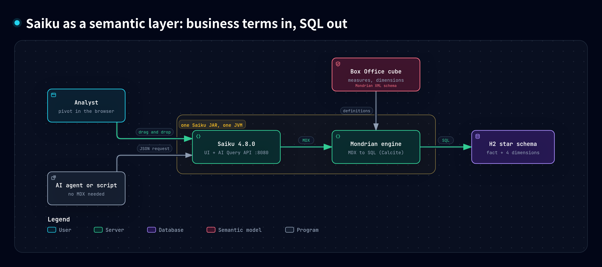
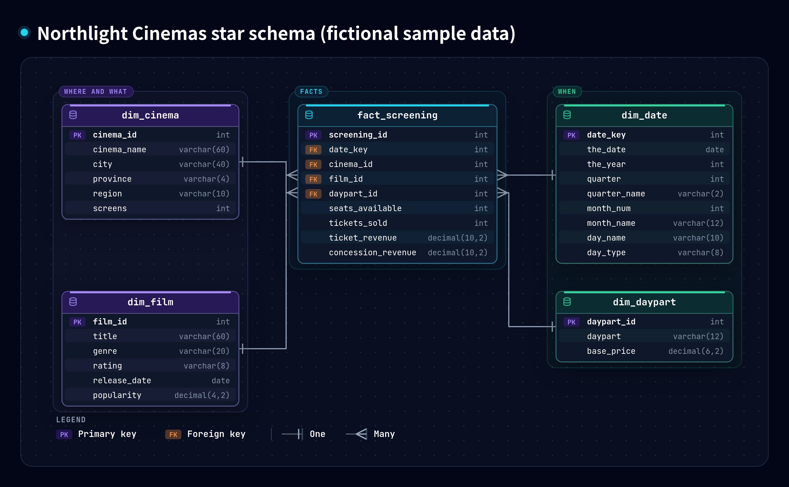

# 08 — The Semantic Layer, Hands-On with Saiku

A **semantic layer** gives business metrics one shared name and one definition, so every tool gets the same number. In this lesson we build one for real with [Saiku](https://github.com/spiculedata/saiku), the open-source analytics tool that runs on the [Mondrian](https://github.com/pentaho/mondrian) OLAP engine. We model a fictional cinema chain as a **cube**, explore it in Saiku's web UI (pivot, drill-down, chart), look at the **MDX** Saiku writes and the **SQL** Mondrian generates, and then query it from a script through Saiku's **AI Query API**, the way an AI agent would.

The business: **Northlight Cinemas**, a made-up chain with 7 cinemas in 6 Canadian cities, 12 made-up films and 8,277 screenings from January to June 2026. Every cinema, film and number is invented.

| Step | Command | File(s) | What it shows |
|---|---|---|---|
| 1. Sample data | `python3 data/build_data.py` | [data/](data/), [sql/northlight_h2.sql](sql/northlight_h2.sql) | A star schema: one fact table of screenings, four dimension tables |
| 2. The cube | `python3 scripts/show.py schema/NorthlightCinemas.xml 22 46` | [schema/NorthlightCinemas.xml](schema/NorthlightCinemas.xml) | The semantic model: measures, dimensions, hierarchies, calculations, synonyms |
| 3. Load and register | `scripts/load_and_register.sh …` | [saiku/northlight.sds.template](saiku/northlight.sds.template) | Loads H2, registers a Saiku data source for the cube |
| 4. Start Saiku | `scripts/start_saiku.sh …` | [saiku/log4j2-sql.xml](saiku/log4j2-sql.xml) | Saiku 4.8.0 on `127.0.0.1:8080`, with Mondrian's SQL log switched on |
| 5. Explore in the UI | browser | – | Pivot by Region and City, the MDX dialog, a bar chart by Genre and Daypart |
| 6. See the SQL | `python3 scripts/trace_sql.py saiku-home` | – | The last MDX from Saiku and the SQL Mondrian generated for it |
| 7. Ask by name | `python3 scripts/ask_semantic_layer.py queries/box_office_by_genre.json` | [queries/](queries/) | A JSON request in business words (with synonyms); MDX and typed results back |

> **Credits, and what is ours.** Saiku (© its contributors, maintained by [Spicule](https://spicule.co.uk); dual-licensed **Apache-2.0 and EPL-1.0**) and Mondrian do all the semantic work: the cube, MDX, SQL generation, the web UI and the AI Query API. Saiku is **not** included in this folder; you download its official release. Everything here was written for this lesson: the data generator, the cube schema, the data-source template, the logging config, and the helper scripts (`load_and_register.sh`, `start_saiku.sh`, `trace_sql.py`, `ask_semantic_layer.py`, `show.py`). The helpers only call Saiku's own tools and public endpoints.

## What you will build





The diagrams were made with [archify](https://github.com/tt-a1i/archify) and come as PNG, SVG, interactive HTML and the archify JSON. The slides from the video are in [docs/slides.pdf](docs/slides.pdf).

## The cube in one table

| Term | In the Box Office cube |
|---|---|
| Measures | Tickets Sold, Ticket Revenue, Concession Revenue, Seats Available, Screenings |
| Calculated measures | **Occupancy** = Tickets Sold / Seats Available, **Avg Ticket Price** = Ticket Revenue / Tickets Sold, **Total Revenue** = Ticket Revenue + Concession Revenue |
| Dimensions and hierarchies | Location (Region > City > Cinema), Film (Genre > Title, plus Rating), Date (Year > Quarter > Month, plus Day Type), Showtime (Daypart) |
| Synonyms (annotations) | *box office*, *gross* → Ticket Revenue; *admissions*, *attendance* → Tickets Sold; *venue*, *theatre* → Location; … |

Why it matters: asked "how did Montreal do?", a spreadsheet that averages the two Montreal cinemas' occupancy rates says **35.2%**; the cube computes the ratio of sums and says **36.0%**. Ticket-only revenue is $2,242,262; Total Revenue is $3,459,709. The cube names both, so nobody mixes them up.

## Prerequisites

- **Java 21 or later** (for Saiku) and **Python 3.11 or later** (for the helpers), plus Git
- About 1.5 GB of free disk space (the Saiku JAR is about 640 MB and seeds its own demo data on first start)

## Step by step

### 1. Get the code and Saiku

```bash
git clone https://github.com/aniket-work/data-for-ai
cd data-for-ai/08-semantic-layer-with-saiku
python3 -m venv .venv && source .venv/bin/activate        # Windows: .venv\Scripts\activate
pip install -r requirements.txt
```

Download `saiku-dist-4.8.0.zip` from the [Saiku releases page](https://github.com/spiculedata/saiku/releases) and unzip it inside this folder, so you have `saiku-dist-4.8.0/saiku-4.8.0.jar`. (Saiku also publishes a Docker image; this lesson uses the plain JAR.)

### 2. Build the sample data

```bash
python3 data/build_data.py
```

It writes the CSVs in `data/` and `sql/northlight_h2.sql` (fixed seed, so every run is the same): 7 cinemas, 12 films, 181 dates, 8,277 screenings, 538,407 tickets and $7,738,752.84 of ticket revenue.

### 3. Read the cube

```bash
python3 scripts/show.py schema/NorthlightCinemas.xml 22 46     # the Location dimension
python3 scripts/show.py schema/NorthlightCinemas.xml 113 137   # the measures
python3 scripts/show.py schema/NorthlightCinemas.xml 138 159   # links and calculated measures
```

The schema is a Mondrian 4 schema (`metamodelVersion="4.0"`): a physical schema of the five tables, dimensions built from attributes, and the **Box Office** cube with one measure group on `fact_screening`. The `saiku.semantic.*` annotations add descriptions, units and synonyms that Saiku's AI Query API reads.

### 4. Load the data and register the cube

```bash
scripts/load_and_register.sh saiku-dist-4.8.0/saiku-4.8.0.jar $PWD/saiku-home
```

This loads the SQL into an H2 database file with the H2 tool that ships inside the Saiku JAR, copies the schema into `saiku-home/data/`, and writes a Saiku data source (`northlight.sds`) that points Mondrian at both. Stop Saiku before running it again: an H2 file database allows one process at a time.

### 5. Start Saiku

```bash
scripts/start_saiku.sh saiku-dist-4.8.0/saiku-4.8.0.jar $PWD/saiku-home
```

Saiku starts in **demo mode** on `127.0.0.1` only, with the built-in demo login (`admin` / `admin`) and its own demo cubes next to ours. Demo mode is for a local first look only: before you put Saiku on a network, set a real admin password as described in the Saiku distribution README. The script also points Saiku at [saiku/log4j2-sql.xml](saiku/log4j2-sql.xml), which writes Mondrian's MDX and SQL log to `saiku-home/logs/mondrian-sql.log`.

### 6. Explore the cube in the browser

Open <http://127.0.0.1:8080/ui/>, sign in, open the Query Editor and pick the **Box Office** cube.

1. Drag **Tickets Sold**, **Occupancy**, **Avg Ticket Price** and **Total Revenue** into *Measures*, **Region** into *Rows*, and press **Run**. East: 277,808 tickets at 34.2%; West: 260,599 at 36.2%.
2. Add **City** under Region and run again. Montreal: 160,925 tickets, 36.0% occupancy, $3,459,709 total revenue.
3. Open **Tools → MDX…** to see the MDX Saiku wrote for you.
4. In a new tab, put **Tickets Sold** in *Measures*, **Genre** in *Rows* and **Daypart** in *Columns*, run, and switch to **Chart → Bar**.

### 7. See the SQL Mondrian generated

```bash
python3 scripts/trace_sql.py saiku-home
```

For the Region and City pivot, Mondrian writes a single statement: `fact_screening` joined to `dim_cinema`, grouped by city and region, with four `SUM`s. There is no occupancy column: Mondrian sums tickets and seats and then divides, so Occupancy is a ratio of sums at every level.

### 8. Ask the semantic layer by name

```bash
python3 scripts/ask_semantic_layer.py queries/box_office_by_genre.json
python3 scripts/ask_semantic_layer.py queries/typo_measure.json
```

The first request asks for `box office`, `attendance` and `Occupancy` by Genre, top 3 by revenue. Saiku resolves the synonyms to Ticket Revenue and Tickets Sold, writes the MDX and returns typed rows: Action $1,943,659 (125,636 tickets, 39.1%), Sci-Fi $1,537,483 (99,050, 48.6%), Horror $1,258,682 (93,198, 38.8%). The second asks for a measure that does not exist (`Revenue Per Seat`); Saiku answers with a `VALIDATION_ERROR` and the list of measures that do exist, instead of guessing. The helper posts to `/rest/saiku/api/ai/query`; set `SAIKU_URL`, `SAIKU_USER` and `SAIKU_PASSWORD` if your Saiku is not the local demo.

## Try next

- Add a calculated measure **Concessions Per Ticket** (`[Measures].[Concession Revenue] / [Measures].[Tickets Sold]`) to the schema, run `load_and_register.sh` and `start_saiku.sh` again, and use it in a pivot.
- Add a **Province** level between Region and City in the Geography hierarchy.
- Write your own JSON request in `queries/`, for example Total Revenue by Daypart for the West region.
- Point the schema at your own star schema and keep the business names.

## Files

| File | What it is |
|---|---|
| `data/build_data.py` | Writes the fictional data (CSVs and the H2 SQL script, fixed seed) |
| `schema/NorthlightCinemas.xml` | The Box Office cube: a Mondrian 4 schema written for this lesson |
| `saiku/northlight.sds.template` | Saiku data-source template (`@SAIKU_HOME@` is filled in by the load script) |
| `saiku/log4j2-sql.xml` | Logging config that writes Mondrian's MDX and SQL log |
| `scripts/load_and_register.sh`, `scripts/start_saiku.sh` | Our helpers to load H2, register the cube and start Saiku |
| `scripts/trace_sql.py` | Prints the last MDX and the SQL Mondrian generated (reads the log) |
| `scripts/ask_semantic_layer.py` | A small client for Saiku's AI Query API (teaching code) |
| `scripts/show.py` | Prints part of a file with syntax colours |
| `queries/` | Two JSON requests for the AI Query API |
| `diagrams/` | archify diagrams (PNG, SVG, HTML, JSON) |
| `docs/slides.pdf` | Slides from the video |
