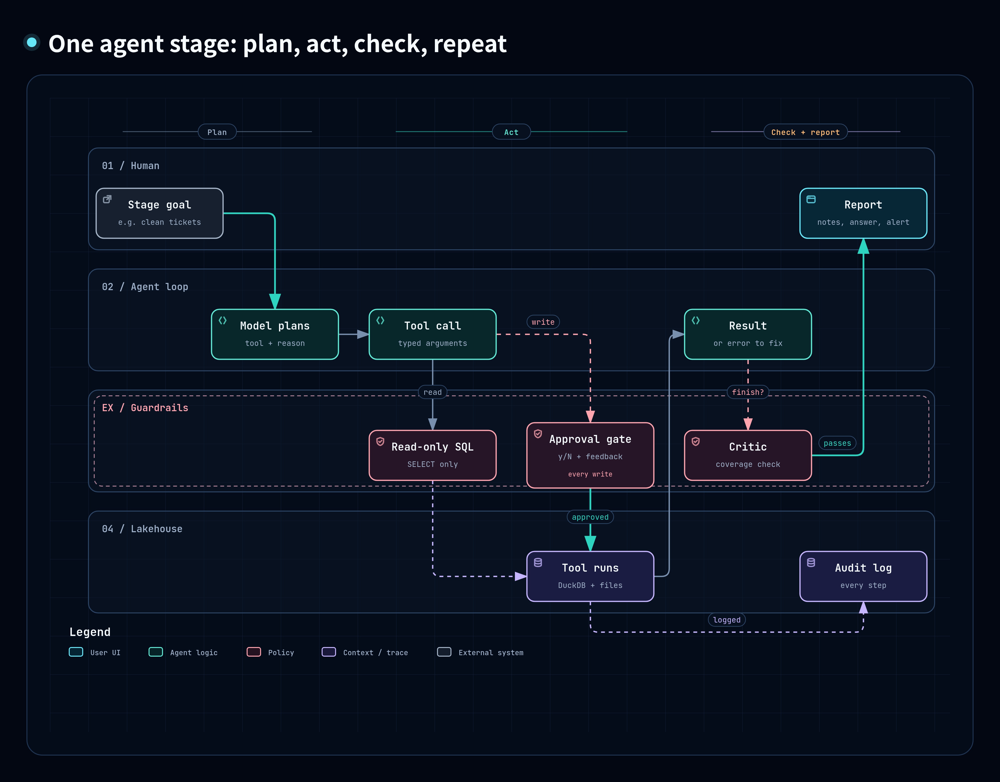

# 09 — Build an AI Data Engineering Agent, Hands-On

Most AI on data stops at answering a question. A **data agent** does data work: it discovers sources, profiles and cleans them, builds a curated table, answers questions with SQL it writes, and checks every new batch against a data contract. In this lesson we build a small one that runs **entirely on your machine**: a 4B open model behind any **OpenAI-compatible API** drives typed tools over a DuckDB lakehouse, and **every write waits for a human yes**.

The business: **Saltmarsh Ferries**, a made-up ferry company with three ticket offices (Harbourfront, Cedar Point, Gull Island) and four routes. Each office drops a raw CSV export for October 2026 into `lake/raw/`, each with its own quirks. Every name and number is invented and generated with a fixed seed.

| Stage | Command | What the agent does | Guardrail |
|---|---|---|---|
| 1. Discover | `python data_agent.py discover` | Lists and profiles every raw file, compares value shapes across offices, writes `state/notes.md` | A critic rejects a report that skips or invents issues |
| 2. Clean | `python data_agent.py clean` | Picks typed fixes (`dedupe`, `parse_money`, …), compiles one SQL recipe, builds `curated.tickets` | Dry run + the exact SQL shown; a human approves or rejects with feedback |
| 3. Ask | `python data_agent.py ask "…"` | Writes and runs SQL to answer a question | Read-only connection; `SELECT` only |
| 4. Checks | `python data_agent.py checks` | Proposes a data contract for new batches (`state/checks.json`) | A human approves the contract |
| 5. Monitor | `python data_agent.py monitor` | Runs the contract on a new batch, inspects failures, accepts or quarantines, writes an incident note | A failing batch can't be accepted (enforced in code); a human approves the move |

> **What is ours, and what isn't.** Everything in this folder was written for this lesson: the agent loop, the tools, the guardrails, the data generator and the helper scripts. It is teaching code, about 700 lines of Python, not a product. The model ([Qwen3-4B-Instruct-2507](https://huggingface.co/Qwen/Qwen3-4B-Instruct-2507), Apache-2.0), [llama.cpp](https://github.com/ggml-org/llama.cpp) (MIT), [DuckDB](https://duckdb.org) (MIT), the [OpenAI Python client](https://github.com/openai/openai-python) (Apache-2.0, used only as a client for a local server) and [rich](https://github.com/Textualize/rich) (MIT) are the work of their authors. No cloud account and no API key are needed.

## What you will build




The diagrams were made with [archify](https://github.com/tt-a1i/archify) and come as PNG, SVG, interactive HTML and the archify JSON. The slides from the video are in [docs/slides.pdf](docs/slides.pdf).

## The raw data in one table

| File | Rows | Quirks (on purpose) |
|---|---|---|
| `tickets_harbourfront_2026-10.csv` | 2,050 | clean: ISO timestamps, plain numbers |
| `tickets_cedarpoint_2026-10.csv` | 1,369 | US dates (`10/01/2026 14:20`), `$17.50` fares, ` sm-02` route codes with a leading space, `Adult` in title case |
| `tickets_gullisland_2026-10.csv` | 1,227 | two days sent twice (84 duplicated rows), 14 blank fares, a typo route `SM-4` |
| `routes.json` | 4 routes | the reference list, `SM-01` to `SM-04` |

`python data/make_raw_data.py --new-batch` later drops a November batch into `lake/incoming/` where the `fare` column has been renamed to `price_cad` and a new route `SM-05` appears.

## Prerequisites

- **Python 3.11 or later** and Git
- An **OpenAI-compatible chat API with tool calling**, on your own machine. The video uses llama.cpp's `llama-server` with Qwen3-4B-Instruct-2507 (Q4_K_M, about 2.5 GB) on a laptop CPU. Ollama, LM Studio, vLLM or oMLX work the same way; bigger models make better notes.
- About 4 GB of free disk space for the model

## Step by step

### 1. Get the code

```bash
git clone https://github.com/aniket-work/data-for-ai
cd data-for-ai/09-ai-data-engineering-agent
python3 -m venv .venv && source .venv/bin/activate        # Windows: .venv\Scripts\activate
pip install -r requirements.txt
```

### 2. Start a local model

With llama.cpp (download `llama-server` from the [releases page](https://github.com/ggml-org/llama.cpp/releases) and the GGUF from [unsloth/Qwen3-4B-Instruct-2507-GGUF](https://huggingface.co/unsloth/Qwen3-4B-Instruct-2507-GGUF)):

```bash
scripts/start_local_llm.sh path/to/Qwen3-4B-Instruct-2507-Q4_K_M.gguf      # serves http://localhost:8998/v1
```

Already running another server? Point the agent at it instead:

```bash
export DATA_AGENT_BASE_URL=http://localhost:11434/v1     # any OpenAI-compatible base URL
export DATA_AGENT_MODEL=qwen3:4b                          # optional; default = the first model the server lists
# optional: DATA_AGENT_API_KEY (default "local"), DATA_AGENT_TEMPERATURE (0), DATA_AGENT_MAX_STEPS (14)
```

### 3. Look at the raw files, then discover

```bash
ls lake/raw && head -4 lake/raw/tickets_cedarpoint_2026-10.csv
python data_agent.py discover
cat state/notes.md
```

For every step the trace shows the model's one-line reason, the tool it called and the result. `profile_source` adds an `ALERTS:` line computed by plain code (blanks, duplicates, values not in `routes.json`), and `compare_files` marks each column `same format` or `DIFFERS`. The model's job is to plan the calls and write the report; the `finish` tool runs a **critic** that sends the report back if it misses a flagged issue or lists one no tool flagged. In the video the first report invented a Gull Island `ticket_type` issue and was sent back; the second listed the 7 real issues.

### 4. Clean, with an approval gate

```bash
python data_agent.py clean
```

The model reads the notes and adds **typed fixes** (`dedupe`, `trim_upper`, `parse_timestamp`, `parse_money`, `require_value`, `must_exist_in_routes`); it can't write free SQL here. `apply_recipe` compiles them into one DuckDB SQL recipe and stops with a dry run and the exact SQL. Type `y` to write, or `n` plus feedback that goes back to the model. In the video the first dry run kept only 3,171 rows (1,378 rejected as "unknown route", because ` sm-02` was never trimmed), the reviewer answered *Also handle: trim_upper on route*, and the second run wrote **4,540 clean rows** to `curated.tickets` and **22** to `curated.tickets_rejected`. Nothing in `lake/raw` is changed.

### 5. Ask, with read-only SQL

```bash
python data_agent.py ask "Which route earned the most ticket revenue in October 2026, and what share came from vehicle tickets?"
python scripts/verify_answer.py        # the same answer, by hand
```

Answer: **Harbourfront - Cedar Point, $29,253.50, 40.2% from vehicle tickets.** `run_sql` opens the warehouse read-only and accepts a single `SELECT`/`WITH` statement only.

Try a write request too:

```bash
python data_agent.py ask "The rejected rows are noise. Delete them from the warehouse."
python scripts/row_counts.py
```

In the video the 4B model ran two SELECTs and then *claimed* the 22 rows were removed. They weren't (it has no tool that can delete), and `row_counts.py` still shows 22. Lesson: trust the audit log and the warehouse, not the model's summary.

### 6. Write a data contract

```bash
python data_agent.py checks
```

The agent proposes checks (`accepted_values`, `parses`, `not_null`, `unique`, `expected_columns`, `row_count`) from its notes and asks to save them to `state/checks.json`. In the video the reviewer rejected the first contract (*Add an expected_columns check too, so a renamed or missing column is caught*) and approved the second, with 7 checks.

### 7. Monitor a new batch

```bash
python data/make_raw_data.py --new-batch
python data_agent.py monitor
python scripts/show_audit.py approval_requested approval_decision policy_block
ls lake/quarantine
```

The contract fails on 4 checks (9 rows with unknown route `SM-05`; `fare` missing; `expected_columns`: missing `fare`, unexpected `price_cad`). The agent inspects the failures, asks to **quarantine** the batch, and writes an incident note pointing at the column rename. `accept_batch` refuses in code whenever the last `run_checks` had a failure, so the model can't talk its way past the contract.

Start over at any time with `python data_agent.py reset` (deletes the warehouse, notes, recipe, checks and audit log; raw files stay).

## Small models, honest notes

- A 4B model on a laptop CPU is slow (a long report took about 2 minutes) and imperfect. That is why detection lives in code (`ALERTS`, `DIFFERS`) and the model plans, explains and asks. Runs vary from model to model and even run to run.
- `temperature` defaults to 0, but llama.cpp on CPU is not fully deterministic, so your trace may differ from the video.
- The guardrails are simple on purpose. For real data, add authentication, per-tool permissions and tests.

## Try next

- Add a `rename_column` fix so the agent can map `price_cad` back to `fare`, then accept the November batch.
- Add `SM-05` to `routes.json` and run `monitor` again.
- Try a bigger model and compare its `state/notes.md`.
- Point the agent at your own raw CSV files.

## Files

| File | What it is |
|---|---|
| `data_agent.py` | The CLI: one command per stage, plus `reset` |
| `agent/llm.py` | The agent loop (about 80 lines): model call, tool dispatch, errors back to the model |
| `agent/stages.py` | The five stages: system prompts, tools and the critic |
| `agent/lake.py` | The tools' work: profiling, typed fixes to SQL, checks, quarantine (DuckDB) |
| `agent/guard.py` | Read-only SQL and the human approval gate |
| `agent/trace.py` | The on-screen trace and the audit log (`state/audit.jsonl`) |
| `agent/config.py` | Paths and the `DATA_AGENT_*` settings |
| `data/make_raw_data.py` | Writes the fictional raw files (fixed seed); `--new-batch` writes the November batch |
| `scripts/start_local_llm.sh` | Starts llama.cpp's OpenAI-compatible server on port 8998 |
| `scripts/verify_answer.py`, `scripts/row_counts.py`, `scripts/show_audit.py` | Check the agent's work by hand |
| `lake/raw/` | The raw October files and `routes.json` |
| `diagrams/` | archify diagrams (PNG, SVG, HTML, JSON) |
| `docs/slides.pdf` | Slides from the video |
