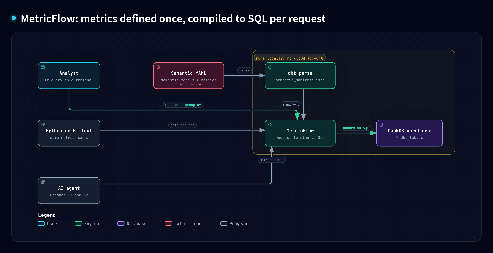
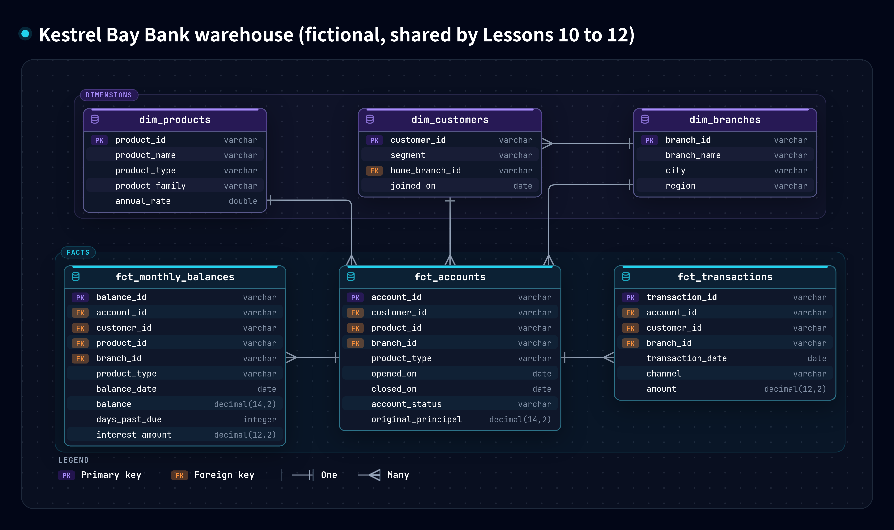

# 10 — Define Bank Metrics Once with MetricFlow, Hands-On

Every team needs the same few numbers, so every team writes its own SQL, and the numbers drift. In this lesson we fix that with **[MetricFlow](https://github.com/dbt-labs/metricflow)**, the open-source metrics engine from dbt Labs (Apache-2.0). We define a bank's metrics **once**, in YAML semantic models next to a dbt project, and query them by **region, product, customer segment and time**. MetricFlow compiles every request into SQL, and we read that SQL. Everything runs locally on **dbt-core + DuckDB**: no cloud account, no API key.

The business: **Kestrel Bay Bank**, a made-up retail bank with four regions, ten branches, 2,400 customers (IDs only) and six products. Every name and number is invented and generated with a fixed seed.

> **Part 1 of 3 on the same bank.** Lesson 11 points WrenAI at this warehouse to compare raw text-to-SQL with text-to-SQL on a semantic layer, and Lesson 12 serves the bank's semantic layer with Cube (SQL, REST, GraphQL, MCP) to an AI agent. The data, the dbt tables and the metric definitions here are designed to be reused there.

| Metric | Type | Definition (written once) |
|---|---|---|
| `total_deposits` | simple | deposit balances at the last month-end of the period (semi-additive) |
| `loan_book` | simple | outstanding loan balances at period end (semi-additive) |
| `delinquency_rate` | ratio | `delinquent_loans / loan_book`, 30+ days past due, by balance |
| `net_interest_income` | derived | `interest_income - interest_expense` |
| `nii_growth_mom` | derived + offset | NII vs the previous month (`offset_window: 1 month`) |
| `new_accounts`, `loan_originations`, `new_loans` | simple | accounts opened, loan principal at origination, loans opened |
| `avg_loan_size` | ratio | `loan_originations / new_loans` |
| `loan_originations_ytd` | cumulative | running total since January 1 (`grain_to_date: year`) |
| `active_customers` | cumulative | distinct customers with a transaction in the trailing 90 days |

Also `delinquent_loans`, `interest_income`, `interest_expense` and `transactions` (15 metrics in total), and a saved query `board_kpis_by_region`.

> **What is ours, and what isn't.** The data generator, the dbt models, the semantic models, the hand-written "drift" SQL and the helper scripts (`drift.py`, `check_consistency.py`, `show.py`) were written for this lesson as teaching code. [MetricFlow](https://github.com/dbt-labs/metricflow) and [dbt-core](https://github.com/dbt-labs/dbt-core) (Apache-2.0, dbt Labs), [dbt-duckdb](https://github.com/duckdb/dbt-duckdb) (Apache-2.0), [DuckDB](https://duckdb.org) (MIT) and [rich](https://github.com/Textualize/rich) (MIT) are the work of their authors.

## What you will build





The diagrams were made with [archify](https://github.com/tt-a1i/archify) and come as PNG, SVG, interactive HTML and the archify JSON. The slides from the video are in [docs/slides.pdf](docs/slides.pdf).

## The data in one table

| Raw file (`data/raw/`) | Rows | dbt table | What it holds |
|---|---|---|---|
| `regions.csv`, `branches.csv` | 4, 10 | `dim_branches` | branch, city, region (Atlantic, Central, Prairies, Pacific) |
| `products.csv` | 6 | `dim_products` | chequing, savings, 1-year GIC (deposit); mortgage, personal loan, business line of credit (loan) |
| `customers.csv` | 2,400 | `dim_customers` | segment (Retail, Premier, Small Business), home branch, joined date |
| `accounts.csv` | 6,792 | `fct_accounts` | product, branch, opened/closed dates, loan principal |
| `monthly_balances.csv` | 98,038 | `fct_monthly_balances` | month-end balance snapshot, days past due, the month's interest |
| `transactions.csv` | 150,888 | `fct_transactions` | date, channel, amount |

Months: January 2025 to October 2026. `metricflow_time_spine` is a daily spine for cumulative metrics and offsets.

## Prerequisites

- **Python 3.12** (3.11 also works) and Git
- About 300 MB of disk for the virtual environment
- The versions in `requirements.txt` were tested together in November 2026: `dbt-core==1.10.23`, `dbt-duckdb==1.11.1`, `dbt-metricflow==0.13.0`, `metricflow==0.211.0`, `duckdb==2.0.1`. Newer dbt-core 1.12 with dbt-metricflow 0.16 also ran, with noisier output.

## Step by step

### 1. Get the code and build the warehouse

```bash
git clone https://github.com/aniket-work/data-for-ai
cd data-for-ai/10-metricflow-banking-metrics
python3 -m venv .venv && source .venv/bin/activate        # Windows: .venv\Scripts\activate
pip install -r requirements.txt
python data/make_bank_data.py          # writes data/raw/*.csv (fixed seed)
cd bank_dbt
dbt build                              # 7 tables in ../warehouse/bank.duckdb + 12 key tests
```

`profiles.yml` sits in `bank_dbt/`, so `dbt` and `mf` find it when you run them from there. The sources read the CSV files directly through dbt-duckdb's `external_location`.

### 2. Read the definitions

```bash
python ../scripts/show.py models/semantic/balances.yml 35-56     # measures + non_additive_dimension
python ../scripts/show.py models/semantic/balances.yml 87-119    # ratio and derived metrics
python ../scripts/show.py models/semantic/accounts.yml 54-62     # cumulative, grain_to_date: year
python ../scripts/show.py models/semantic/transactions.yml 43-51 # cumulative, window: 90 days
```

Balances are **snapshots**: you can add them across accounts, products and regions, but not across months. Each balance measure has `non_additive_dimension: {name: balance_date, window_choice: max}`, so MetricFlow takes the last month-end in each period. Interest is a flow and adds up over time normally.

### 3. Validate and explore

```bash
mf validate-configs
mf list metrics
mf list dimensions --metrics delinquency_rate
```

`validate-configs` checks the YAML and then runs every definition against the warehouse. Expect **0 errors and 2 warnings**: dbt passes the cumulative metrics' input both as a measure and as a metric; MetricFlow ignores the extra one, and the results are correct.

### 4. Query by time and by slice

```bash
mf query --metrics total_deposits,loan_book,delinquency_rate,net_interest_income \
  --group-by metric_time__quarter --order metric_time__quarter \
  --start-time 2025-01-01 --end-time 2026-10-31 --decimals 4

OCT="--start-time 2026-10-01 --end-time 2026-10-31"
mf query --metrics delinquency_rate,net_interest_income --group-by branch__region $OCT --decimals 4
mf query --metrics delinquency_rate,net_interest_income --group-by customer__segment $OCT --decimals 4
mf query --metrics delinquency_rate,net_interest_income --group-by product__product_name $OCT --decimals 4

mf query --metrics active_customers,loan_originations_ytd,new_accounts --group-by metric_time__month \
  --order metric_time__month --start-time 2026-01-01 --end-time 2026-10-31 --decimals 0

mf query --metrics delinquency_rate,loan_book --group-by customer__segment \
  --where "{{ Dimension('branch__region') }} = 'Prairies'" $OCT --decimals 4
```

October 2026, from one definition: deposits **$468.0 M**, loan book **$484.4 M**, delinquency **2.03%**, net interest income **$830.7 K**, active customers **1,940**. Prairies is at 3.80% delinquent and Small Business at 5.25%.

Cumulative metrics need a time group-by (`metric_time__month`); without it MetricFlow refuses the query, by design.

### 5. See the generated SQL

```bash
mf query --metrics delinquency_rate --group-by branch__region $OCT --explain --quiet > ../sql/generated/delinquency_by_region.sql
python ../scripts/show.py ../sql/generated/delinquency_by_region.sql
```

The SQL applies the measure expressions, joins `dim_branches` through the `branch` entity, keeps only the latest `balance_date` in the window (an inner join on `MAX(balance_date)`), sums both sides of the ratio, and divides last. A copy from the video is in `sql/generated/`.

### 6. Hand-written SQL vs MetricFlow

```bash
python ../scripts/drift.py
mf query --metrics total_deposits,delinquency_rate,active_customers --group-by metric_time__month $OCT --decimals 4
python ../scripts/check_consistency.py
```

| Team (file in `sql/handwritten/`) | Asks for | What drifted | Their number | MetricFlow |
|---|---|---|---|---|
| Finance | Total deposits | sums every month-end snapshot | $3.74 B | $468.0 M |
| Branch operations | Delinquency rate | counts loans, not balances | 3.80% | 2.03% |
| Risk | Delinquency rate | only 90+ days past due | 0.44% | 2.03% |
| Marketing | Active customers | "has an open account" | 2,398 | 1,940 |

`check_consistency.py` asks MetricFlow for the same metrics with no group-by and then by region, product and segment, and shows that every slice adds back up: NII $830,691 and a 2.03% rate recomputed from the summed numerator and denominator, every time. Averaging the slice rates instead gives 1.92%, 3.94% or 3.10%.

### 7. Saved query

```bash
mf query --saved-query board_kpis_by_region $OCT --decimals 4
```

## Try next

- Add a `deposit_growth_mom` derived metric with an `offset_window`.
- Add a 90+ days past due rate as its own metric (that's what the risk team meant).
- Query loan originations by `product__product_family` and `customer__segment`.
- Write a saved query for your own report.

## Files

| File | What it is |
|---|---|
| `data/make_bank_data.py` | Writes the fictional raw CSV files (fixed seed 10) |
| `bank_dbt/dbt_project.yml`, `bank_dbt/profiles.yml` | The dbt project and a local DuckDB profile (`../warehouse/bank.duckdb`) |
| `bank_dbt/models/sources.yml` | Raw CSV sources via dbt-duckdb `external_location` |
| `bank_dbt/models/marts/*.sql`, `_marts.yml` | Six tables, the time spine and key tests |
| `bank_dbt/models/semantic/*.yml` | Six semantic models, 15 metrics and a saved query |
| `sql/handwritten/*.sql` | Four teams' hand-written queries that drift |
| `sql/generated/delinquency_by_region.sql` | SQL generated by `mf query --explain` |
| `scripts/drift.py`, `scripts/check_consistency.py`, `scripts/show.py` | Helpers used in the video |
| `diagrams/` | archify diagrams (PNG, SVG, HTML, JSON) |
| `docs/slides.pdf` | Slides from the video |
