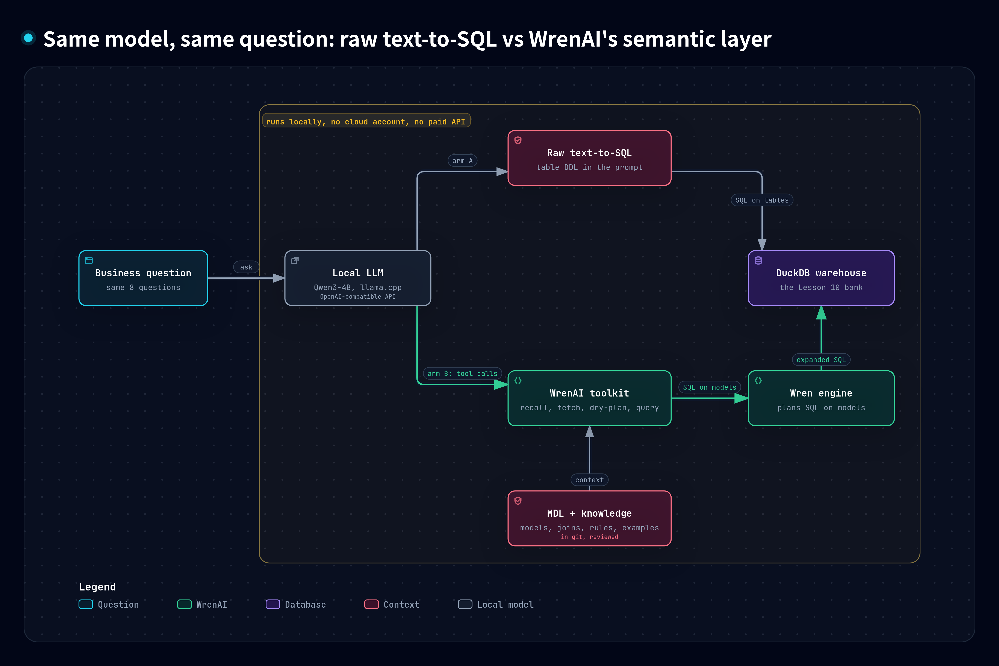

# 11 — Text-to-SQL That Knows the Business: WrenAI's Semantic Layer, Hands-On

Ask a model "what was net interest income by region last quarter?" and it will happily write SQL that runs and is wrong. The schema has the columns, but not the meaning. In this lesson we give the **same local model** the **same bank questions** two ways: once with only the raw table definitions, and once through **[WrenAI](https://github.com/Canner/WrenAI)**'s semantic layer (MDL models, relationships, calculated fields, business rules and example queries). Then we score both by **running their SQL** against the numbers from Lesson 10's MetricFlow definitions.

Everything runs locally: a small open model on a llama.cpp server, DuckDB, and the WrenAI engine from pip. No cloud account, no paid API key.

> **Part 2 of 3 on the same bank.** [Lesson 10](../10-metricflow-banking-metrics/) built Kestrel Bay Bank's warehouse and defined its metrics once with MetricFlow; this lesson reuses that warehouse (same generator, same seed) and uses the MetricFlow results as ground truth. [Lesson 12](../12-cube-semantic-layer-ai-agent/) serves the same bank through Cube to an AI agent, with access controls.

## The result

Same model (Qwen3-4B-Instruct-2507, Q4_K_M, on CPU), temperature 0, the same 10-request budget and the same "the data ends on 2026-10-31" note for every arm.

| # | Question | Raw (DDL only) | Raw + values | WrenAI (MDL + rules) |
|---|---|---|---|---|
| q1 | What was net interest income by region last quarter? | wrong | wrong | **correct** |
| q2 | What is the delinquency rate for small-business loans? | wrong | wrong | **correct** |
| q3 | How many active customers do we have? | wrong | wrong | **correct** |
| q4 | What were total deposits at the end of October 2026? | wrong | **correct** | **correct** |
| q5 | What were total deposits by product in Q3 2026? | wrong | wrong | **correct** |
| q6 | What is the delinquency rate in each region? | wrong | wrong | **correct** |
| q7 | How much have we originated in new loans year to date? | wrong | wrong | wrong |
| q8 | What is the average size of new mortgages opened in 2026? | wrong | wrong | wrong |
| | **Accuracy** | **0/8** | **1/8** | **6/8** |

What went wrong without the semantic layer (real SQL, saved in `eval/runs/`): net interest income summed one `interest_amount` column, adding interest paid on deposits to interest earned on loans; delinquency averaged days past due or counted rows across every month; "active customers" filtered on a status value that doesn't exist, or counted open accounts; deposits were looked up in transactions. Where WrenAI missed: q7 started "year to date" in 2025 although the rule says January 1 of the current year, and q8 averaged every loan instead of only mortgages. The semantic layer fixes definitions; a 4B model can still misread a time window or drop a filter.

> **What is ours, and what isn't.** The MDL project (`wren_bank/`), the eval questions, the harness (`t2s/`, `ask.py`) and the helper scripts were written for this lesson as teaching code. [WrenAI](https://github.com/Canner/WrenAI) (its engine is Apache-2.0, by Canner), [wren-pydantic](https://pypi.org/project/wren-pydantic/), [Pydantic AI](https://github.com/pydantic/pydantic-ai) (MIT), [DuckDB](https://duckdb.org) (MIT), [llama.cpp](https://github.com/ggml-org/llama.cpp) (MIT), [Qwen3](https://huggingface.co/Qwen/Qwen3-4B-Instruct-2507) (Apache-2.0), [sqlglot](https://github.com/tobymao/sqlglot) (MIT) and [rich](https://github.com/Textualize/rich) (MIT) are the work of their authors.

> **How WrenAI is run here.** WrenAI's older Docker "GenBI" app is now called *Wren GenBI Classic* and lives on the `legacy/v1` branch. The current open-source project ships the engine, CLI, MDL projects, knowledge and memory as a Python package (`pip install wrenai`) plus agent toolkits, so that is what this lesson uses. No Docker needed.

## What you will build



| Piece | Where | What it holds |
|---|---|---|
| MDL models | `wren_bank/models/*/metadata.yml` | 6 models over the Lesson 10 tables, every column described, allowed values listed |
| Relationships | `wren_bank/relationships.yml` | 8 MANY_TO_ONE joins (accounts, balances, transactions to customers, products, branches) |
| Calculated fields | in the models | `region`, `segment`, `product_name`, `deposit_balance`, `loan_balance`, `delinquent_loan_balance`, `interest_income`, `interest_expense`, `net_interest_income`, `loan_origination_amount` |
| Rules | `wren_bank/knowledge/rules/*.md` | metric definitions (same as the MetricFlow metrics), time rules, conventions |
| Example pairs | `wren_bank/knowledge/sql/*.md` | 3 approved question + SQL pairs, deliberately different from the test questions |

The three arms:

| Arm | What the model sees | Tools |
|---|---|---|
| `raw` | the table DDL | `run_sql` on a read-only DuckDB connection |
| `raw+` | DDL + 2 sample rows per table + the values of every low-cardinality text column | `run_sql` |
| `wren` | the WrenAI toolkit instructions + the rules files | `wren_recall_queries`, `wren_fetch_context`, `wren_list_models`, `wren_dry_plan`, `wren_query` |

`raw+` is there to keep the test fair: it shows how far plain schema hints get you before definitions matter.

**Scoring.** We never trust the model's prose. For each answer we take the last SQL that ran successfully, execute it ourselves, and compare it with `eval/ground_truth.json` (from `mf query` in Lesson 10): within 0.5% for amounts and counts, within 0.05 percentage points for rates (fraction or percent form). For a breakdown every expected row must match; a filtered question (one expected key) may answer with a single row.

The diagram comes as PNG, SVG, interactive HTML and JSON source. The slides from the video are in [docs/slides.pdf](docs/slides.pdf).

## Prerequisites

- **Python 3.12** and Git, about 2 GB of disk (torch, the embedding model and the LLM)
- The Lesson 10 warehouse (step 1 builds it)
- A local OpenAI-compatible model server. The video used [llama.cpp](https://github.com/ggml-org/llama.cpp)'s `llama-server` with `Qwen3-4B-Instruct-2507-Q4_K_M.gguf` (about 2.5 GB) on an 8-core CPU; a WrenAI question took 40 seconds to 4 minutes there, a raw one 5 to 50 seconds. Ollama, LM Studio or vLLM work too.
- Versions tested together in November 2026: `wrenai[memory]==0.18.0`, `wren-pydantic==0.3.1`, `pydantic-ai-slim[openai]==1.107.10`, `duckdb==2.0.1`.

## Step by step

### 1. Build the Lesson 10 warehouse

```bash
git clone https://github.com/aniket-work/data-for-ai
cd data-for-ai/10-metricflow-banking-metrics
python3 -m venv .venv && source .venv/bin/activate
pip install -r requirements.txt
python data/make_bank_data.py && (cd bank_dbt && dbt build)
deactivate
```

### 2. Install this lesson

```bash
cd ../11-wrenai-semantic-text-to-sql
python3 -m venv .venv && source .venv/bin/activate     # Windows: .venv\Scripts\activate
pip install torch --index-url https://download.pytorch.org/whl/cpu   # optional: small CPU-only torch
pip install -r requirements.txt
bash scripts/setup_wren.sh
```

`setup_wren.sh` adds a WrenAI profile pointing at `../10-metricflow-banking-metrics/warehouse` (DuckDB), then runs `wren context validate`, `wren context build` (writes `wren_bank/target/mdl.json`) and `wren memory index --no-seed` (embeds the models and the example pairs into a local LanceDB index; the first run downloads a small embedding model). Expect `Valid — 6 models, 0 views, 8 relationships.`

### 3. Start the local model

```bash
LLAMA_SERVER=/path/to/llama-server MODEL=/path/to/Qwen3-4B-Instruct-2507-Q4_K_M.gguf bash scripts/start_local_llm.sh
```

The harness reads `T2S_BASE_URL` (default `http://127.0.0.1:8999/v1`), `T2S_MODEL` (default: the first model the server lists) and `T2S_API_KEY` (default `local`). Point `T2S_BASE_URL` at any other OpenAI-compatible server to try a bigger model.

### 4. Look at the semantic model and the engine

```bash
python scripts/show.py wren_bank/models/monthly_balances/metadata.yml 94-117   # calculated fields
python scripts/show.py wren_bank/knowledge/rules/metrics.md                     # the business rules
python scripts/plan.py "SELECT region, SUM(net_interest_income) AS nii FROM monthly_balances WHERE balance_date BETWEEN '2026-07-31' AND '2026-09-30' GROUP BY region"
(cd wren_bank && wren --sql "SELECT region, SUM(delinquent_loan_balance) / SUM(loan_balance) AS rate FROM monthly_balances WHERE balance_date = DATE '2026-10-31' GROUP BY region")
```

`plan.py` runs `wren dry-plan` and shows how SQL written on the business model becomes DuckDB SQL: the join to branches through the relationship and the CASE expression that subtracts deposit interest.

### 5. Ask questions, raw and with WrenAI

```bash
python ask.py raw  "What was net interest income by region last quarter?"
python ask.py raw+ "What was net interest income by region last quarter?"
python ask.py wren "What was net interest income by region last quarter?"
```

Each run prints every tool call, the final SQL and the answer.

### 6. Run the evaluation and compare

```bash
python ask.py eval all                       # 8 questions x 3 arms -> eval/runs/<arm>.json (resumable)
python scripts/scoreboard.py                 # runs every final SQL and scores it -> eval/scoreboard.json
python scripts/side_by_side.py q3 raw raw+ wren
python scripts/side_by_side.py q6
```

The runs from the video are already in `eval/runs/`, so `scoreboard.py` and `side_by_side.py` work right after step 2. Small models are not perfectly deterministic across machines and builds, so your own run can differ by a question or two. `scripts/ground_truth.py` regenerates `eval/ground_truth.json` with `mf query` from Lesson 10 (run it with Lesson 10's environment).

## Try next

- Add a rule for the 90+ days past due rate, and a question that needs it.
- Add an example pair for "year to date", re-run `wren memory index --no-seed`, and re-score q7.
- Point `T2S_BASE_URL` at a bigger model and watch the raw and WrenAI scores move.
- Write your own questions in `eval/questions.yml` with an `mf` spec for the ground truth.

## Files

| File | What it is |
|---|---|
| `wren_bank/wren_project.yml` | The WrenAI MDL project (schema v5, DuckDB, profile `kestrel_bay_bank`) |
| `wren_bank/models/*/metadata.yml`, `wren_bank/relationships.yml` | Six models, calculated fields, descriptions, eight relationships |
| `wren_bank/knowledge/rules/*.md`, `wren_bank/knowledge/sql/*.md` | Business rules and three example question + SQL pairs |
| `t2s/config.py` | Paths and `T2S_*` settings, shared notes for every arm |
| `t2s/arms.py` | The three arms: raw, raw + values, WrenAI toolkit |
| `t2s/trace.py`, `t2s/score.py` | Live trace of tool calls; scoring by executing SQL |
| `ask.py` | Ask one question in one arm, or run the eval |
| `eval/questions.yml`, `eval/ground_truth.json`, `eval/runs/`, `eval/scoreboard.json` | Questions, MetricFlow truth, the runs from the video, the scores |
| `scripts/setup_wren.sh`, `scripts/start_local_llm.sh` | Profile + build + memory; the local model server |
| `scripts/plan.py`, `scripts/scoreboard.py`, `scripts/side_by_side.py`, `scripts/show.py`, `scripts/ground_truth.py` | Helpers used in the video |
| `diagrams/` | Diagrams (PNG, SVG, HTML, JSON) |
| `docs/slides.pdf` | Slides from the video |
