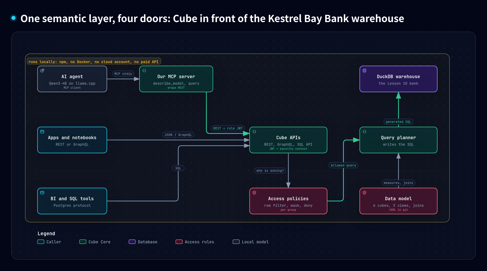

# 12 — Cube Semantic Layer: A Local AI Agent over MCP That Respects Access

Every dashboard, app, notebook and AI agent that talks to your warehouse ends up re-implementing two things: **the metrics** ("what is delinquency rate?") and **the permissions** ("which regions may this person see?"). In this lesson we put Kestrel Bay Bank behind **[Cube Core](https://github.com/cube-js/cube)**, the open-source semantic layer, and define both once: cubes, views, measures, dimensions and joins, plus **access policies** with row-level security per region and member masking. Then we serve that one model over the **SQL API, REST and GraphQL**, and to a **local AI agent over MCP**.

Everything runs locally: Cube from npm (no Docker) with DuckDB, a small open model on a llama.cpp server. No cloud account, no paid API key.

> **Part 3 of 3 on the same bank, and the end of the series.** [Lesson 10](../10-metricflow-banking-metrics/) built Kestrel Bay Bank's warehouse and defined its metrics with MetricFlow (the ground truth here). [Lesson 11](../11-wrenai-semantic-text-to-sql/) asked the same bank questions through WrenAI with the same local model. This lesson reuses that warehouse (same generator, same seed) and the same eight questions.

## The result

**Access control, through every API and through the agent.** The same query sent with three security contexts:

| Role (security context) | Delinquency + deposits by region | Customer IDs (loan originations) | Agent asks "net interest income by region" |
|---|---|---|---|
| `exec` (group `executive`) | all 4 regions | real IDs | answers, all 4 regions |
| `prairies_mgr` (group `regional_manager`, region Prairies) | **only Prairies** (3.80%) | **masked** `CUST-****`, Prairies only | — (asked "delinquency in each region": one row, Prairies 3.80%) |
| `marketing` (group `marketing`) | **denied** delinquency (hidden member); deposits by region allowed | **denied** (no lending access) | **refused**: hidden member, and the agent says so |

**Bank questions, through the agent.** The eight Lesson 11 questions, asked by a Pydantic AI agent on the same local model (Qwen3-4B-Instruct-2507, Q4_K_M, CPU, temperature 0) as the executive role, scored on the rows Cube returned against the Lesson 10 MetricFlow numbers:

| # | Question | Cube over MCP |
|---|---|---|
| q1 | What was net interest income by region last quarter? | **correct** |
| q2 | What is the delinquency rate for small-business loans? | **correct** |
| q3 | How many active customers do we have? | **correct** |
| q4 | What were total deposits at the end of October 2026? | **correct** |
| q5 | What were total deposits by product in Q3 2026? | **correct** |
| q6 | What is the delinquency rate in each region? | **correct** |
| q7 | How much have we originated in new loans year to date? | wrong |
| q8 | What is the average size of new mortgages opened in 2026? | **correct** |
| | **Accuracy** | **7/8** (Lesson 11, same model: raw schema 0/8, WrenAI 6/8) |

q7: the agent split year-to-date originations by segment and added the total up wrong (223,997,982 instead of 224,027,982).

> **How we got to 7/8, honestly.** The first development run scored 6/8. We then made `period` a required argument of the MCP `query` tool (the model handled date ranges badly), clamped running periods such as "2026" to the last day of data, added a guard in `agent/ask.py` that retries once when the model answers without a query result behind it, added a `loan_originations_ytd` measure and allowed-value lists in the descriptions, and fixed a rate-tolerance bug in our own scorer. The 7/8 run is the one in `eval/scoreboard.json`. Small models are not perfectly deterministic across machines, so your run can differ by a question.

> **What is ours, and what isn't.** The Cube model and policies (`cube/`), the MCP server, the agent and the eval harness (`agent/`) and the helper scripts were written for this lesson as teaching code. [Cube](https://github.com/cube-js/cube) (Apache-2.0, by Cube Dev), the [MCP Python SDK](https://github.com/modelcontextprotocol/python-sdk) (MIT), [Pydantic AI](https://github.com/pydantic/pydantic-ai) (MIT), [DuckDB](https://duckdb.org) (MIT), [llama.cpp](https://github.com/ggml-org/llama.cpp) (MIT), [Qwen3](https://huggingface.co/Qwen/Qwen3-4B-Instruct-2507) (Apache-2.0) and [rich](https://github.com/Textualize/rich) (MIT) are the work of their authors.

> **How MCP is run here.** Cube's own MCP server is part of Cube Cloud (hosted, OAuth sign-in). To stay fully local, `agent/cube_mcp_server.py` is a small MCP server of our own (about 90 lines, built on the official MCP Python SDK) with two tools, `describe_model` and `query`, that call Cube Core's REST API with a JWT signed for one role. The agent never writes SQL and never sees a token.

## What you will build



| Piece | Where | What it holds |
|---|---|---|
| Cubes | `cube/model/cubes/*.yml` | 6 cubes over the Lesson 10 marts (all `public: false`), 13 measures, joins `many_to_one` to branches, products and customers |
| Views | `cube/model/views/*.yml` | `balance_sheet`, `lending`, `customer_activity`: what callers query, each with an `access_policy` |
| Access policies | in the views | `executive`: everything. `regional_manager`: `row_level` filter `region = securityContext.region`, `customer_id` masked. `marketing`: deposits by region, product and segment; customer activity with masked IDs; no lending |
| Security context | `cube/cube.js`, `cube/roles.json` | `contextToGroups` maps the JWT payload to policy groups; `checkSqlAuth` maps a SQL login user to a context |
| Snapshot rule | `cube/cube.js` (`queryRewrite`) | balances are month-end snapshots: a point-in-time measure over a range is read at its last month-end, and with no range Cube refuses with a reason |
| MCP server | `agent/cube_mcp_server.py` | `describe_model()` (from `/v1/meta`, per role) and `query(measures, period, dimensions, filters)` (via `/v1/load`) |
| Agent | `agent/ask.py`, `agent/eval.py` | Pydantic AI + local LLM over MCP stdio; the 8-question evaluation |

Measures: `total_deposits`, `loan_book`, `delinquent_loans`, `delinquency_rate`, `interest_income`, `interest_expense`, `net_interest_income` (balances); `new_loans`, `loan_originations`, `loan_originations_ytd`, `avg_loan_size` (accounts); `transaction_count`, `active_customers` (transactions, 90-day rolling window).

**Scoring.** We never trust the model's prose. For each question we take the rows of the last successful `query` call and compare them with `eval/ground_truth.json` (from `mf query` in Lesson 10): within 0.5% for amounts and counts, within 0.05 percentage points for rates. For a breakdown every expected row must match.

The diagram comes as PNG, SVG, interactive HTML and JSON source. The slides from the video are in [docs/slides.pdf](docs/slides.pdf).

## Prerequisites

- **Node.js 20 or newer** (tested with Node 24) and npm, **Python 3.12**, Git, `openssl`, about 1.5 GB of disk (Cube's npm packages and the LLM)
- The Lesson 10 warehouse (step 1 builds it)
- A local OpenAI-compatible model server. The video used [llama.cpp](https://github.com/ggml-org/llama.cpp)'s `llama-server` with `Qwen3-4B-Instruct-2507-Q4_K_M.gguf` (about 2.5 GB) on an 8-core CPU; one agent question took 20 to 60 seconds there. Ollama, LM Studio or vLLM work too.
- Versions tested together in November 2026: `@cubejs-backend/server` and `@cubejs-backend/duckdb-driver` 1.8.31, `mcp==1.30.0`, `pydantic-ai-slim[openai,mcp]==1.107.10`.
- Optional: `psql`, to talk to Cube's SQL API by hand.

## Step by step

### 1. Build the Lesson 10 warehouse

```bash
git clone https://github.com/aniket-work/data-for-ai
cd data-for-ai/10-metricflow-banking-metrics
python3 -m venv .venv && source .venv/bin/activate
pip install -r requirements.txt
python data/make_bank_data.py && (cd bank_dbt && dbt build)
deactivate
```

### 2. Install this lesson

```bash
cd ../12-cube-semantic-layer-ai-agent
python3 -m venv .venv && source .venv/bin/activate     # Windows: .venv\Scripts\activate
pip install -r requirements.txt
python scripts/make_warehouse.py      # copies the 6 marts into warehouse/bank.duckdb
bash scripts/setup_cube.sh            # npm install + cube/.env with fresh random secrets
```

`make_warehouse.py` exists because Lesson 10 writes its DuckDB file with duckdb 2.x, while Cube 1.8's Node DuckDB driver bundles duckdb 1.5; the copy is written with `STORAGE_VERSION 'v1.2.0'`, which both read. `setup_cube.sh` runs `npm install` and `npm rebuild @cubejs-backend/native` (npm 11 may skip install scripts; `cube/package.json` allow-lists the two Cube packages that need one), then writes `cube/.env` from `cube/.env.example` with a random `CUBEJS_API_SECRET` and `CUBEJS_SQL_PASSWORD`. Keep `.env` private; it is git-ignored.

### 3. Start Cube

```bash
scripts/cube_up.sh          # background, logs to cube.log; stop with: pkill -f cubejs-server
# or, in the foreground:  scripts/start_cube.sh
```

Cube runs in production mode (`CUBEJS_DEV_MODE=false`): no playground, every REST and GraphQL call needs a JWT, and the model is not hot-reloaded, so restart Cube after you edit it. REST and GraphQL listen on `http://localhost:4000`, the SQL API (Postgres wire protocol) on port `15432`.

### 4. One model, three APIs

```bash
python scripts/rest_demo.py        # POST /cubejs-api/v1/load: Oct 2026 deposits, loan book, delinquency
python scripts/graphql_demo.py     # /cubejs-api/graphql: Q3 2026 net interest income by region
python scripts/sql_demo.py         # SQL API: MEASURE(delinquency_rate) by region, as user exec
```

All three return the Lesson 10 numbers (October 31, 2026 deposits 468,047,328.77). By hand:

```bash
PGPASSWORD=$(grep -m1 '^CUBEJS_SQL_PASSWORD=' cube/.env | cut -d= -f2) \
  psql -h localhost -p 15432 -U prairies_mgr cube \
  -c "SELECT region, MEASURE(delinquency_rate) FROM balance_sheet WHERE snapshot_date >= '2026-10-01' AND snapshot_date < '2026-11-01' GROUP BY 1"
```

### 5. Access control

```bash
python scripts/access_demo.py region      # one query, three security contexts: rows filtered, member denied
python scripts/access_demo.py customers   # customer_id: real, masked, denied
python scripts/sql_demo.py prairies_mgr   # the same policies over the SQL API
python scripts/sql_demo.py marketing
```

### 6. Start the local model and ask the agent

```bash
LLAMA_SERVER=/path/to/llama-server MODEL=/path/to/Qwen3-4B-Instruct-2507-Q4_K_M.gguf bash scripts/start_local_llm.sh
```

```bash
python agent/ask.py "What was net interest income by region last quarter?"
python agent/ask.py --role prairies_mgr "What is the delinquency rate in each region?"
python agent/ask.py --role marketing "What was net interest income by region last quarter?"
```

Each run prints every MCP tool call and result, then the answer. The agent reads `AGENT_BASE_URL` (default `http://127.0.0.1:8999/v1`), `AGENT_MODEL` (default: the first model the server lists) and `AGENT_API_KEY` (default `local`); point `AGENT_BASE_URL` at any other OpenAI-compatible server to try a bigger model. The MCP server reads `CUBE_ROLE` (set by `ask.py --role`), `CUBE_URL` (default `http://localhost:4000`) and `BANK_DATA_END` (default `2026-10-31`).

To use the MCP server from another MCP client, run it over stdio:

```json
{ "command": "python", "args": ["agent/cube_mcp_server.py"], "env": { "CUBE_ROLE": "prairies_mgr" } }
```

### 7. Run the evaluation

```bash
python agent/eval.py              # 8 questions as exec -> eval/scoreboard.json (or: python agent/eval.py q1 q6)
python scripts/scoreboard.py      # the table from the video
```

The run from the video is already in `eval/scoreboard.json`, so `scoreboard.py` works right after step 2.

## Try next

- Add a question for `central_mgr` and check that the agent only ever sees Central.
- Mask another member (for example `segment` for marketing) and watch the agent's answers change.
- Add a measure (say, a 90+ days past due rate), restart Cube, and re-run `agent/eval.py`.
- Point `AGENT_BASE_URL` at a bigger model and see whether q7 comes right.

## Files

| File | What it is |
|---|---|
| `cube/package.json`, `cube/package-lock.json` | Cube Core 1.8.31 + DuckDB driver from npm |
| `cube/.env.example` | Cube settings (DuckDB path, production mode, SQL API port); `setup_cube.sh` copies it to `.env` and adds secrets |
| `cube/cube.js` | `contextToGroups`, `checkSqlAuth`, `queryRewrite` (the snapshot rule) |
| `cube/roles.json` | The four demo roles and their security contexts |
| `cube/model/cubes/*.yml`, `cube/model/views/*.yml` | Six cubes, three views with access policies |
| `agent/cube_client.py` | Signs a JWT per role; REST `load`/`meta`, GraphQL and SQL API helpers |
| `agent/cube_mcp_server.py` | The MCP server: `describe_model` and `query` |
| `agent/ask.py`, `agent/eval.py` | The agent (one question, any role) and the 8-question evaluation |
| `eval/questions.yml`, `eval/ground_truth.json`, `eval/scoreboard.json` | Questions and MetricFlow truth (from Lesson 11), the scores from the video |
| `scripts/make_warehouse.py`, `scripts/setup_cube.sh`, `scripts/cube_up.sh`, `scripts/start_cube.sh`, `scripts/start_local_llm.sh` | Warehouse copy, install, start Cube, start the local model |
| `scripts/rest_demo.py`, `scripts/graphql_demo.py`, `scripts/sql_demo.py`, `scripts/access_demo.py`, `scripts/scoreboard.py`, `scripts/show.py` | Helpers used in the video |
| `diagrams/` | Diagrams (PNG, SVG, HTML, JSON) |
| `docs/slides.pdf` | Slides from the video |
