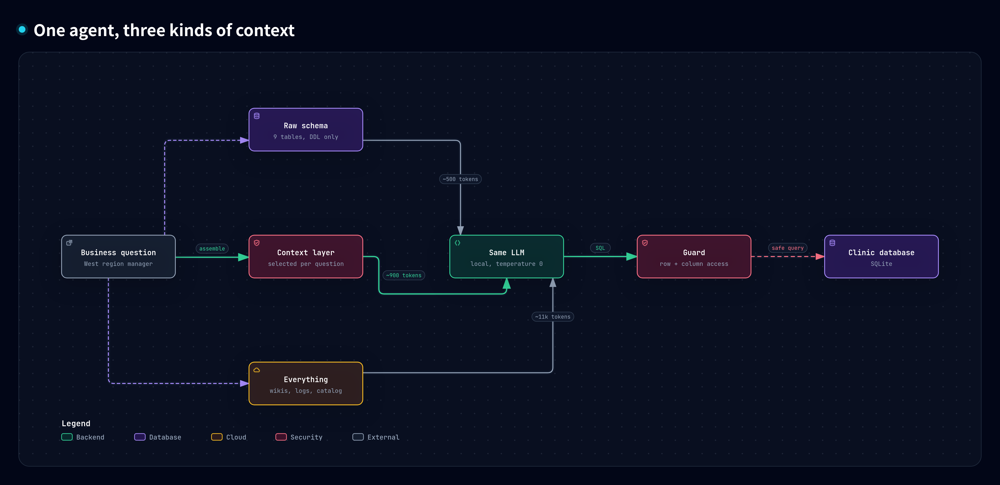
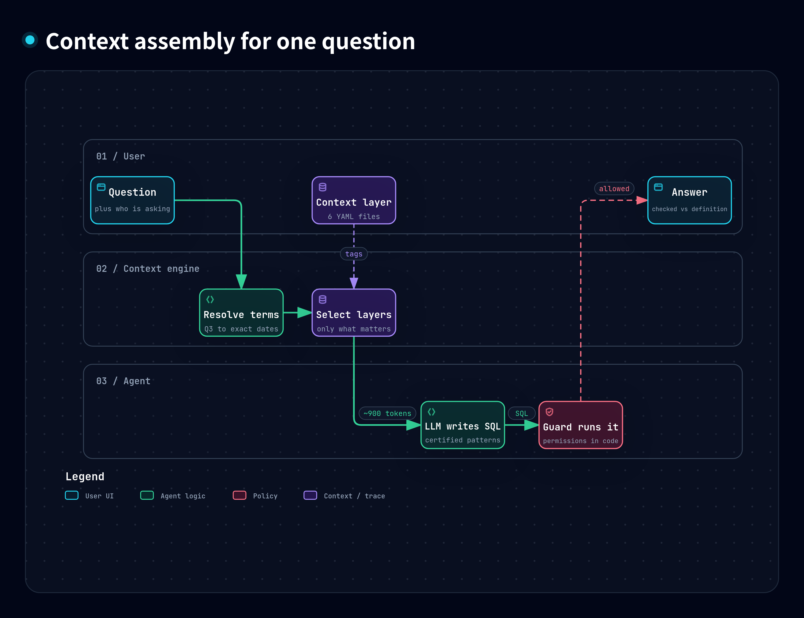

# 13 — Why Your AI Agent Doesn't Understand Your Business: The Context Engineering Problem

An agent that can read every table in your database can still get your business wrong. The schema says `tot_amt_c INTEGER`; it doesn't say "cents, including 13% sales tax". This lesson gives **one real, local LLM** the same five business questions three ways and grades every answer:

| Run | What the agent sees | Correct | What went wrong | Prompt tokens per question |
|---|---|---|---|---|
| `raw` | The database schema (DDL) only | **0 / 5** | 3 wrong, 2 policy violations (East clinics shown to a West manager; client names returned) | ~500 |
| `curated` | A small business context layer, assembled per question, and a guard that enforces access in code | **5 / 5** | none | ~860 |
| `polluted` | Everything: full schema, the whole context layer, stale wikis, a warehouse catalog, old chat logs and meeting notes | **2 / 5** | followed a 2023 wiki's revenue definition, invented a date filter, treated a metric name as a table | ~11,400 |

Model: [Qwen2.5-Coder-3B-Instruct](https://huggingface.co/Qwen/Qwen2.5-Coder-3B-Instruct-GGUF) (Q4_K_M, open weights) on a local [llama.cpp](https://github.com/ggml-org/llama.cpp) server, CPU only, temperature 0. No cloud account, no API key. On the recording machine a curated answer took about 5 to 20 s and a polluted one about 60 to 120 s.

> **Honest notes.** Every answer in [runs/](runs/) is real model output, graded by the transparent code in `ce_agent.py` against certified queries. Small local models are not perfectly repeatable even at temperature 0: across our runs the raw agent's individual mistakes changed (for example which quarter it picked), but it never scored above 0/5, and the curated run scored 5/5 every time. Your run can differ by a question. While building the curated layer we added two things after seeing failures, and they are part of the lesson: a **term resolver** (the model kept mapping "Q3" to the wrong months) and **"most specific metric only"** selection (pulling in every revenue metric confused it).

> **What is ours.** `ce_agent.py`, `guard.py`, the YAML formats in `context/` and the grader are teaching code written for this lesson, not a product or a standard. Brightpaw, its clinics, clients, pets and numbers are invented; phone numbers use the fictional 555-01xx range.

## What you will build





Diagrams made with [archify](https://github.com/tt-a1i/archify) (PNG, SVG, interactive HTML and the archify JSON). The slides from the video are in [docs/slides.pdf](docs/slides.pdf).

## The business: Brightpaw Veterinary Clinics (fictional)

Six clinics in two regions (West: CL-01..03, East: CL-04..06), one SQLite database with deliberately realistic, cryptic columns: `clinic`, `client`, `patient`, `appt`, `item`, `inv_hdr`, `inv_line`, `pmt`, `rfnd`. Every question is asked **as the West region manager**.

| # | Question | The trap |
|---|---|---|
| Q1 | What was our net revenue for each clinic in Q3 2026? | amounts in cents, totals include tax, voided invoices, refunds, migration duplicates, West only |
| Q2 | How many active patients do we have? | "active" = alive and a completed visit in the last 18 months |
| Q3 | Which clinic had the highest no-show rate in Q3 2026? | late cancels (`LCN`) count as no-shows |
| Q4 | Which clients owe us more than $300? List them so the front desk can call them. | no names or phone numbers; payments are many per invoice (fan-out) |
| Q5 | Did dental revenue grow from Q2 to Q3 2026? | the dental code changed from `DENT` to `DNT` on July 1 |

## The context layer: six kinds of business context

| Layer | File | Example |
|---|---|---|
| Business definitions | [context/glossary.yaml](context/glossary.yaml) | `net_revenue` with a certified SQL pattern; the fiscal calendar |
| Relationships | [context/relationships.yaml](context/relationships.yaml) | `pmt.inv_id -> inv_hdr.inv_id`: many payments per invoice, aggregate first |
| Metadata | [context/columns.yaml](context/columns.yaml) | `appt.status_cd`: CMP, CNL, LCN (late cancel), NSH |
| Policies | [context/policies.yaml](context/policies.yaml) | POL-PII-01: client IDs only, never names or phone numbers |
| Permissions | [context/permissions.yaml](context/permissions.yaml) | `west_manager` sees CL-01..03 |
| Relevant history | [context/history.yaml](context/history.yaml) | DEC-14 dental code rename, QRK-07 August migration duplicates |

For each question `ce_agent.py` **resolves** vague terms (Q3 2026 → exact dates), **selects** only the matching items by tag, adds the DDL of the relevant tables, and sends that (about 500 to 1,200 tokens) to the model. The generated SQL then runs through [guard.py](guard.py), which opens the database read-only and shadows every table with a temp view filtered to the role's clinics, with client names and phone numbers removed. Policies are enforced in code, not just requested in the prompt.

The `polluted` run adds [context/_dump/](context/_dump/), built by `build_noise.py`: what teams often paste into a prompt "just in case", including stale definitions that contradict the glossary.

## Prerequisites

- Python 3.11 or later and Git
- A local model behind an OpenAI-compatible API. The video uses llama.cpp's `llama-server` with `qwen2.5-coder-3b-instruct-q4_k_m.gguf` (about 2 GB). Ollama, LM Studio or vLLM also work: set `LLM_BASE_URL` (default `http://127.0.0.1:8089/v1`) and `LLM_MODEL`.

## Step by step

### 1. Get the code and build the data

```bash
git clone https://github.com/aniket-work/data-for-ai
cd data-for-ai/13-context-engineering-for-ai-agents
python -m venv .venv && source .venv/bin/activate        # Windows: .venv\Scripts\activate
pip install -r requirements.txt
python build_db.py        # data/brightpaw.db (seeded, same numbers every time)
python build_noise.py     # context/_dump/ for the pollution run
```

### 2. Start a local model

```bash
# download qwen2.5-coder-3b-instruct-q4_k_m.gguf from Hugging Face, then:
llama-server -m qwen2.5-coder-3b-instruct-q4_k_m.gguf --port 8089 -c 16384 --temp 0
```

### 3. See what each agent gets

```bash
python ce_agent.py schema          # the raw agent's whole world (~300 tokens of DDL)
python ce_agent.py context 5       # the curated context assembled for Q5, layer by layer
python ce_agent.py guard           # rows and columns the West manager's agent can see
```

### 4. Ask, compare, score

```bash
python ce_agent.py ask 4 --mode raw        # streams the model's SQL, runs it, grades it
python ce_agent.py ask 4 --mode curated
python ce_agent.py run --mode raw          # all five questions, saved to runs/
python ce_agent.py run --mode curated
python ce_agent.py run --mode polluted     # slow: ~11k tokens per question
python ce_agent.py compare                 # raw vs curated, side by side
python ce_agent.py compare --detail --q 1 --modes curated polluted
python ce_agent.py pollution               # curated vs polluted, tokens and seconds
python ce_agent.py scorecard
```

## Try it yourself

- Add a metric (for example average invoice value) to `glossary.yaml` and a sixth question to `questions.yaml`.
- Add a policy and a matching rule in `guard.py`, then try to make the agent break it.
- Swap in a bigger or smaller model and see how much the curated context matters.
- Move the glossary to the end of the polluted prompt, or remove the stale wiki, and watch the score change.

## Related lessons

- [05 Context layers for AI agents](../05-context-layers-for-ai/): a context graph across data, semantics, governance and memory.
- [11 Text-to-SQL with WrenAI](../11-wrenai-semantic-text-to-sql/) and [12 Cube semantic layer](../12-cube-semantic-layer-ai-agent/): the same raw-vs-semantic idea with real semantic-layer products.

## Credits

[llama.cpp](https://github.com/ggml-org/llama.cpp) (MIT), [Qwen2.5-Coder](https://huggingface.co/Qwen/Qwen2.5-Coder-3B-Instruct) (Qwen team), [rich](https://github.com/Textualize/rich) (MIT), [PyYAML](https://pyyaml.org/) (MIT), SQLite (public domain) and [archify](https://github.com/tt-a1i/archify) are the work of their authors.
