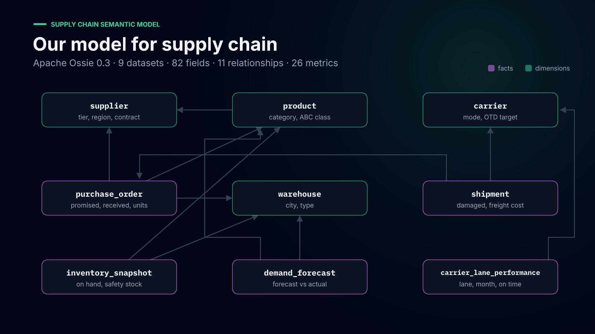
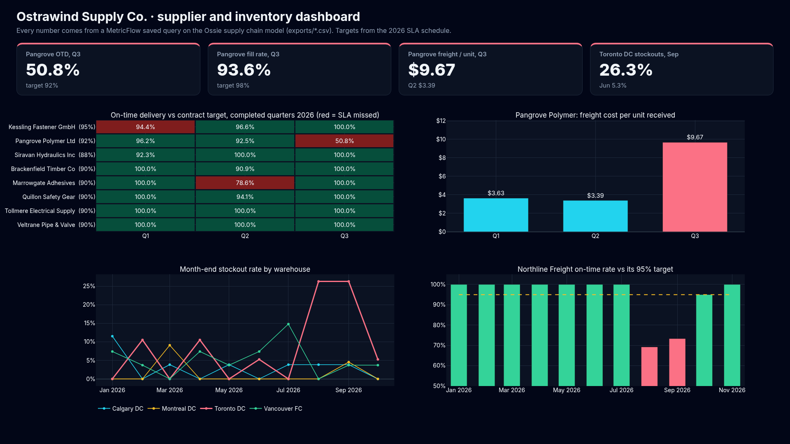

# 19 · Supply Chain Semantic Model with dbt MetricFlow

Our Apache Ossie semantic model for supply chain, consumed with **dbt MetricFlow**: metric queries by dimension and time, saved queries with exports, a dashboard built only from MetricFlow output, and a local AI agent that answers *"Did Pangrove breach its SLA last quarter, and why?"* from the metrics plus the contract and incident documents.

Everything runs locally: Python, DuckDB, dbt and, for the agent, llama.cpp with a small open model. No API keys.

> Ostrawind Supply Co., its suppliers, carriers, contracts and incidents are **fictional**.





## What's in the folder

| Path | What it is |
| --- | --- |
| `model/ostrawind_supply_chain.ossie.yaml` | The semantic model (Apache Ossie 0.3): 9 datasets, 82 fields, 11 relationships, 26 metrics, plus `ai_context` for agents |
| `data/make_data.py` | Generates the fictional data (seed 19) into `data/csv/` and `warehouse/ostrawind.duckdb` |
| `docs/` | Supply agreement CTR-PGV-2025, the 2026 SLA schedule, two incident reports, an inventory policy |
| `scripts/ossie_to_dbt.py` | Teaching converter: Ossie YAML to dbt sources, thin views and MetricFlow semantic models |
| `ostrawind_dbt/` | The dbt project (DuckDB), time spine and five saved queries |
| `scripts/verify_metrics.py` | Recompiles every Ossie metric to plain SQL and compares it with MetricFlow, month by month |
| `scripts/export_saved_queries.py` | Runs the saved queries into `exports/*.csv` |
| `scripts/dashboard.py` | Builds `dashboard/index.html` (Plotly) from the exports and the SLA schedule |
| `scripts/agent.py` | Local agent with two tools: `query_metrics` (MetricFlow CLI) and `search_documents`, plus a numeric fact check |
| `scripts/show.py` | Pretty-prints a line range of a file (used in the video) |
| `diagrams/` | Slides from the video (PDF) and key diagrams |

## Run it

```bash
python -m venv venv && source venv/bin/activate      # Python 3.12 tested
pip install -r requirements.txt

python data/make_data.py
python scripts/ossie_to_dbt.py model/ostrawind_supply_chain.ossie.yaml ostrawind_dbt
cd ostrawind_dbt
export DBT_PROFILES_DIR=.
dbt build
mf validate-configs

# metrics by supplier, last quarter
mf query --metrics on_time_delivery_rate,fill_rate --group-by supplier__supplier_name \
  --start-time 2026-07-01 --end-time 2026-09-30 --order on_time_delivery_rate

# one supplier by quarter (single hop, then two hops through the purchase order)
mf query --metrics on_time_delivery_rate,fill_rate,purchase_value --group-by metric_time__quarter \
  --start-time 2026-01-01 --end-time 2026-09-30 --order metric_time__quarter \
  --where "{{ Dimension('supplier__supplier_name') }} = 'Pangrove Polymer Ltd'"
mf query --metrics damage_rate,freight_cost_per_unit --group-by metric_time__quarter \
  --start-time 2026-01-01 --end-time 2026-09-30 --order metric_time__quarter \
  --where "{{ Dimension('supplier__supplier_name', entity_path=['purchase_order']) }} = 'Pangrove Polymer Ltd'"

# see the SQL MetricFlow writes
mf query --metrics on_time_delivery_rate --group-by supplier__supplier_name --explain

mf list saved-queries
python ../scripts/export_saved_queries.py
python ../scripts/dashboard.py            # writes dashboard/index.html
cd ..
python scripts/verify_metrics.py          # 26 of 26 metrics match in every month
```

### The agent (optional, local LLM)

```bash
# any OpenAI-compatible server works; we used llama.cpp on CPU
llama-server -m Qwen3-4B-Instruct-2507-Q4_K_M.gguf --port 8999 -c 16384 --jinja
python scripts/agent.py "Did Pangrove breach its SLA last quarter, and why?"
```

Set `LLM_URL` to point at another server. The answer is saved to `results/agent_last_run.md`. A 4B model's wording and arithmetic vary between runs even at temperature 0; the fact check flags any number that is not in a tool result or derived from them. Read the answer, don't just trust it.

## How the converter maps Ossie to MetricFlow

| Ossie | dbt / MetricFlow |
| --- | --- |
| dataset | semantic model on a thin view (`models/ossie/<dataset>.sql`) |
| primary key | primary entity named after the dataset |
| relationship | foreign entity on the "from" dataset, named after the "to" dataset |
| field | dimension, with its SQL expression kept |
| `AGG(dataset.field)` | measure + simple metric |
| `metric_a / metric_b` | ratio metric (helper simple metrics for numerator and denominator) |
| time | each dataset's first date field is its aggregation time dimension (purchase orders: promised delivery date) |

Result: 9 semantic models, 20 entities, 62 dimensions, 27 measures, 26 metrics (+11 helper metrics). The converter is teaching code for this lesson, not a product feature.

## Measured results (seed 19)

Pangrove Polymer Ltd, quarters by promised delivery date:

| Metric | Q1 | Q2 | Q3 | Target (CTR-PGV-2025) |
| --- | --- | --- | --- | --- |
| on_time_delivery_rate | 96.2% | 92.5% | **50.8%** | ≥ 92% |
| fill_rate | 99.1% | 99.7% | **93.6%** | ≥ 98% |
| damage_rate | 0.32% | 0.35% | 0.32% | ≤ 0.5% |
| freight_cost_per_unit | $3.63 | $3.39 | $9.67 | n/a |
| purchase_value | $664,420 | $494,450 | $696,330 | n/a |

Two service levels missed in Q3, at 2% of the quarter's purchase value each: 4% x $696,330 = **$27,853.20**. Cause (INC-2026-0709): resin dryer fire on extrusion line 3, Jul 9 to Sep 26, after its thermal cut-off sat on the deferred maintenance list. Under the contract that is equipment failure, not force majeure.

Same word, different numbers (Pangrove, Q3): fill rate by units 93.6% vs lines filled in full 38.5%; on-time by promised date 50.8% vs by order date 49.2% vs by receipt date 51.6%; Toronto on-hand at the latest month end 14,627 vs 46,076 if you add up the quarter's snapshots.

## Gotchas

- In `--where` filters and saved queries, reach a dimension two hops away with `entity_path`, e.g. `{{ Dimension('supplier__supplier_name', entity_path=['purchase_order']) }}`. In `--group-by` the plain `purchase_order__supplier__supplier_name` form works.
- One DuckDB file allows one writer: don't keep another connection open while `dbt build` runs.
- Inventory snapshots are point-in-time: never sum on-hand units across months.
