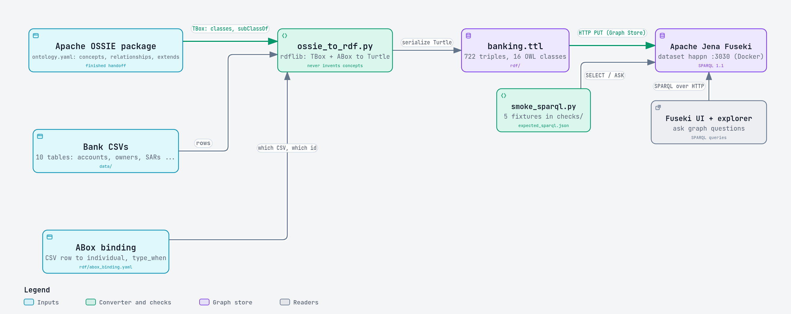
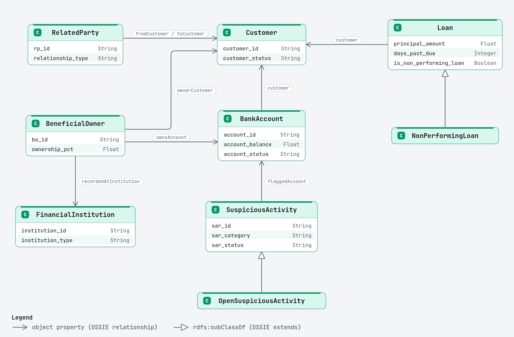
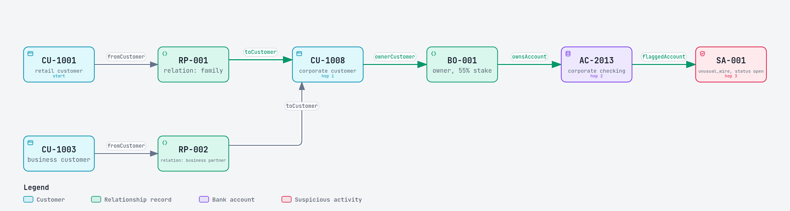

# 22 — A Bank Knowledge Graph from Apache OSSIE: RDF, OWL and SPARQL in Apache Jena Fuseki

**Stack:** Apache OSSIE (incubating) package → `scripts/ossie_to_rdf.py` (rdflib) → Turtle → Apache Jena Fuseki 5.1 → SPARQL
**Bank:** Happn Community Bank (fictional; all names and figures are made up)



## Learning objective

The classes, subclasses and links of a knowledge graph come from one Apache OSSIE
ontology. A small converter turns the ontology and ten CSV files into RDF/OWL; Apache Jena
Fuseki serves it; SPARQL answers multi-hop questions such as *"which customers reach a
suspicious activity report within three hops?"*

## What lives where

| What | Defined in | Becomes |
|------|------------|---------|
| Classes, subclasses, links | `ossie/ontology.yaml` (`concept`, `extends`, `relationships`) | `owl:Class`, `rdfs:subClassOf`, object / datatype properties |
| Which CSV feeds which class | `rdf/abox_binding.yaml` (`csv`, `id_column`, `literals`, `links`, `type_when`) | individuals and links |
| The rows | `data/*.csv` (10 files) | literal values |
| The graph | `rdf/banking.ttl` | generated by the converter, never hand-edited |
| Serving and queries | Fuseki dataset `happn` | SPARQL endpoint `http://127.0.0.1:3030/happn/sparql` |

The converter never invents concepts: every class named in the binding must exist in the
ontology, and the six graph concepts (Customer, BankAccount, BeneficialOwner, RelatedParty,
FinancialInstitution, SuspiciousActivity) are required, or the build stops.



## Run the demo

Prerequisites: Docker with Docker Compose, Python 3, network access to pull the image.

```bash
cd 22-banking-ossie-jena-sparql
./run-local.sh            # convert, start Fuseki, load, smoke-test, open the UI
./run-local.sh --no-open  # same, without opening a browser
./run-local.sh --smoke-only
./run-local.sh --down     # stop the stack
```

That script runs five steps:

1. Checks that the OSSIE package is present in `ossie/`.
2. Converts it: `scripts/ossie_to_rdf.py` writes `rdf/banking.ttl` (722 triples).
3. Starts Apache Jena Fuseki in Docker and waits until dataset `happn` answers.
4. Loads the Turtle file into `happn` (`scripts/load_fuseki.sh`).
5. Runs the SPARQL smoke test (`scripts/smoke_sparql.py` against `checks/expected_sparql.json`).

Then open:

| | URL |
|-|-----|
| Fuseki UI | http://127.0.0.1:3030/ |
| SPARQL endpoint | http://127.0.0.1:3030/happn/sparql |
| Explorer | `explorer/index.html` (four ready-made questions) |

The Fuseki admin pages ask for a login. The user name and the default password are set in
`docker-compose.yml`; set `FUSEKI_PASSWORD` in your environment to choose your own.
`scripts/smoke_sparql.py` reads `FUSEKI_USER` / `FUSEKI_PASSWORD` too. SPARQL queries on
`/happn/sparql` need no login.

## The three-hop question



```sparql
PREFIX happn: <https://example.com/happn-bank#>
PREFIX rdfs:  <http://www.w3.org/2000/01/rdf-schema#>
SELECT ?customer ?relationship ?owner ?account ?sar WHERE {
  ?rp  a happn:RelatedParty ; happn:RelatedParty_fromCustomer/rdfs:label ?customer ;
       happn:RelatedParty_toCustomer ?o ; happn:RelatedParty_relationship_type ?relationship .
  ?bo  a happn:BeneficialOwner ; happn:BeneficialOwner_ownerCustomer ?o ;
       happn:BeneficialOwner_ownsAccount ?a .
  ?s   a happn:SuspiciousActivity ; happn:SuspiciousActivity_flaggedAccount ?a .
  ?o rdfs:label ?owner . ?a rdfs:label ?account . ?s rdfs:label ?sar .
}
```

| customer | relationship | owner | account | sar |
|----------|--------------|-------|---------|-----|
| CU-1001 | family | CU-1008 | AC-2013 | SA-001 |
| CU-1003 | business_partner | CU-1008 | AC-2013 | SA-001 |

## Real numbers from this folder

| Question | Answer |
|----------|--------|
| Triples in `rdf/banking.ttl` | 722 (all asserted), 16 OWL classes, 145 subjects |
| Individuals per class | Transaction 20, BankAccount 18, Customer 10, Loan 8, Branch 4, RelatedParty 4, BeneficialOwner 3, FinancialInstitution 3, SuspiciousActivity 3, NonPerformingLoan 2, OpenSuspiciousActivity 2 |
| Beneficial owner of AC-2013 | BO-001 → CU-1008 (55 % stake) |
| Open suspicious activity (subclass) | SA-001 on AC-2013, SA-003 on AC-2014 (both held by CU-1008) |
| Non-performing loans (subclass) | LN-4003 (142 days past due, 22,000) + LN-4007 (210 days, 35,000) = 57,000 |
| With the OWL Micro reasoner | 1,764 triples; loans still 8, suspicious activities still 3 |

## Optional: what an OWL reasoner adds

`fuseki/config.ttl` configures Jena's OWL Micro reasoner over `rdf/banking.ttl`. After
`./run-local.sh` has written the Turtle file, start a second Fuseki next to the plain one:

```bash
docker run -d --rm --name jena-owl -p 3031:3030 \
  -v $PWD/fuseki/config.ttl:/config.ttl:ro -v $PWD/rdf:/fuseki-data:ro \
  stain/jena-fuseki:5.1.0 /jena-fuseki/fuseki-server --config=/config.ttl
curl -s -H 'Accept: text/csv' --data-urlencode 'query=SELECT (COUNT(*) AS ?triples) WHERE { ?s ?p ?o }' http://127.0.0.1:3031/happn/sparql
docker stop jena-owl
```

The reasoner adds generic triples (every individual is an `rdfs:Resource` and an
`owl:Thing`, plus the subclass closure). The business answers do not change.

## Try a what-if

Add one related-party row, rerun, and ask the three-hop question again:

```bash
echo 'RP-005,CU-1010,CU-1008,director,active' >> data/related_parties.csv
./run-local.sh --no-open
# the three-hop query now returns 3 rows (CU-1010 via director)
sed -i '/^RP-005,/d' data/related_parties.csv && ./run-local.sh --no-open
```

## Files

| Path | Purpose |
|------|---------|
| `ossie/ontology.yaml`, `semantic_model.yaml`, `mapping.yaml`, `validation.json` | The Apache OSSIE package (passes the official OSSIE validator) |
| `rdf/abox_binding.yaml` | CSV → individual binding |
| `scripts/ossie_to_rdf.py` | Converter (OSSIE + CSV → Turtle) |
| `scripts/load_fuseki.sh` | Loads `rdf/banking.ttl` into dataset `happn` |
| `scripts/smoke_sparql.py`, `checks/expected_sparql.json` | SPARQL smoke test |
| `fuseki/config.ttl` | Optional OWL Micro reasoner config |
| `explorer/index.html` | Static SPARQL explorer |
| `docker-compose.yml`, `run-local.sh`, `requirements.txt` | Local stack |
| `docs/` | Diagrams (made with [archify](https://github.com/tt-a1i/archify)) |

Part of [Data for AI](https://github.com/aniket-work/data-for-ai). Learn more:
[Apache OSSIE](https://ossie.apache.org) · [Apache Jena](https://jena.apache.org).
