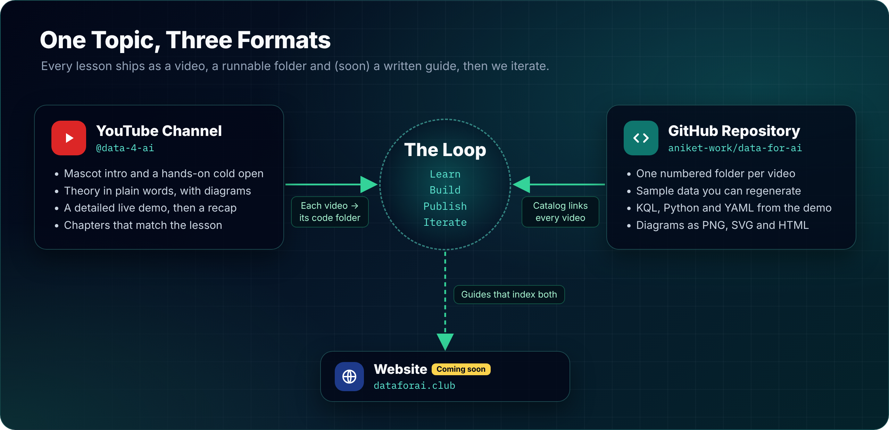
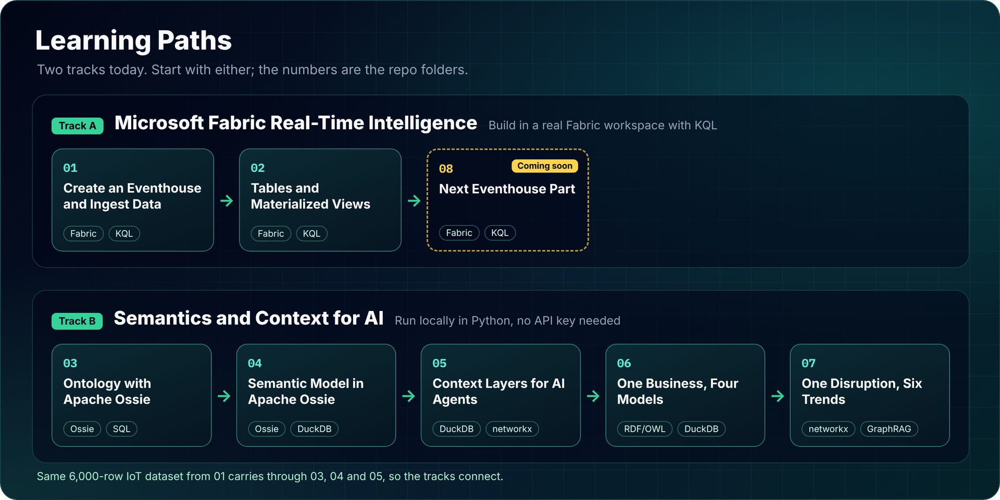
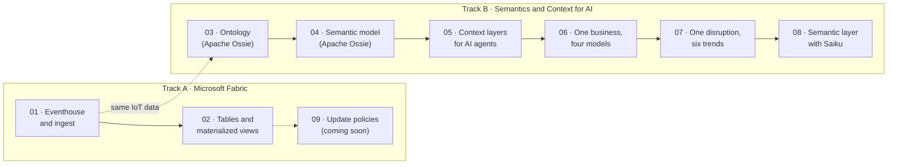
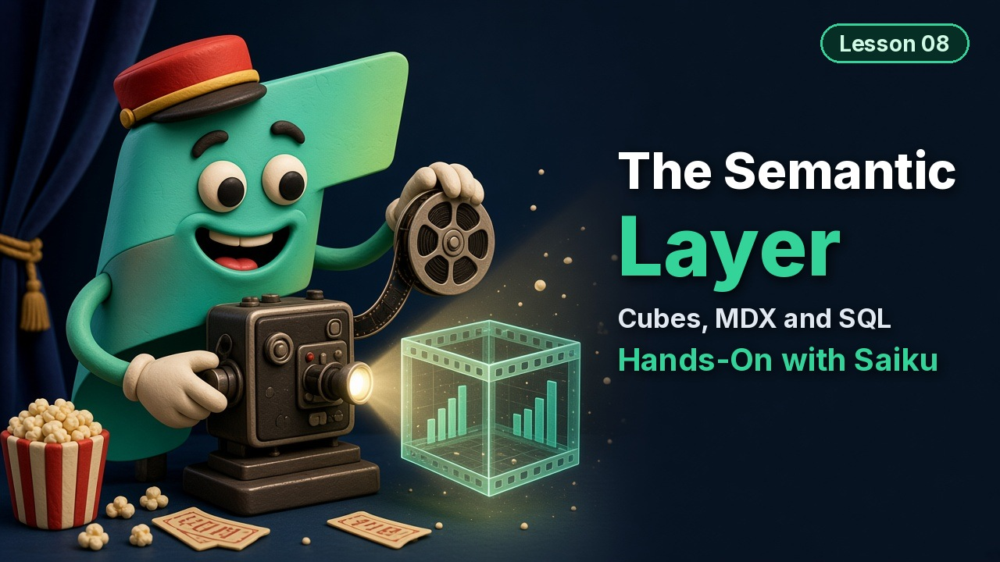

<p align="center">
  <a href="https://www.youtube.com/@learn-physical-ai">
    
  </a>
</p>

<p align="center">
  <a href="https://www.youtube.com/@learn-physical-ai"></a>
  <a href="#-video-catalog"></a>
  <a href="LICENSE"></a>
  <br>
  <a href="https://github.com/aniket-work/data-for-ai/commits/main"></a>
  <a href="https://github.com/aniket-work/data-for-ai/stargazers"></a>
  
  
  
</p>

<h3 align="center">Learn the data side of AI by building it: one video, one runnable folder, one idea at a time.</h3>

<p align="center">
  <a href="#-about">About</a> ·
  <a href="#-learning-paths">Learning Paths</a> ·
  <a href="#-video-catalog">Video Catalog</a> ·
  <a href="#-getting-started">Getting Started</a> ·
  <a href="#-repo-structure">Repo Structure</a> ·
  <a href="#-roadmap">Roadmap</a> ·
  <a href="#-connect">Connect</a>
</p>

---

## 👋 About

**Data for AI** is a free, hands-on learning series about the data that AI systems depend on: how it is ingested and modelled, how its meaning is described, and how an AI agent gets the right context at the right time.

Every lesson comes in matching formats:

| Format | Where | What you get |
| --- | --- | --- |
| 🎬 **Video** | [YouTube: Data for AI](https://www.youtube.com/@learn-physical-ai) | A quick hands-on preview, the theory in plain words, then a detailed live demo and a recap |
| 💻 **Code** | This repository | One numbered folder per video with the sample data, scripts, queries, diagrams and slides |
| 🌐 **Guides** | `dataforai.club` (coming soon) | Written guides and learning paths that tie the videos and folders together |

<p align="center">
  
</p>

## 💡 Why Data for AI

- **AI is only as good as its data.** Models get the headlines, but real projects succeed or fail on ingestion, modelling, meaning and governance. That is the part this series teaches.
- **Build, don't just watch.** Every video has a folder you can run. Item names in the steps match the video so the two stay in sync.
- **Plain words first.** Terms like *ontology*, *semantic layer*, *knowledge graph* and *context layer* are explained side by side in small runnable examples, so the differences are easy to see.
- **Open and vendor-neutral where possible.** Track A uses Microsoft Fabric. Track B runs locally with open tools such as Apache Ossie (incubating), DuckDB, rdflib and networkx, with no API key.
- **Honest teaching code.** Where a lesson writes its own helper or format, its README says so.

## 🧭 Learning Paths

<p align="center">
  
</p>

| Track | Lessons | Best for | You need |
| --- | --- | --- | --- |
| **A. Microsoft Fabric Real-Time Intelligence** | 01 → 02 | Data engineers moving event and telemetry data into Fabric with KQL | A Fabric workspace on a Fabric-enabled capacity |
| **B. Semantics and Context for AI** | 03 → 04 → 05 → 06 → 07 → 08 | Anyone who wants AI agents to understand business data: ontologies, semantic models, knowledge graphs, context layers, semantic layers | Python 3.11+ and Git (08 also needs Java 21+) |

<details>
<summary><b>Text version of the learning path (Mermaid)</b></summary>



</details>

## 🎬 Video Catalog

Click a thumbnail to watch on YouTube. Durations are approximate.

<table>
  <tr>
    <th width="34%">Video</th>
    <th>What you build</th>
  </tr>
  <tr>
    <td><a href="https://youtu.be/4E5-xwSKkG0"></a></td>
    <td><b>01 · Create an Eventhouse and Ingest Data</b><br><sub>Track A · Microsoft Fabric · KQL · ~7 min</sub><br><br>Create an Eventhouse, load 6,000 rows of IoT telemetry into a <code>Telemetry</code> table with the Get data wizard, and prove the data landed with KQL.<br><br>📁 <a href="01-eventhouse-create-and-ingest/">01-eventhouse-create-and-ingest</a> · ▶️ <a href="https://youtu.be/4E5-xwSKkG0">Watch</a></td>
  </tr>
  <tr>
    <td><a href="https://youtu.be/YYVZEckY2gY"></a></td>
    <td><b>02 · Tables and Materialized Views</b><br><sub>Track A · Microsoft Fabric · KQL · ~9 min</sub><br><br>Create a <code>SensorReadings</code> table with a KQL command, add duplicates on purpose, then build three materialized views: deduplicated rows, the latest reading per sensor, and hourly averages per city.<br><br>📁 <a href="02-tables-and-materialized-views/">02-tables-and-materialized-views</a> · ▶️ <a href="https://youtu.be/YYVZEckY2gY">Watch</a></td>
  </tr>
  <tr>
    <td><a href="https://youtu.be/TV70PHBNNPk"></a></td>
    <td><b>03 · Ontology with Apache Ossie (incubating)</b><br><sub>Track B · Python · Apache Ossie · ~8 min</sub><br><br>Write a small IoT ontology, a semantic model and a mapping document, validate all three with the official Ossie schemas and validator, and use them to generate and run SQL.<br><br>📁 <a href="03-ontology-with-apache-ossie/">03-ontology-with-apache-ossie</a> · ▶️ <a href="https://youtu.be/TV70PHBNNPk">Watch</a></td>
  </tr>
  <tr>
    <td><a href="https://youtu.be/6fAn39bPZb0"></a></td>
    <td><b>04 · Semantic Model in Apache Ossie (incubating)</b><br><sub>Track B · Python · Apache Ossie · DuckDB · ~8.5 min</sub><br><br>Go deep on the core semantic model: datasets, fields, keys, relationships, metrics and <code>ai_context</code>. Catch name-resolution mistakes and compile metrics into SQL that runs on DuckDB.<br><br>📁 <a href="04-semantic-model-with-apache-ossie/">04-semantic-model-with-apache-ossie</a> · ▶️ <a href="https://youtu.be/6fAn39bPZb0">Watch</a></td>
  </tr>
  <tr>
    <td><a href="https://youtu.be/DSXlY7Gruhg"></a></td>
    <td><b>05 · Context Layers for AI Agents</b><br><sub>Track B · Python · DuckDB · networkx · ~10 min</sub><br><br>Link data, semantics, ontology, governance and runtime memory into one graph, then answer agent questions through a context assembler: understand, retrieve, apply policies, compute, answer, remember.<br><br>📁 <a href="05-context-layers-for-ai/">05-context-layers-for-ai</a> · ▶️ <a href="https://youtu.be/DSXlY7Gruhg">Watch</a></td>
  </tr>
  <tr>
    <td><a href="https://youtu.be/3Nr_XUtVRY4"></a></td>
    <td><b>06 · One Business, Four Models</b><br><sub>Track B · Python · RDF/OWL · DuckDB · ~9.5 min</sub><br><br>Model one fictional bike-share business as a taxonomy (SKOS), an ontology (OWL), a knowledge graph (RDF) and a semantic layer, ask all four the same questions, and score what each can answer.<br><br>📁 <a href="06-one-business-four-models/">06-one-business-four-models</a> · ▶️ <a href="https://youtu.be/3Nr_XUtVRY4">Watch</a></td>
  </tr>
  <tr>
    <td><a href="https://youtu.be/8ndA5hIxuEg"></a></td>
    <td><b>07 · One Flight Disruption, Six Data and AI Trends</b><br><sub>Track B · Python · networkx · ~12 min</sub><br><br>Run one airline disruption through six lenses: data residency, decision governance, AI governance, agentic streaming, agentic data quality and GraphRAG, then compare them on one scorecard.<br><br>📁 <a href="07-one-disruption-six-trends/">07-one-disruption-six-trends</a> · ▶️ <a href="https://youtu.be/8ndA5hIxuEg">Watch</a></td>
  <tr>
    <td><a href="https://youtu.be/TM_1xsWUr48"></a></td>
    <td><b>08 · The Semantic Layer, Hands-On with Saiku</b><br><sub>Track B · Saiku · Mondrian · MDX · ~11 min</sub><br><br>Model a fictional cinema chain as an OLAP cube, explore it in Saiku's web UI with a pivot, a drill-down and a chart, see the MDX and the SQL Mondrian generates, and ask the cube by name through Saiku's AI Query API.<br><br>📁 <a href="08-semantic-layer-with-saiku/">08-semantic-layer-with-saiku</a> · ▶️ <a href="https://youtu.be/TM_1xsWUr48">Watch</a></td>
  </tr>
</table>

<details>
<summary><b>Compact list</b></summary>

| # | Title | Folder | Video |
| --- | --- | --- | --- |
| 1 | Create an Eventhouse and ingest data | [01-eventhouse-create-and-ingest](01-eventhouse-create-and-ingest/) | [Watch](https://youtu.be/4E5-xwSKkG0) |
| 2 | Tables and materialized views | [02-tables-and-materialized-views](02-tables-and-materialized-views/) | [Watch](https://youtu.be/YYVZEckY2gY) |
| 3 | Ontology with Apache Ossie (incubating) | [03-ontology-with-apache-ossie](03-ontology-with-apache-ossie/) | [Watch](https://youtu.be/TV70PHBNNPk) |
| 4 | Semantic model in Apache Ossie (incubating) | [04-semantic-model-with-apache-ossie](04-semantic-model-with-apache-ossie/) | [Watch](https://youtu.be/6fAn39bPZb0) |
| 5 | Context layers for AI agents | [05-context-layers-for-ai](05-context-layers-for-ai/) | [Watch](https://youtu.be/DSXlY7Gruhg) |
| 6 | One business, four models: taxonomy, ontology, knowledge graph and semantic layer | [06-one-business-four-models](06-one-business-four-models/) | [Watch](https://youtu.be/3Nr_XUtVRY4) |
| 7 | One flight disruption, six data and AI trends: residency, decisions, governance, streaming, data quality and GraphRAG | [07-one-disruption-six-trends](07-one-disruption-six-trends/) | [Watch](https://youtu.be/8ndA5hIxuEg) |
| 8 | The semantic layer, hands-on with Saiku: cube, MDX, SQL and the AI Query API | [08-semantic-layer-with-saiku](08-semantic-layer-with-saiku/) | [Watch](https://youtu.be/TM_1xsWUr48) |

</details>

## 🚀 Getting Started

1. **Pick a track** from [Learning Paths](#-learning-paths), or jump to any video in the [catalog](#-video-catalog).
2. **Watch the video**, then open its folder and follow the README step by step.
3. **Run it yourself**, then change the data or the question and see what breaks. That is where the learning sticks.

### Prerequisites

<details open>
<summary><b>Track A: Microsoft Fabric (folders 01 and 02)</b></summary>

- A Microsoft Fabric workspace on a Fabric-enabled capacity, and permission to create items in it
- For folder 02: Database Admin permission on the KQL database (you have it if you created the Eventhouse)
- The sample file in [01-eventhouse-create-and-ingest/data/](01-eventhouse-create-and-ingest/data/), or a fresh copy from its generator script

</details>

<details open>
<summary><b>Track B: Python (folders 03 to 08)</b></summary>

- Python 3.11 or later and Git
- Each folder has its own `requirements.txt` (for example PyYAML, rich, DuckDB, sqlglot, networkx, rdflib, owlrl)
- Folders 03 and 04 also clone the Apache Ossie (incubating) repository; their READMEs show how
- Folder 08 also needs Java 21+ and the Saiku release download; its README shows how
- No LLM is called and no API key is needed

```bash
git clone https://github.com/aniket-work/data-for-ai.git
cd data-for-ai/05-context-layers-for-ai    # or any folder from 03 to 08
python -m venv .venv && source .venv/bin/activate
pip install -r requirements.txt
# then follow the folder's README
```

</details>

> [!IMPORTANT]
> Never put passwords, connection strings, workspace or tenant identifiers, or other private details into this repo or into a pull request.

## 🗂️ Repo Structure

```text
data-for-ai/
├── 01-eventhouse-create-and-ingest/      Track A · Eventhouse, Get data, first KQL
├── 02-tables-and-materialized-views/     Track A · tables, duplicates, materialized views
├── 03-ontology-with-apache-ossie/        Track B · ontology, semantic model, mapping
├── 04-semantic-model-with-apache-ossie/  Track B · datasets, metrics, name resolution
├── 05-context-layers-for-ai/             Track B · five layers, one context graph
├── 06-one-business-four-models/          Track B · taxonomy, ontology, KG, semantic layer
├── 07-one-disruption-six-trends/         Track B · six lenses, one scorecard
├── 08-semantic-layer-with-saiku/         Track B · OLAP cube, MDX, SQL, AI Query API
├── assets/readme/                        Images for this page (and their HTML sources)
├── LICENSE
└── README.md
```

Inside a lesson folder you will usually find:

| Path | What it holds |
| --- | --- |
| `README.md` | The written lesson: concepts, prerequisites and step-by-step instructions |
| `data/` | Sample data, or the script that regenerates it |
| `kql/` or `*.py` | The queries and code used in the video |
| `models/`, `context/`, `ontology/` … | Lesson-specific YAML, Turtle or JSON documents |
| `diagrams/` | Diagrams as PNG, SVG, interactive HTML and their source |
| `docs/` | Concept notes, and from folder 03 on, the slides from the video |

## 🛣️ Roadmap

- [x] Track A: Eventhouse basics (01) and materialized views (02)
- [x] Track B: Apache Ossie ontology and semantic model, context layers, four models, six trends, semantic layer with Saiku (03 to 08)
- [ ] Next Microsoft Fabric Eventhouse part: update policies and stored functions (folder 09)
- [ ] Launch the **dataforai.club** website with written guides and learning paths
- [ ] More series on the data side of AI, one video and one folder at a time

New lessons land here first as a numbered folder, then in the catalog above as soon as the video is live.

## 🤝 Community and Contributing

Found a typo, a broken step or a version change? Contributions are welcome.

- **Report a problem:** open an [issue](https://github.com/aniket-work/data-for-ai/issues) and name the folder and step.
- **Suggest a fix:** open a pull request. Keep it small and focused on one folder.
- **Ask a question or suggest a topic:** leave a comment under the matching YouTube video.

Please read [CONTRIBUTING.md](CONTRIBUTING.md) before opening a pull request. If this repo helps you, a ⭐ helps others find it.

## 📣 Connect

<p align="center">
  <a href="https://www.youtube.com/@learn-physical-ai"></a>
  <a href="https://github.com/aniket-work/data-for-ai"></a>
  
</p>

## 📚 Official Starting Points

- [Eventhouse overview](https://learn.microsoft.com/en-us/fabric/real-time-intelligence/eventhouse)
- [Get started with Real-Time Intelligence](https://learn.microsoft.com/en-us/fabric/real-time-intelligence/get-started-with-real-time-intelligence)
- [Apache Ossie (incubating)](https://github.com/apache/ossie)
- [Saiku](https://github.com/spiculedata/saiku)

## 📄 License

Released under the [MIT License](LICENSE). Microsoft Fabric and other product names are trademarks of their respective owners; this is an independent learning project.

<p align="center"><sub><b>Data for AI</b> · Learn → Build → Publish → Iterate</sub></p>
