<p align="center">
  <a href="https://www.youtube.com/@data-4-ai">
    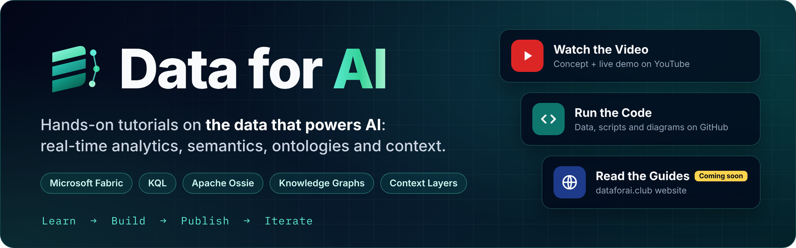
  </a>
</p>

<p align="center">
  <a href="https://www.youtube.com/@data-4-ai"></a>
  <a href="#-video-catalog"></a>
  <a href="LICENSE"></a>
  <br>
  <a href="https://github.com/aniket-work/data-for-ai/commits/main"></a>
  <a href="https://github.com/aniket-work/data-for-ai/stargazers"></a>
  
  
  
</p>

<h3 align="center">Learn the data side of AI by building it: one video, one runnable folder, one idea at a time.</h3>

<p align="center">
  <a href="#-about">About</a> ·
  <a href="#-learning-paths">Learning Paths</a> ·
  <a href="#-video-catalog">Video Catalog</a> ·
  <a href="#-getting-started">Getting Started</a> ·
  <a href="#-repo-structure">Repo Structure</a> ·
  <a href="#-roadmap">Roadmap</a> ·
  <a href="#-connect">Connect</a>
</p>

---

## 👋 About

**Data for AI** is a free, hands-on learning series about the data that AI systems depend on: how it is ingested and modelled, how its meaning is described, and how an AI agent gets the right context at the right time.

Every lesson comes in matching formats:

| Format | Where | What you get |
| --- | --- | --- |
| 🎬 **Video** | [YouTube: Data for AI](https://www.youtube.com/@data-4-ai) | A quick hands-on preview, the theory in plain words, then a detailed live demo and a recap |
| 💻 **Code** | This repository | One numbered folder per video with the sample data, scripts, queries, diagrams and slides |
| 🌐 **Guides** | `dataforai.club` (coming soon) | Written guides and learning paths that tie the videos and folders together |

<p align="center">
  
</p>

## 💡 Why Data for AI

- **AI is only as good as its data.** Models get the headlines, but real projects succeed or fail on ingestion, modelling, meaning and governance. That is the part this series teaches.
- **Build, don't just watch.** Every video has a folder you can run. Item names in the steps match the video so the two stay in sync.
- **Plain words first.** Terms like *ontology*, *semantic layer*, *knowledge graph* and *context layer* are explained side by side in small runnable examples, so the differences are easy to see.
- **Open and vendor-neutral where possible.** Track A uses Microsoft Fabric. Tracks B and C run locally with open tools such as Apache Ossie (incubating), DuckDB, dbt and MetricFlow, rdflib, networkx and llama.cpp, with no API key.
- **Honest teaching code.** Where a lesson writes its own helper or format, its README says so.

## 🧭 Learning Paths

<p align="center">
  
</p>

| Track | Lessons | Best for | You need |
| --- | --- | --- | --- |
| **A. Microsoft Fabric Real-Time Intelligence** | 01 → 02 | Data engineers moving event and telemetry data into Fabric with KQL | A Fabric workspace on a Fabric-enabled capacity |
| **B. Semantics and Context for AI** | 03 → 04 → 05 → 06 → 07 → 08 → 10 → 11 → 12 → 13 → 16 | Anyone who wants AI agents to understand business data: ontologies, semantic models, knowledge graphs, context layers, semantic layers, metrics layers, text-to-SQL on a semantic layer and governed access for AI agents, and context graphs | Python 3.11+ and Git (08 also needs Java 21+; 11, 12, 13 and 16 also need a local OpenAI-compatible model server; 12 also needs Node.js 20+) |
| **C. Agentic Data Management** | 09 | Anyone who wants AI agents to discover, clean, query and monitor data, with a human in the loop | Python 3.11+ and a local OpenAI-compatible model server (for example llama.cpp) |

<details>
<summary><b>Text version of the learning path (Mermaid)</b></summary>

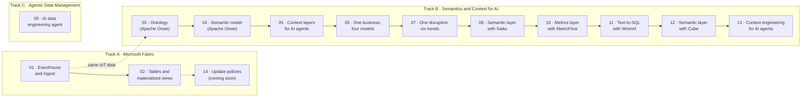

</details>

## 🎬 Video Catalog

Click a thumbnail to watch on YouTube. Durations are approximate.

<table>
  <tr>
    <th width="34%">Video</th>
    <th>What you build</th>
  </tr>
  <tr>
    <td><a href="https://youtu.be/4E5-xwSKkG0"></a></td>
    <td><b>01 · Create an Eventhouse and Ingest Data</b><br><sub>Track A · Microsoft Fabric · KQL · ~7 min</sub><br><br>Create an Eventhouse, load 6,000 rows of IoT telemetry into a <code>Telemetry</code> table with the Get data wizard, and prove the data landed with KQL.<br><br>📁 <a href="01-eventhouse-create-and-ingest/">01-eventhouse-create-and-ingest</a> · ▶️ <a href="https://youtu.be/4E5-xwSKkG0">Watch</a></td>
  </tr>
  <tr>
    <td><a href="https://youtu.be/YYVZEckY2gY"></a></td>
    <td><b>02 · Tables and Materialized Views</b><br><sub>Track A · Microsoft Fabric · KQL · ~9 min</sub><br><br>Create a <code>SensorReadings</code> table with a KQL command, add duplicates on purpose, then build three materialized views: deduplicated rows, the latest reading per sensor, and hourly averages per city.<br><br>📁 <a href="02-tables-and-materialized-views/">02-tables-and-materialized-views</a> · ▶️ <a href="https://youtu.be/YYVZEckY2gY">Watch</a></td>
  </tr>
  <tr>
    <td><a href="https://youtu.be/TV70PHBNNPk"></a></td>
    <td><b>03 · Ontology with Apache Ossie (incubating)</b><br><sub>Track B · Python · Apache Ossie · ~8 min</sub><br><br>Write a small IoT ontology, a semantic model and a mapping document, validate all three with the official Ossie schemas and validator, and use them to generate and run SQL.<br><br>📁 <a href="03-ontology-with-apache-ossie/">03-ontology-with-apache-ossie</a> · ▶️ <a href="https://youtu.be/TV70PHBNNPk">Watch</a></td>
  </tr>
  <tr>
    <td><a href="https://youtu.be/6fAn39bPZb0"></a></td>
    <td><b>04 · Semantic Model in Apache Ossie (incubating)</b><br><sub>Track B · Python · Apache Ossie · DuckDB · ~8.5 min</sub><br><br>Go deep on the core semantic model: datasets, fields, keys, relationships, metrics and <code>ai_context</code>. Catch name-resolution mistakes and compile metrics into SQL that runs on DuckDB.<br><br>📁 <a href="04-semantic-model-with-apache-ossie/">04-semantic-model-with-apache-ossie</a> · ▶️ <a href="https://youtu.be/6fAn39bPZb0">Watch</a></td>
  </tr>
  <tr>
    <td><a href="https://youtu.be/DSXlY7Gruhg"></a></td>
    <td><b>05 · Context Layers for AI Agents</b><br><sub>Track B · Python · DuckDB · networkx · ~10 min</sub><br><br>Link data, semantics, ontology, governance and runtime memory into one graph, then answer agent questions through a context assembler: understand, retrieve, apply policies, compute, answer, remember.<br><br>📁 <a href="05-context-layers-for-ai/">05-context-layers-for-ai</a> · ▶️ <a href="https://youtu.be/DSXlY7Gruhg">Watch</a></td>
  </tr>
  <tr>
    <td><a href="https://youtu.be/3Nr_XUtVRY4"></a></td>
    <td><b>06 · One Business, Four Models</b><br><sub>Track B · Python · RDF/OWL · DuckDB · ~9.5 min</sub><br><br>Model one fictional bike-share business as a taxonomy (SKOS), an ontology (OWL), a knowledge graph (RDF) and a semantic layer, ask all four the same questions, and score what each can answer.<br><br>📁 <a href="06-one-business-four-models/">06-one-business-four-models</a> · ▶️ <a href="https://youtu.be/3Nr_XUtVRY4">Watch</a></td>
  </tr>
  <tr>
    <td><a href="https://youtu.be/8ndA5hIxuEg"></a></td>
    <td><b>07 · One Flight Disruption, Six Data and AI Trends</b><br><sub>Track B · Python · networkx · ~12 min</sub><br><br>Run one airline disruption through six lenses: data residency, decision governance, AI governance, agentic streaming, agentic data quality and GraphRAG, then compare them on one scorecard.<br><br>📁 <a href="07-one-disruption-six-trends/">07-one-disruption-six-trends</a> · ▶️ <a href="https://youtu.be/8ndA5hIxuEg">Watch</a></td>
  <tr>
    <td><a href="https://youtu.be/TM_1xsWUr48"></a></td>
    <td><b>08 · The Semantic Layer, Hands-On with Saiku</b><br><sub>Track B · Saiku · Mondrian · MDX · ~11 min</sub><br><br>Model a fictional cinema chain as an OLAP cube, explore it in Saiku's web UI with a pivot, a drill-down and a chart, see the MDX and the SQL Mondrian generates, and ask the cube by name through Saiku's AI Query API.<br><br>📁 <a href="08-semantic-layer-with-saiku/">08-semantic-layer-with-saiku</a> · ▶️ <a href="https://youtu.be/TM_1xsWUr48">Watch</a></td>
  </tr>
  <tr>
    <td><a href="https://youtu.be/nl3S2voeCd0">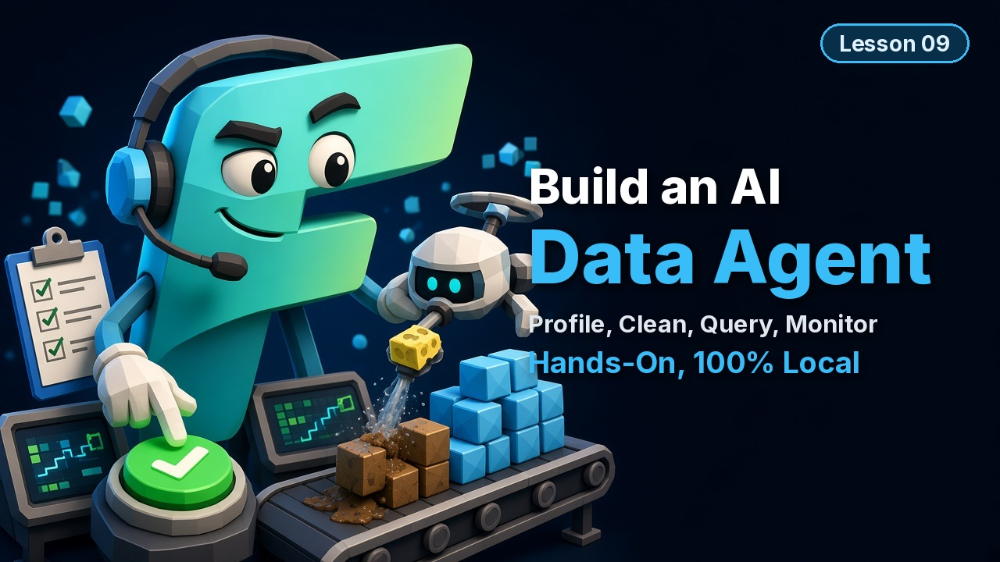</a></td>
    <td><b>09 · Build an AI Data Engineering Agent, Hands-On</b><br><sub>Track C · Python · llama.cpp · DuckDB · ~11.5 min</sub><br><br>Build a local data agent on a 4B open model: it profiles messy raw files, cleans them into a curated table behind a human approval gate, answers with read-only SQL, writes a data contract, and quarantines a bad batch.<br><br>📁 <a href="09-ai-data-engineering-agent/">09-ai-data-engineering-agent</a> · ▶️ <a href="https://youtu.be/nl3S2voeCd0">Watch</a></td>
  </tr>
  <tr>
    <td><a href="https://youtu.be/_eirsNuqM4w">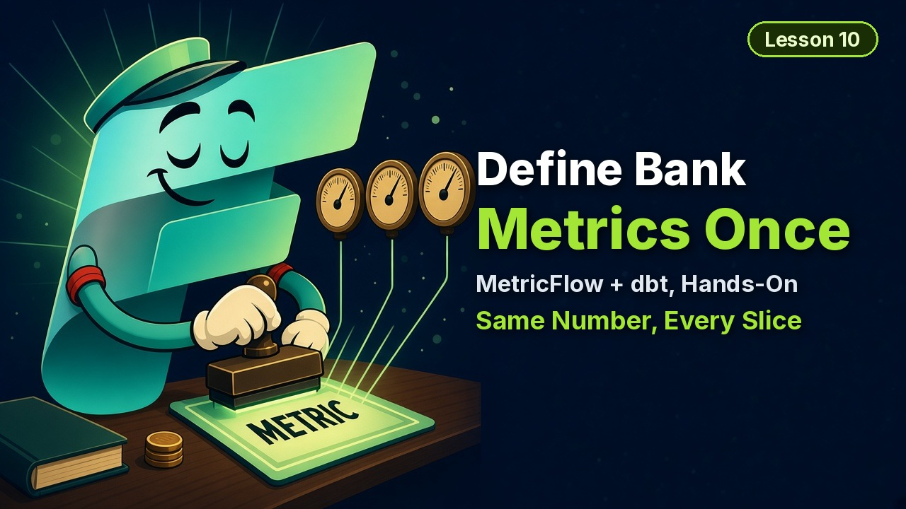</a></td>
    <td><b>10 · Define Bank Metrics Once with MetricFlow, Hands-On</b><br><sub>Track B · dbt · MetricFlow · DuckDB · ~12 min</sub><br><br>Define a fictional retail bank's metrics once in dbt semantic models (simple, ratio, derived and cumulative), query them by region, product, customer segment and time, read the SQL MetricFlow generates, and watch four teams' hand-written SQL drift. Part 1 of a three-part series on the same bank (11 WrenAI, 12 Cube).<br><br>📁 <a href="10-metricflow-banking-metrics/">10-metricflow-banking-metrics</a> · ▶️ <a href="https://youtu.be/_eirsNuqM4w">Watch</a></td>
  </tr>
  <tr>
    <td><a href="https://youtu.be/TSkL_apn34c">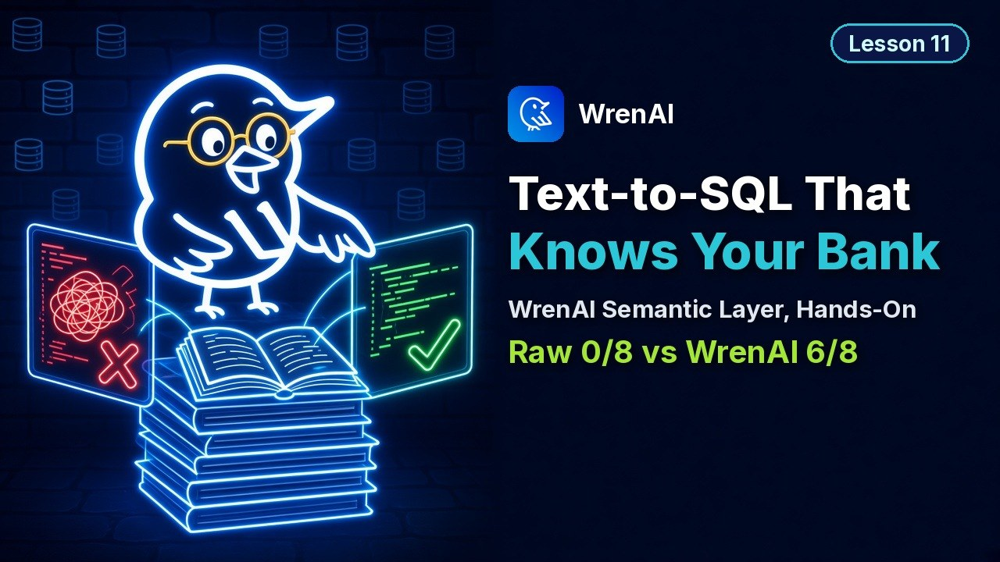</a></td>
    <td><b>11 · Text-to-SQL That Knows the Business: WrenAI's Semantic Layer, Hands-On</b><br><sub>Track B · WrenAI · llama.cpp · DuckDB · ~12 min</sub><br><br>Ask the same bank questions with the same local model two ways, from the raw schema and through WrenAI's semantic layer (MDL models, relationships, calculated fields, business rules), and score every answer by running its SQL against Lesson 10's MetricFlow numbers: raw 0/8, WrenAI 6/8. Part 2 of the bank series.<br><br>📁 <a href="11-wrenai-semantic-text-to-sql/">11-wrenai-semantic-text-to-sql</a> · ▶️ <a href="https://youtu.be/TSkL_apn34c">Watch</a></td>
  </tr>
  <tr>
    <td><a href="https://youtu.be/_yO8wqrezmA">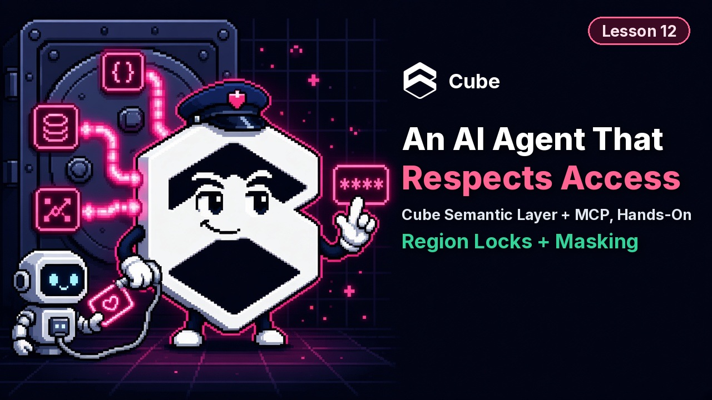</a></td>
    <td><b>12 · Cube Semantic Layer: A Local AI Agent over MCP That Respects Access</b><br><sub>Track B · Cube · MCP · llama.cpp · DuckDB · ~15 min</sub><br><br>Put the same bank behind Cube Core: cubes, views and joins, access policies with row-level security per region and member masking, one model served over the SQL API, REST and GraphQL, and a local AI agent over MCP that only sees what its role allows (7/8 bank questions right as the executive). Part 3, wrapping up the bank series.<br><br>📁 <a href="12-cube-semantic-layer-ai-agent/">12-cube-semantic-layer-ai-agent</a> · ▶️ <a href="https://youtu.be/_yO8wqrezmA">Watch</a></td>
  </tr>
  <tr>
    <td><a href="https://youtu.be/rOq6GO1ihqg">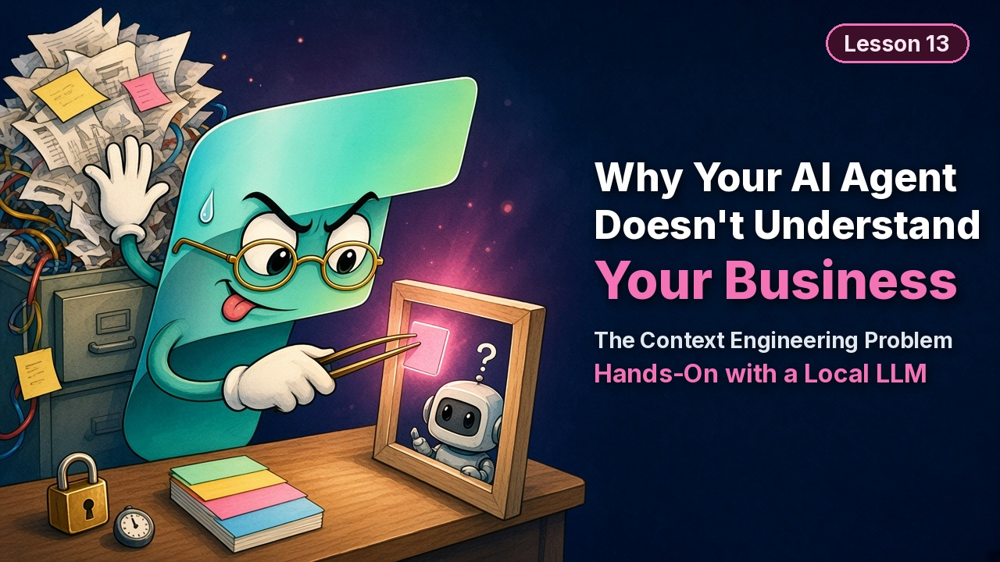</a></td>
    <td><b>13 · Why Your AI Agent Doesn't Understand Your Business: The Context Engineering Problem</b><br><sub>Track B · Python · llama.cpp · SQLite</sub><br><br>Ask a fictional vet clinic chain's five business questions with the same local model three ways: raw schema only, a curated context layer (definitions, relationships, policies, metadata, permissions, history) with access enforced in code, and everything dumped in. Score every answer: raw 0/5, curated 5/5, polluted 2/5.<br><br>📁 <a href="13-context-engineering-for-ai-agents/">13-context-engineering-for-ai-agents</a> · ▶️ <a href="https://youtu.be/rOq6GO1ihqg">Watch on YouTube</a></td>
  </tr>
  <tr>
    <td><a href="https://youtu.be/zbb1ywHqW2A">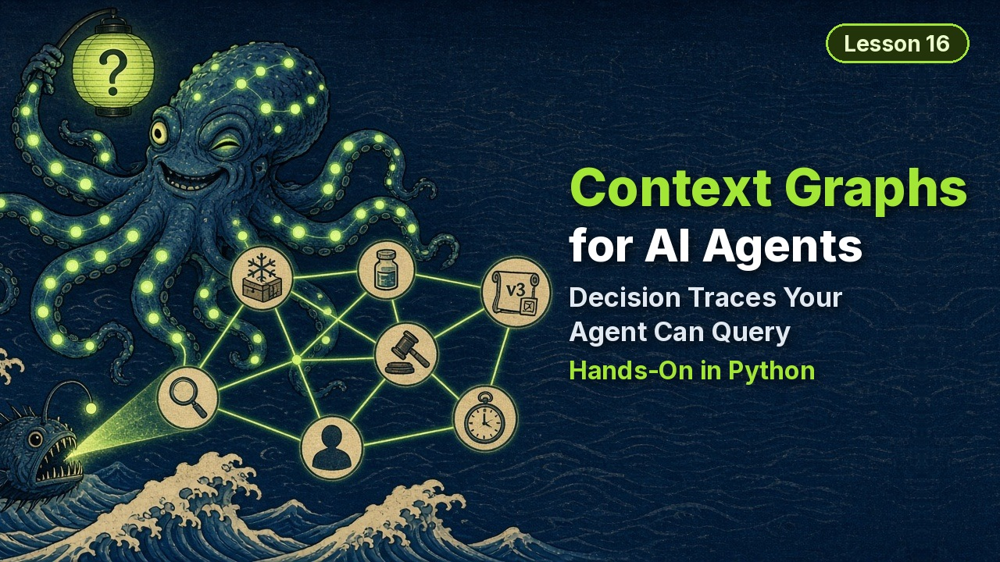</a></td>
    <td><b>16 · Context Graphs for AI Agents: Decision Traces Your Agent Can Query</b><br><sub>Track B · Python · NetworkX · llama.cpp · ~11 min</sub><br><br>Give a local agent a fictional cold-chain company's decision history two ways: plain RAG over documents and a context graph of entities, decision traces, policy versions and precedents. Score five questions: plain RAG 1/5, context graph 5/5, then write the new decision back and export the graph for Microsoft Fabric.<br><br>📁 <a href="16-context-graphs-for-ai-agents/">16-context-graphs-for-ai-agents</a> · ▶️ <a href="https://youtu.be/zbb1ywHqW2A">Watch on YouTube</a></td>
  </tr>
  <tr>
    <td><a href="https://youtu.be/6Lx4JSycNIc">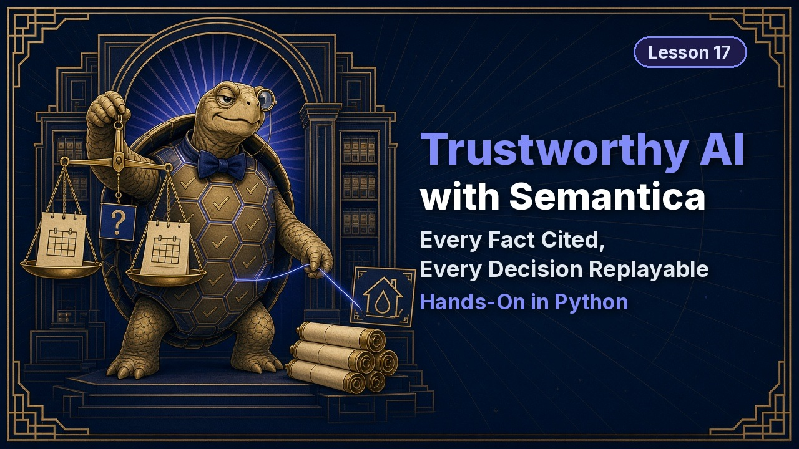</a></td>
    <td><b>17 · Trustworthy AI with Semantica: Every Fact Cited, Every Decision Replayable</b><br><sub>Track B · Python · Semantica · llama.cpp · ~11 min</sub><br><br>A fictional home insurer triages five water-damage claims with the same local model two ways: plain RAG over the documents, and a Semantica-backed agent with provenance for every fact, conflict checks, policy versions in force, a rules check, a guardrail and a hash-chained audit record. Score: plain RAG 7/15, Semantica-backed 15/15, then tamper with the store and export the trail as PROV-O and tables for a Fabric lakehouse.<br><br>📁 <a href="17-trustworthy-ai-with-semantica/">17-trustworthy-ai-with-semantica</a> · ▶️ <a href="https://youtu.be/6Lx4JSycNIc">Watch on YouTube</a></td>
  </tr>
  <tr>
    <td><a href="https://youtu.be/9TE_qgn4qWE">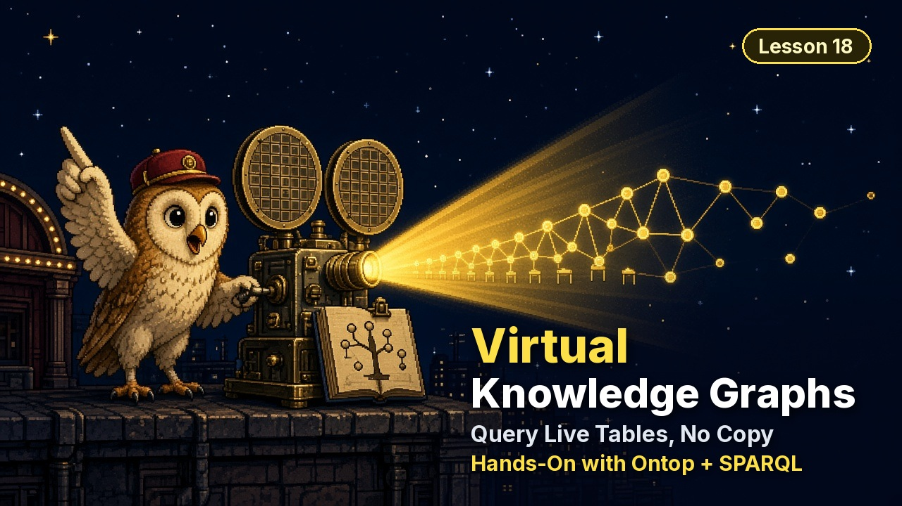</a></td>
    <td><b>18 · Virtual Knowledge Graphs: Query Live Tables as a Graph, No Copy</b><br><sub>Track B · Ontop · SPARQL · PostgreSQL · ~11 min</sub><br><br>Give a fictional outdoor retailer's three legacy systems business meaning with an OWL 2 QL ontology and 13 mappings, then let Ontop rewrite SPARQL into one SQL query over the live tables, reasoning included. Measured against an ETL copy into a triple store: 235 MB copied vs nothing stored, stale vs live after 26 changes, and a renamed column fixed in two mapping lines. Plus how the same mapping points at a Microsoft Fabric Warehouse or SQL analytics endpoint.<br><br>📁 <a href="18-virtual-knowledge-graphs/">18-virtual-knowledge-graphs</a> · ▶️ <a href="https://youtu.be/9TE_qgn4qWE">Watch on YouTube</a></td>
  </tr>
  <tr>
    <td><a href="https://youtu.be/hHz3NcQyBXM">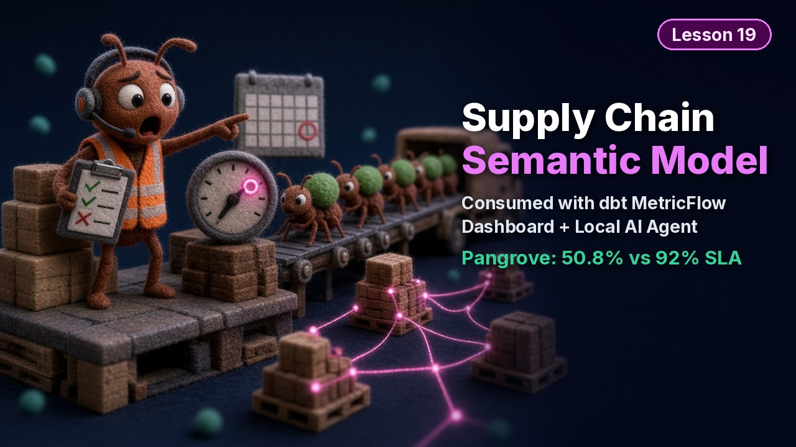</a></td>
    <td><b>19 · Supply Chain Semantic Model with dbt MetricFlow: Metric Queries, Dashboard and a Local AI Agent</b><br><sub>Track B · Apache Ossie · dbt MetricFlow · DuckDB · llama.cpp · ~12 min</sub><br><br>Take our Apache Ossie semantic model for a fictional distributor (9 datasets, 26 metrics) and consume it with dbt MetricFlow: metric queries by supplier and quarter, multi-hop filters, the generated SQL, saved queries exported to CSV and a dashboard built only from them. Every metric is recompiled to plain SQL and matches MetricFlow in every month (26/26). Then a local agent answers "Did Pangrove breach its SLA, and why?": on-time delivery 50.8% vs 92%, fill rate 93.6% vs 98%, cause from the incident report, credit $27,853.20.<br><br>📁 <a href="19-supply-chain-semantic-model-dbt-metricflow/">19-supply-chain-semantic-model-dbt-metricflow</a> · ▶️ <a href="https://youtu.be/hHz3NcQyBXM">Watch on YouTube</a></td>
  </tr>
  <tr>
    <td><a href="https://youtu.be/39KPiE605VU">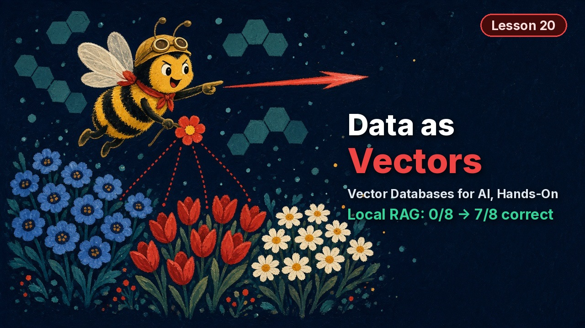</a></td>
    <td><b>20 · Vector Databases for AI: Embeddings, HNSW, Hybrid Search and Local RAG</b><br><sub>Track B · Qdrant · pgvector · DuckDB · llama.cpp · ~10 min</sub><br><br>Turn a fictional bank's policy library into vectors, load it into Qdrant as a single binary (no Docker), and measure every trade-off live: similarity metrics, HNSW, IVF, int8 and product quantization with rescoring, chunking, metadata filters and the post-filter trap, and BM25 + vectors fused with RRF. Hybrid search finds the right page in the top 5 for 94% of questions (keywords 88%, vectors 91%), and a small local model goes from 0/8 to 7/8 correct with retrieval, every answer cited. pgvector and DuckDB vss run on the same 40,000 vectors.<br><br>📁 <a href="20-vector-databases-for-ai/">20-vector-databases-for-ai</a> · ▶️ <a href="https://youtu.be/39KPiE605VU">Watch on YouTube</a></td>
  </tr>
  <tr>
    <td><a href="https://youtu.be/5r-Sm2JJBOA">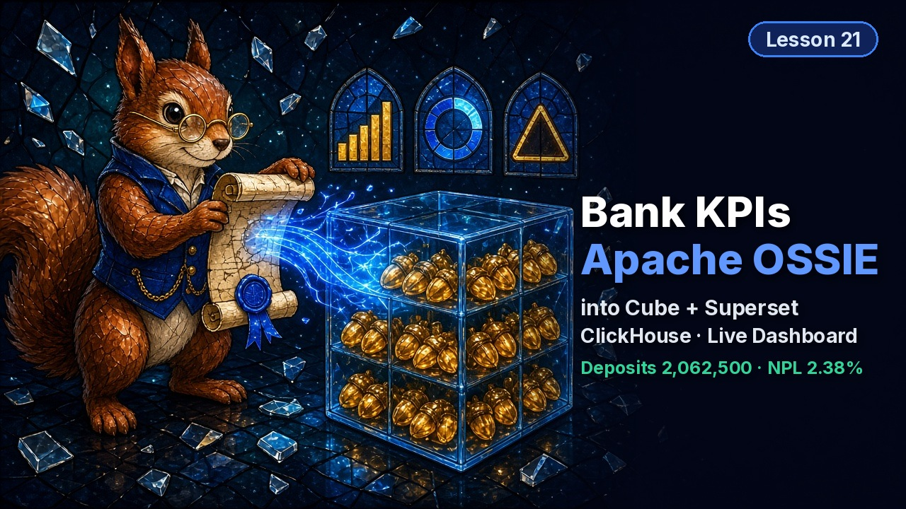</a></td>
    <td><b>21 · Bank KPIs from Apache OSSIE: Cube, ClickHouse and a Live Superset Dashboard</b><br><sub>Track B · Apache Ossie · Cube Core · ClickHouse · Apache Superset · ~11 min</sub><br><br>Start from a finished Apache Ossie package for a fictional bank (semantic model, ontology, mapping, validation) and serve it end to end: the official apache-ossie-cube converter writes the Cube model, ClickHouse holds the data, and Superset shows the OSSIE KPIs next to the ontology's business conditions and violation tiles. Live numbers: deposits 2,062,500, NPL ratio 2.38%, one customer at 50.7% of deposits against a 25% limit. Change one definition in the OSSIE model, regenerate, and the NPL ratio moves to 4.39% with no dashboard edits.<br><br>📁 <a href="21-banking-ossie-cube-superset/">21-banking-ossie-cube-superset</a> · ▶️ <a href="https://youtu.be/5r-Sm2JJBOA">Watch on YouTube</a></td>
  </tr>
  <tr>
    <td>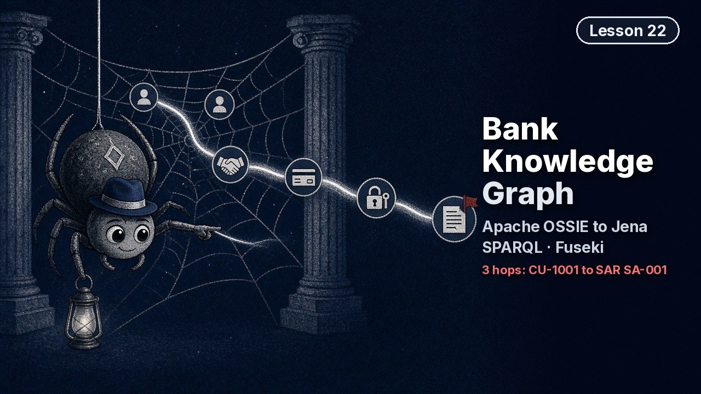</td>
    <td><b>22 · Bank Knowledge Graph from Apache OSSIE: RDF, OWL and SPARQL in Apache Jena Fuseki</b><br><sub>Track B · Apache Ossie · RDF/OWL · Apache Jena Fuseki · SPARQL · ~12 min</sub><br><br>Start from a finished Apache Ossie package for a fictional bank and turn its ontology and ten CSV files into a knowledge graph: concepts become OWL classes, extends becomes subClassOf, and a small binding turns every row into an individual. Load the 722 triples into Apache Jena Fuseki and ask in SPARQL which customers reach a suspicious activity report within three hops (CU-1001 and CU-1003, through the 55% owner of account AC-2013). See what an OWL reasoner adds (1,764 triples, same business answers), then add one related-party row and watch the answer grow to three customers.<br><br>📁 <a href="22-banking-ossie-jena-sparql/">22-banking-ossie-jena-sparql</a> · 📐 <a href="22-banking-ossie-jena-sparql/docs/jena-architecture.png">Architecture diagram</a> · ▶️ Coming soon</td>
  </tr>
</table>

<details>
<summary><b>Compact list</b></summary>

| # | Title | Folder | Video |
| --- | --- | --- | --- |
| 1 | Create an Eventhouse and ingest data | [01-eventhouse-create-and-ingest](01-eventhouse-create-and-ingest/) | [Watch](https://youtu.be/4E5-xwSKkG0) |
| 2 | Tables and materialized views | [02-tables-and-materialized-views](02-tables-and-materialized-views/) | [Watch](https://youtu.be/YYVZEckY2gY) |
| 3 | Ontology with Apache Ossie (incubating) | [03-ontology-with-apache-ossie](03-ontology-with-apache-ossie/) | [Watch](https://youtu.be/TV70PHBNNPk) |
| 4 | Semantic model in Apache Ossie (incubating) | [04-semantic-model-with-apache-ossie](04-semantic-model-with-apache-ossie/) | [Watch](https://youtu.be/6fAn39bPZb0) |
| 5 | Context layers for AI agents | [05-context-layers-for-ai](05-context-layers-for-ai/) | [Watch](https://youtu.be/DSXlY7Gruhg) |
| 6 | One business, four models: taxonomy, ontology, knowledge graph and semantic layer | [06-one-business-four-models](06-one-business-four-models/) | [Watch](https://youtu.be/3Nr_XUtVRY4) |
| 7 | One flight disruption, six data and AI trends: residency, decisions, governance, streaming, data quality and GraphRAG | [07-one-disruption-six-trends](07-one-disruption-six-trends/) | [Watch](https://youtu.be/8ndA5hIxuEg) |
| 8 | The semantic layer, hands-on with Saiku: cube, MDX, SQL and the AI Query API | [08-semantic-layer-with-saiku](08-semantic-layer-with-saiku/) | [Watch](https://youtu.be/TM_1xsWUr48) |
| 9 | Build an AI data engineering agent, hands-on: discover, clean, ask, contract and monitor with a local model | [09-ai-data-engineering-agent](09-ai-data-engineering-agent/) | [Watch](https://youtu.be/nl3S2voeCd0) |
| 10 | Define bank metrics once with MetricFlow, hands-on: simple, ratio, derived and cumulative metrics by region, product, segment and time | [10-metricflow-banking-metrics](10-metricflow-banking-metrics/) | [Watch](https://youtu.be/_eirsNuqM4w) |
| 11 | Text-to-SQL that knows the business, hands-on with WrenAI: raw text-to-SQL vs a semantic layer, scored on the same bank | [11-wrenai-semantic-text-to-sql](11-wrenai-semantic-text-to-sql/) | [Watch](https://youtu.be/TSkL_apn34c) |
| 12 | Cube semantic layer, hands-on: a local AI agent over MCP with row-level security and masking, plus SQL, REST and GraphQL on the same bank | [12-cube-semantic-layer-ai-agent](12-cube-semantic-layer-ai-agent/) | [Watch](https://youtu.be/_yO8wqrezmA) |
| 13 | Why your AI agent doesn't understand your business: context engineering with a raw schema, a curated context layer and context pollution, scored | [13-context-engineering-for-ai-agents](13-context-engineering-for-ai-agents/) | [Watch](https://youtu.be/rOq6GO1ihqg) |
| 16 | Context graphs for AI agents, hands-on: decision traces an agent can query, plain RAG vs a context graph on the same local model, plus a Microsoft Fabric graph export | [16-context-graphs-for-ai-agents](16-context-graphs-for-ai-agents/) | [Watch](https://youtu.be/zbb1ywHqW2A) |
| 17 | Trustworthy AI with Semantica, hands-on: provenance for every fact, conflict checks, policy versions, a guardrail and a hash-chained audit trail, plain RAG vs Semantica on the same local model | [17-trustworthy-ai-with-semantica](17-trustworthy-ai-with-semantica/) | [Watch](https://youtu.be/6Lx4JSycNIc) |
| 18 | Virtual knowledge graphs, hands-on with Ontop: an ontology and mappings over live PostgreSQL tables, SPARQL rewritten to SQL, measured against an ETL copy into a triple store, plus a Microsoft Fabric tie-in | [18-virtual-knowledge-graphs](18-virtual-knowledge-graphs/) | [Watch](https://youtu.be/9TE_qgn4qWE) |
| 19 | Supply chain semantic model with dbt MetricFlow, hands-on: an Apache Ossie model converted to MetricFlow semantic models, metric queries, saved queries and exports, a dashboard, every metric verified in plain SQL, and a local AI agent answering an SLA question | [19-supply-chain-semantic-model-dbt-metricflow](19-supply-chain-semantic-model-dbt-metricflow/) | [Watch](https://youtu.be/hHz3NcQyBXM) |
| 20 | Vector databases for AI, hands-on with Qdrant: embeddings, similarity metrics, HNSW, IVF and quantization, chunking, metadata filters, hybrid search with RRF and local RAG with citations, plus pgvector and DuckDB vss on the same vectors | [20-vector-databases-for-ai](20-vector-databases-for-ai/) | [Watch](https://youtu.be/39KPiE605VU) |
| 21 | Bank KPIs from Apache Ossie, hands-on: an Apache Ossie package converted with the official apache-ossie-cube converter into Cube Core, served from ClickHouse, and shown in an Apache Superset dashboard with the ontology business conditions and violation tiles | [21-banking-ossie-cube-superset](21-banking-ossie-cube-superset/) | [Watch](https://youtu.be/5r-Sm2JJBOA) |
| 22 | Bank knowledge graph from Apache Ossie, hands-on: an Apache Ossie ontology and CSV data converted to RDF and OWL, loaded into Apache Jena Fuseki, and queried with SPARQL for three-hop links to a suspicious activity report, plus what an OWL reasoner adds | [22-banking-ossie-jena-sparql](22-banking-ossie-jena-sparql/) | Coming soon |

</details>

## 🚀 Getting Started

1. **Pick a track** from [Learning Paths](#-learning-paths), or jump to any video in the [catalog](#-video-catalog).
2. **Watch the video**, then open its folder and follow the README step by step.
3. **Run it yourself**, then change the data or the question and see what breaks. That is where the learning sticks.

### Prerequisites

<details open>
<summary><b>Track A: Microsoft Fabric (folders 01 and 02)</b></summary>

- A Microsoft Fabric workspace on a Fabric-enabled capacity, and permission to create items in it
- For folder 02: Database Admin permission on the KQL database (you have it if you created the Eventhouse)
- The sample file in [01-eventhouse-create-and-ingest/data/](01-eventhouse-create-and-ingest/data/), or a fresh copy from its generator script

</details>

<details open>
<summary><b>Track B: Python (folders 03 to 08 and 10 to 13)</b></summary>

- Python 3.11 or later and Git
- Each folder has its own `requirements.txt` (for example PyYAML, rich, DuckDB, sqlglot, networkx, rdflib, owlrl, dbt-core and MetricFlow)
- Folders 03 and 04 also clone the Apache Ossie (incubating) repository; their READMEs show how
- Folder 08 also needs Java 21+ and the Saiku release download; its README shows how
- Folder 10 pins dbt-core, dbt-duckdb and dbt-metricflow versions tested together; it runs on Python 3.11 or 3.12
- Folder 11 reuses the folder 10 warehouse and calls a local model behind an OpenAI-compatible API (the video uses llama.cpp with Qwen3-4B-Instruct-2507); it pins wrenai and wren-pydantic and runs on Python 3.12
- Folder 12 also reuses the folder 10 warehouse, installs Cube Core from npm (Node.js 20+, no Docker) and calls the same kind of local model through an MCP server; it runs on Python 3.12
- Folder 13 calls a local model (the video uses llama.cpp with Qwen2.5-Coder-3B-Instruct) through any OpenAI-compatible API
- Folders 16 and 17 call a local model (the videos use llama.cpp with Qwen2.5-7B-Instruct Q4_K_M) through any OpenAI-compatible API; folder 17 installs Semantica 0.7.0 from PyPI
- Folder 18 also needs PostgreSQL (a local Docker container works), Java 17+ and the Ontop 5.5 CLI; its README shows how
- Folder 20 runs Qdrant as a single binary (no Docker), embeds on the CPU with FastEmbed, and calls a local model (the video uses llama.cpp with Qwen3-4B-Instruct-2507 Q4_K_M) through any OpenAI-compatible API; its optional pgvector step needs PostgreSQL 17 with pgvector 0.8
- Apart from folders 11, 12, 13, 16, 17 and 20, no LLM is called; no paid API key is needed anywhere

```bash
git clone https://github.com/aniket-work/data-for-ai.git
cd data-for-ai/05-context-layers-for-ai    # or any folder from 03 to 08, 10 to 18, or 20
python -m venv .venv && source .venv/bin/activate
pip install -r requirements.txt
# then follow the folder's README
```

</details>

<details open>
<summary><b>Track C: Agentic data management (folder 09)</b></summary>

- Python 3.11 or later and Git
- A local model behind an OpenAI-compatible API with tool calling: the video uses llama.cpp with Qwen3-4B-Instruct-2507 (about 2.5 GB); Ollama, LM Studio, vLLM or oMLX also work
- No cloud account and no API key; the folder README shows how to point the agent at your server

</details>

> [!IMPORTANT]
> Never put passwords, connection strings, workspace or tenant identifiers, or other private details into this repo or into a pull request.

## 🗂️ Repo Structure

```text
data-for-ai/
├── 01-eventhouse-create-and-ingest/      Track A · Eventhouse, Get data, first KQL
├── 02-tables-and-materialized-views/     Track A · tables, duplicates, materialized views
├── 03-ontology-with-apache-ossie/        Track B · ontology, semantic model, mapping
├── 04-semantic-model-with-apache-ossie/  Track B · datasets, metrics, name resolution
├── 05-context-layers-for-ai/             Track B · five layers, one context graph
├── 06-one-business-four-models/          Track B · taxonomy, ontology, KG, semantic layer
├── 07-one-disruption-six-trends/         Track B · six lenses, one scorecard
├── 08-semantic-layer-with-saiku/         Track B · OLAP cube, MDX, SQL, AI Query API
├── 09-ai-data-engineering-agent/         Track C · local data agent, guardrails, data contract
├── 10-metricflow-banking-metrics/        Track B · dbt semantic models, MetricFlow metrics, generated SQL
├── 11-wrenai-semantic-text-to-sql/       Track B · WrenAI MDL, raw vs semantic text-to-SQL, scored eval
├── 12-cube-semantic-layer-ai-agent/      Track B · Cube views, access policies, SQL/REST/GraphQL, MCP agent
├── 13-context-engineering-for-ai-agents/ Track B · six context layers, guard, raw vs curated vs polluted
├── assets/readme/                        Images for this page (and their HTML sources)
├── LICENSE
└── README.md
```

Inside a lesson folder you will usually find:

| Path | What it holds |
| --- | --- |
| `README.md` | The written lesson: concepts, prerequisites and step-by-step instructions |
| `data/` | Sample data, or the script that regenerates it |
| `kql/` or `*.py` | The queries and code used in the video |
| `models/`, `context/`, `ontology/` … | Lesson-specific YAML, Turtle or JSON documents |
| `diagrams/` | Diagrams as PNG, SVG, interactive HTML and their source |
| `docs/` | Concept notes, and from folder 03 on, the slides from the video |

## 🛣️ Roadmap

- [x] Track A: Eventhouse basics (01) and materialized views (02)
- [x] Track B: Apache Ossie ontology and semantic model, context layers, four models, six trends, semantic layer with Saiku (03 to 08)
- [x] Track B: bank metrics defined once with MetricFlow on dbt and DuckDB (10), part 1 of a series on one fictional bank
- [x] Track C: an AI data engineering agent with a local model (09)
- [x] Track B: text-to-SQL with and without a semantic layer, using WrenAI on the same bank (11), part 2 of the bank series
- [x] Track B: the bank's semantic layer with Cube, served over SQL, REST, GraphQL and MCP to an AI agent with access controls (12), part 3, completing the bank series
- [x] Track B: context engineering for AI agents: raw schema vs a curated context layer vs context pollution, with the same local model (13)
- [ ] Next: Microsoft Fabric Eventhouse part: update policies and stored functions (folder 14)
- [ ] Launch the **dataforai.club** website with written guides and learning paths
- [ ] More series on the data side of AI, one video and one folder at a time

New lessons land here first as a numbered folder, then in the catalog above as soon as the video is live.

## 🤝 Community and Contributing

Found a typo, a broken step or a version change? Contributions are welcome.

- **Report a problem:** open an [issue](https://github.com/aniket-work/data-for-ai/issues) and name the folder and step.
- **Suggest a fix:** open a pull request. Keep it small and focused on one folder.
- **Ask a question or suggest a topic:** leave a comment under the matching YouTube video.

Please read [CONTRIBUTING.md](CONTRIBUTING.md) before opening a pull request. If this repo helps you, a ⭐ helps others find it.

## 📣 Connect

<p align="center">
  <a href="https://www.youtube.com/@data-4-ai"></a>
  <a href="https://github.com/aniket-work/data-for-ai"></a>
  
</p>

## 📚 Official Starting Points

- [Eventhouse overview](https://learn.microsoft.com/en-us/fabric/real-time-intelligence/eventhouse)
- [Get started with Real-Time Intelligence](https://learn.microsoft.com/en-us/fabric/real-time-intelligence/get-started-with-real-time-intelligence)
- [Apache Ossie (incubating)](https://github.com/apache/ossie)
- [Saiku](https://github.com/spiculedata/saiku)
- [MetricFlow](https://github.com/dbt-labs/metricflow) and [dbt-duckdb](https://github.com/duckdb/dbt-duckdb)
- [WrenAI](https://github.com/Canner/WrenAI)
- [Cube](https://github.com/cube-js/cube) and the [MCP Python SDK](https://github.com/modelcontextprotocol/python-sdk)
- [llama.cpp](https://github.com/ggml-org/llama.cpp) and [DuckDB](https://duckdb.org/docs/)

## 📄 License

Released under the [MIT License](LICENSE). Microsoft Fabric and other product names are trademarks of their respective owners; this is an independent learning project.

<p align="center"><sub><b>Data for AI</b> · Learn → Build → Publish → Iterate</sub></p>
